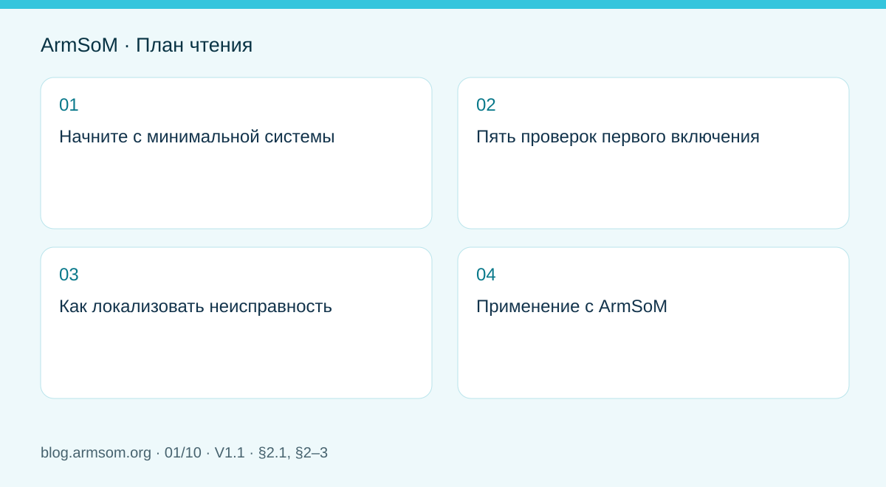
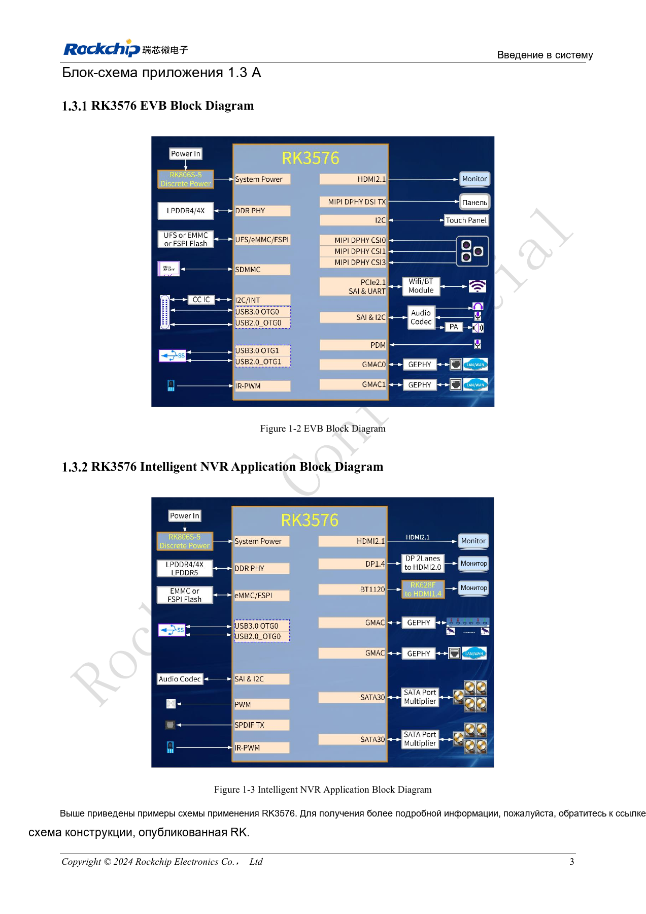
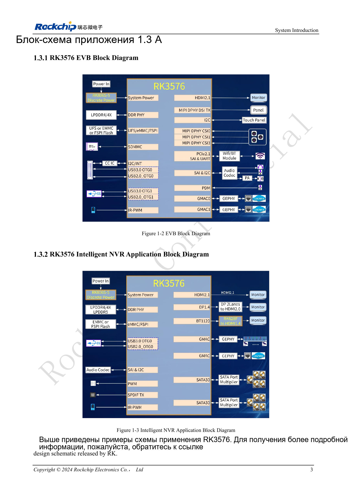

# Запуск платы RK3576: минимальная система и проверка первого включения

## Область применения и источники

Это тематическое инженерное руководство, а не постраничный перевод всего PDF. Примеры источника не являются измерениями ArmSoM. Напряжения, выводы, SDK/BSP и ядро сверяйте с фактической ревизией платы.

**Rockchip:** `RK3576_Hardware_Design_Guide_V1.1_20240528_CN.pdf` · V1.1 · §2.1, §2–3

## Начните с минимальной системы

Раздел 2.1 руководства RK3576 V1.1 посвящён тактированию, сбросу, загрузке, JTAG, UART и памяти. Сначала получите конфигурацию, которая повторяемо загружается, выводит журнал через UART и позволяет восстановить систему. Камеры, дисплеи и скоростные устройства подключайте по одному: тогда причину сбоя проще связать с изменением.

На собственной плате с SoC минимальная система включает DDR, генераторы и преобразователи питания. Для CM5 исходными документами служат описание модуля и платы-носителя: внутренние шины питания процессора не являются входами питания модуля. Sige5 полезна для проверки приложения, но не подтверждает электрическую корректность другой платы.

## Пять проверок первого включения

| Узел | До подачи питания | Что сохранить |
| --- | --- | --- |
| Питание | BOM, напряжения, полярность, замыкания, ограничение тока | Ток, напряжения и переходные процессы |
| Тактирование | Кварц, нагрузочная цепь, трассировка | Частоту и форму сигнала при корректном измерении |
| Сброс | Домен питания, подтяжки, источники сброса | Момент стабилизации питания и снятия сброса |
| Загрузка | Носитель, резисторы конфигурации, Loader, ревизия | Полный журнал до запуска ядра |
| Отладка | UART, восстановление, контрольные точки | Повторяемость холодного старта и восстановления |

В §2.1.1 описана схема основного тактирования с внешним кварцем 24MHz. Это не требование повторить её на носителе CM5. Уровни UART и сброса также сверяют с реальными доменами питания.

## Как локализовать неисправность

Если UART молчит, сначала проверьте напряжение адаптера, общий провод, TX/RX, скорость, питание и сброс. Если Loader работает, а ядро не запускается, проверьте инициализацию DDR, носитель, образ и дерево устройств. После запуска Linux отдельно проверяйте питание периферии, мультиплексирование выводов, тактирование и драйверы.

Меняйте только один параметр за раз. Записывайте ревизии схемы и модуля, контрольную сумму образа и журналы. После первого успеха нужны повторные холодные старты, восстановление после отключения питания и нагрузочные испытания. Одного запуска недостаточно для приёмки серии.

## Применение с ArmSoM

Для CM5 сначала получите программную базовую конфигурацию на штатной IO-плате, затем переносите её на собственный носитель. Для Sige5 фиксируйте модели устройств, кабели и условия питания. Здесь дана методика проверки, а не универсальная таблица напряжений.

## Иллюстрация из источника

Оригинал английского документа, общий для EN/RU/DE. Эталонный проект, а не схема платы ArmSoM.

`RK3576_Hardware_Design_Guide_V1.1_20240528_EN.pdf` · PDF p. 22.

## Продукты и документация

- **CM5** — [Страница продукта](https://www.armsom.org/cm5) · [Документация](https://docs.armsom.org/armsom-cm5)
- **Sige5** — [Страница продукта](https://www.armsom.org/sige5) · [Документация](https://docs.armsom.org/armsom-sige5)

## Другие статьи серии

- [Плата-носитель ArmSoM CM5: питание, загрузка и планирование интерфейсов](/ru/articles/019-cm5-carrier-production/)
- [Скоростные интерфейсы RK3576: совместная проверка схемы и PCB](/ru/articles/rk3576-high-speed-interface-design/)
- [Аппаратное проектирование RK3588S: от эталонной схемы к носителю CM7s](/ru/articles/rk3588s-cm7s-carrier-design/)
- [RK3588 для периферийного ИИ: питание, охлаждение и расширение](/ru/articles/rk3588-edge-ai-hardware-design/)
- [Проверка скоростной PCB RK3588: слои, импеданс и трассировка](/ru/articles/rk3588-high-speed-pcb-review/)
- [Аппаратная часть HMI на RK3506: выбор пути с CM1 или Forge1](/ru/articles/rk3506-industrial-hmi-hardware/)
- [Варианты RK3308: аппаратная совместимость для аудиопроектов P2 Pro](/ru/articles/rk3308-hardware-variant-compatibility/)
- [RK3588S и RK3588S2: что проверить перед изменением платы](/ru/articles/rk3588s-rk3588s2-hardware-differences/)
- [От прототипа Rockchip к серии: технологические требования и испытания](/ru/articles/rockchip-hardware-production-checklist/)

<!-- rk3576-hardware-v11-deep-20261109 -->

## Минимальная система RK3576: от проверки схемы до повторяемого запуска

Минимальная система должна повторяемо запускаться после полного отключения питания, выдавать полный журнал и допускать восстановление. Сначала проверьте питание, тактирование, сброс, DDR, загрузочный носитель и отладку; затем добавляйте дисплеи, камеры и скоростные интерфейсы. Ниже исходная методика дополнена конкретными ограничениями руководства.

Основа — китайская и английская версии RK3576 Hardware Design Guide V1.1 (2024-05-28), для плат с SoC. Носители CM5 проектируют по интерфейсу модуля; Sige5 подходит для программной базы сравнения. Единого SDK/BSP или ядра для всех изделий руководство не задаёт: совместимость проверяют для каждой платы. Значения взяты из источника, а не измерены ArmSoM.

**RK3576_Hardware_Design_Guide_V1.1_20240528_EN.pdf** · §2.1–2.2

## Разделяйте плату SoC и носитель модуля

Для собственной платы RK3576 проектируют внутренние домены питания, DDR и PMIC. Носитель CM5 разрабатывают по входному питанию, разъёмам и назначению выводов модуля. Нельзя переносить напряжения внутренних шин SoC на предполагаемые контакты модуля. Sige5 служит программной базой сравнения, но не проверкой другой PCB.

## Определите этап отказа

Если UART молчит, проверьте землю, уровни, TX/RX, исходные 1500000bps, 24MHz и RESET_L. При ошибке инициализации DDR в Loader сверяйте микросхему памяти, шаблон разводки и DDR firmware. После запуска ядра проверяйте device tree, питание, тактирование и мультиплексирование выводов. Меняйте один параметр за раз, сохраняя и неудачные журналы.

## Сделайте проверку воспроизводимой

Записывайте версии PCB/BOM, контрольную сумму образа, Loader/DDR firmware, SDK/BSP, ядро, источник питания и периферию. Сохраняйте осциллограммы питания и сброса с одинаковыми точками отсчёта; проверяйте холодный старт, перезапуск, внезапное отключение и загрузку восстановления. Здесь эти испытания ArmSoM не проводились; универсальное число повторов не задаётся.

## Параметры и проверочная таблица

| Параметр | Значение/сеть | Проверка |
| --- | --- | --- |
| Основной такт | 24MHz | Проверить кварц и нагрузку; номиналы примера не универсальны |
| Снятие сброса | ≥1ms | После стабилизации последней шины; не длительность импульса |
| Восстановление | USB2_OTG0_DP/DM + VBUSDET | Сохранить даже для устройства только с Host |
| Адрес/данные DDR | DQ/CA | Не переставлять произвольно; следовать шаблону и памяти |

## Исходные схемы и рисунки

Ниже страницы источника со схемами или временными диаграммами; нажмите для полного разрешения. Обозначения и номиналы относятся к эталонной схеме, не к схеме изделия ArmSoM.

Английский оригинал · PDF 22 · 1-2 / 1-3

## Продукты ArmSoM и путь разработки

CM5 позволяет использовать готовый вычислительный модуль на своём носителе; Sige5 подходит для первичной проверки Linux и периферии. Наличие интерфейса в SoC не означает его вывод на обоих продуктах. До покупки или разводки проверьте разъёмы, ревизию и образ системы.

- [ArmSoM CM5](https://www.armsom.org/cm5) · [CM5 Docs](https://docs.armsom.org/armsom-cm5)
- [ArmSoM Sige5](https://www.armsom.org/sige5) · [Sige5 Docs](https://docs.armsom.org/armsom-sige5)

## Порядок чтения серии

- [Серия по аппаратному проектированию RK3576: от минимальной системы до DDR и USB](/ru/articles/rk3576-hardware-design-series/)
- [Тактирование RK3576: кварц 24MHz, режим 32kHz и такты периферии](/ru/articles/rk3576-clock-circuit-design/)
- [Сброс RK3576: NPOR, RK806S-5, watchdog и температурная защита](/ru/articles/rk3576-reset-watchdog-design/)
- [Загрузка и отладка RK3576: конфигурация, Maskrom, UART и JTAG](/ru/articles/rk3576-boot-debug-design/)
- [Питание RK3576: домены CPU, GPU, NPU, LOGIC и развязка](/ru/articles/rk3576-power-domain-design/)
- [RK3576 и RK806S-5: выбор PMIC, управляющие выводы и обратная связь](/ru/articles/rk3576-rk806s5-pmic-design/)
- [Питание и сон RK3576: последовательность, удерживаемые шины и пробуждение](/ru/articles/rk3576-power-sequencing-standby/)
- [DDR RK3576: схемы и питание LPDDR4, LPDDR4X и LPDDR5](/ru/articles/rk3576-ddr-circuit-power/)
- [Трассировка DDR RK3576: импеданс, длина, возвратный ток и PDN](/ru/articles/rk3576-ddr-pcb-routing/)
- [Аппаратное дополнение USB/Type-C RK3576: мультиплексирование и защита](/ru/articles/168-rockchip-rk3576-usb/)
