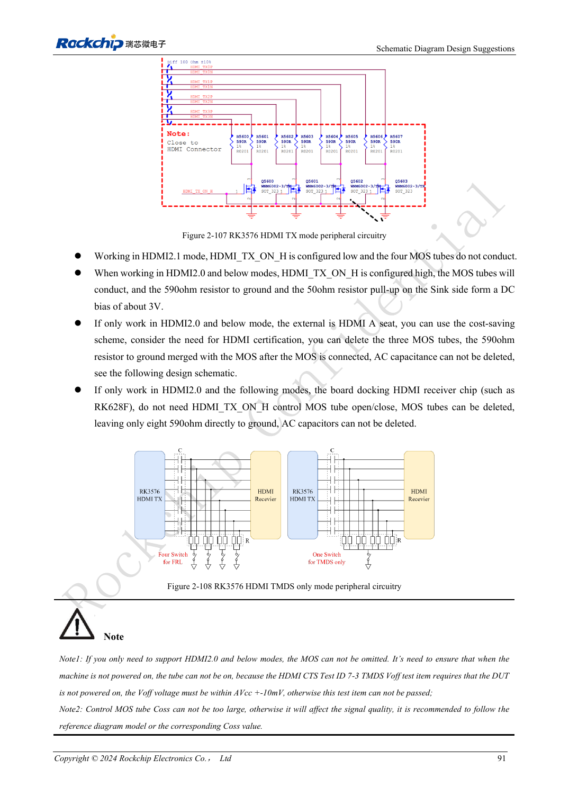
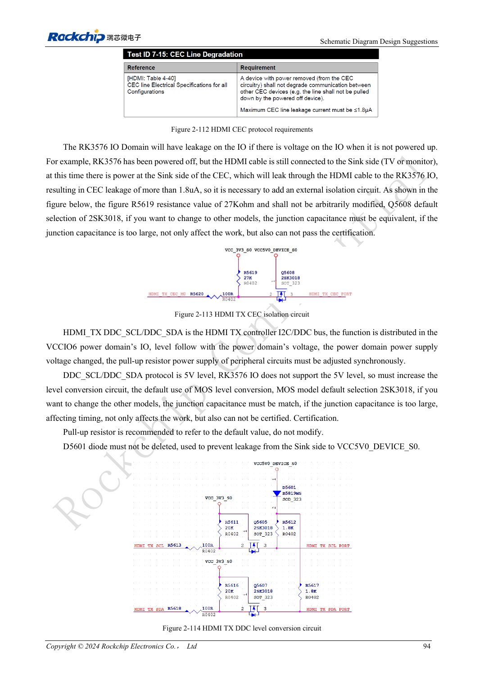

<!-- rk3576-hardware-v11-rest-20261109 -->

# HDMI RK3576: FRL/TMDS, уровни DDC и защита

Основа — китайская и английская версии RK3576 Hardware Design Guide V1.1 (2024-05-28), для плат с SoC. Носители CM5 проектируют по интерфейсу модуля; Sige5 подходит для программной базы сравнения. Единого SDK/BSP или ядра для всех изделий руководство не задаёт: совместимость проверяют для каждой платы. Значения взяты из источника, а не измерены ArmSoM.

**RK3576_Hardware_Design_Guide_V1.1_20240528_EN.pdf** · §2.3.8.1; HDMI PCB

## Общий PHY и режимы

HDMI и eDP делят PHY и не могут одновременно использовать его в разных режимах. HDMI 2.1 работает через FRL, совместимость со старыми версиями — через TMDS. Резистор HDMI/EDP_TX_REXT 8.2kΩ, 1% к земле размещают у SoC без произвольной замены. Каналы требуют 220nF, желательно 0201; прямое подключение другого HDMI-чипа копировать нельзя.

## Смещение TMDS и защита DDC

HDMI_TX_ON_H низкий для FRL и высокий для TMDS, управляя MOS/590Ω эталона. Внешний Type-A отличается от внутреннего приёмника: упрощение для RK628F не переносится на внешний разъём. DDC использует 5V, но IO SoC их не выдерживает. Сохраните преобразование уровней и защиту от обратного тока; проверьте домены CEC/HPD и утечки.

## Проверяйте весь тракт

Питание разъёма по эталону 4.8–5.3V, с 1μF у разъёма. ESD высокоскоростных линий — до 0.2pF, остальных — до 1pF. Сохраняйте землю и короткие ответвления, обработку слоя под 590Ω выполняйте по рисунку. Испытайте подключение, разные кабели и дисплеи, смену режима и пробуждение.

## Параметры и проверочная таблица

| Параметр | Значение источника |
| --- | --- |
| Zdiff | 100Ω ±10% |
| Разница внутри пары | <6mil |
| Разница между парами | <480mil |
| Длина трассы | <4inch |
| AC | 220nF ±20% |
| Зазор | ≥7W |

## Исходные рисунки

Ниже страницы источника со схемами или временными диаграммами; нажмите для полного разрешения. Обозначения и номиналы относятся к эталонной схеме, не к схеме изделия ArmSoM.

Английский оригинал · PDF 110 · 2-107

Английский оригинал · PDF 113 · 2-113

## Разработка с ArmSoM

CM5 уменьшает объём повторной разработки вычислительного ядра; Sige5 подходит для первичной проверки ПО и периферии. Вывод интерфейсов, контакты, уровни и поддержка образа проверяются по документации платы, не по возможностям SoC.

- [ArmSoM CM5](https://www.armsom.org/cm5) · [CM5 Docs](https://docs.armsom.org/armsom-cm5)
- [ArmSoM Sige5](https://www.armsom.org/sige5) · [Sige5 Docs](https://docs.armsom.org/armsom-sige5)

## Читайте далее

- [RK3576: 30 тем аппаратного проектирования](/ru/articles/rk3576-hardware-design-series/)
- [Дисплеи RK3576: MIPI, RGB, подсветка и сенсорная панель](/ru/articles/rk3576-display-panel-hardware/)
- [DP/eDP RK3576: распределение PHY, AUX и расхождение ёмкостей](/ru/articles/rk3576-dp-edp-hardware-design/)
