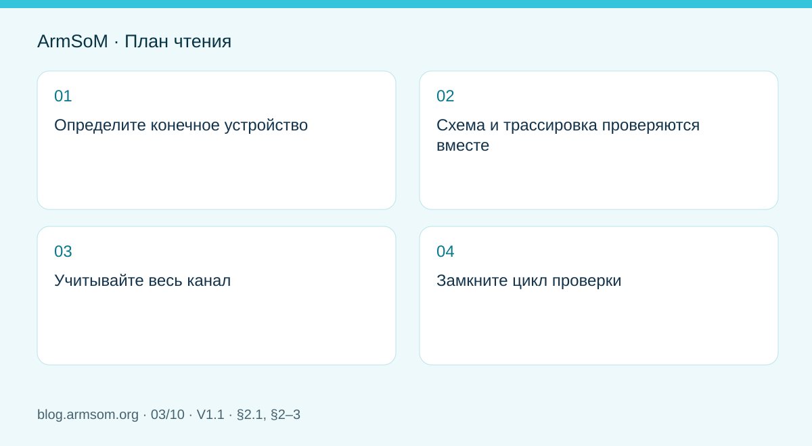

# Скоростные интерфейсы RK3576: совместная проверка схемы и PCB

## Область применения и источники

Это тематическое инженерное руководство, а не постраничный перевод всего PDF. Примеры источника не являются измерениями ArmSoM. Напряжения, выводы, SDK/BSP и ядро сверяйте с фактической ревизией платы.

**Rockchip:** `RK3576_Hardware_Design_Guide_V1.1_20240528_CN.pdf` · V1.1 · §2.1, §2–3

## Определите конечное устройство

В исходном руководстве §2.3 посвящён схемам интерфейсов, §3.4 — сигналам от 8GT/s, §3.5 — PCB отдельных блоков. Начинайте с периферии, режима, разъёма и кабеля. Ресурсы на блок-схеме чипа не обязательно выведены на модуль или доступны одновременно.

Для камер, дисплеев, накопителей и сети составьте список общего использования PHY, шин управления, питания и программных зависимостей. Сверьте его с выводами CM5 либо конкретной ревизией Sige5.

## Схема и трассировка проверяются вместе

| Область | Схема | PCB |
| --- | --- | --- |
| Дифференциальный канал | Направление, развязка, защита | Импеданс, опорные плоскости, переходы, площадки |
| Управление | Сброс, разрешение, шины, уровни | Разделение сигналов и контрольные точки |
| Разъём | Артикул, выводы, экран | Посадочное место, обратный ток, ориентация |
| Питание | Пиковый ток и последовательность | Развязка, токовые петли, теплоотвод |

Руководство рассматривает BGA-площадки, стеклоткань, переходы, разделительные конденсаторы, ESD и разъёмы. Локальное удаление меди опорного слоя служит коррекции конкретных паразитных параметров, а не произвольному разрезанию земли под скоростной трассой.

## Учитывайте весь канал

Включайте дорожки модуля, разъёмы, носитель, кабель и плату периферии. Согласование длин — лишь одно условие: ответвления переходов, смена опоры и ёмкость защиты также уменьшают запас. Численные ограничения берут для конкретного режима и рассчитанного изготовителем стека слоёв.

## Замкните цикл проверки

Испытайте интерфейс на целевой скорости отдельно, затем с соседними каналами и реальной нагрузкой. При сбоях совместной работы проверяйте также питание, нагрев, пропускную способность и драйверы. Фиксируйте кабели, периферию, BSP и ревизии. Снижение скорости помогает диагностике, но не заменяет приёмку целевого режима. После переноса прототипа CM5 или Sige5 в изделие канал проверяют заново.

## Иллюстрация из источника

Оригинал английского документа, общий для EN/RU/DE. Эталонный проект, а не схема платы ArmSoM.

`RK3576_Hardware_Design_Guide_V1.1_20240528_EN.pdf` · PDF p. 22.

## Продукты и документация

- **CM5** — [Страница продукта](https://www.armsom.org/cm5) · [Документация](https://docs.armsom.org/armsom-cm5)
- **Sige5** — [Страница продукта](https://www.armsom.org/sige5) · [Документация](https://docs.armsom.org/armsom-sige5)

## Другие статьи серии

- [Запуск платы RK3576: минимальная система и проверка первого включения](/ru/articles/rk3576-hardware-bringup/)
- [Плата-носитель ArmSoM CM5: питание, загрузка и планирование интерфейсов](/ru/articles/019-cm5-carrier-production/)
- [Аппаратное проектирование RK3588S: от эталонной схемы к носителю CM7s](/ru/articles/rk3588s-cm7s-carrier-design/)
- [RK3588 для периферийного ИИ: питание, охлаждение и расширение](/ru/articles/rk3588-edge-ai-hardware-design/)
- [Проверка скоростной PCB RK3588: слои, импеданс и трассировка](/ru/articles/rk3588-high-speed-pcb-review/)
- [Аппаратная часть HMI на RK3506: выбор пути с CM1 или Forge1](/ru/articles/rk3506-industrial-hmi-hardware/)
- [Варианты RK3308: аппаратная совместимость для аудиопроектов P2 Pro](/ru/articles/rk3308-hardware-variant-compatibility/)
- [RK3588S и RK3588S2: что проверить перед изменением платы](/ru/articles/rk3588s-rk3588s2-hardware-differences/)
- [От прототипа Rockchip к серии: технологические требования и испытания](/ru/articles/rockchip-hardware-production-checklist/)
