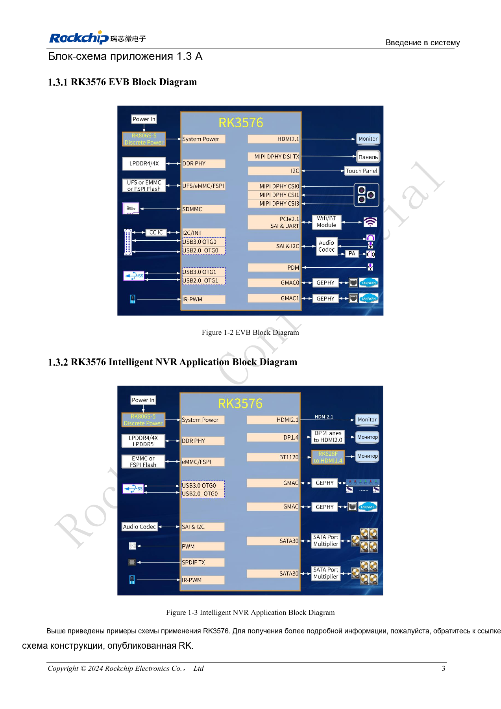
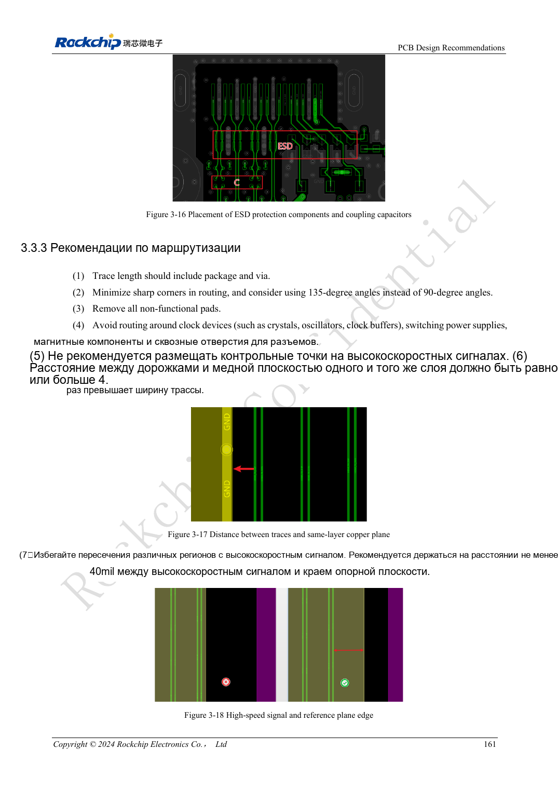
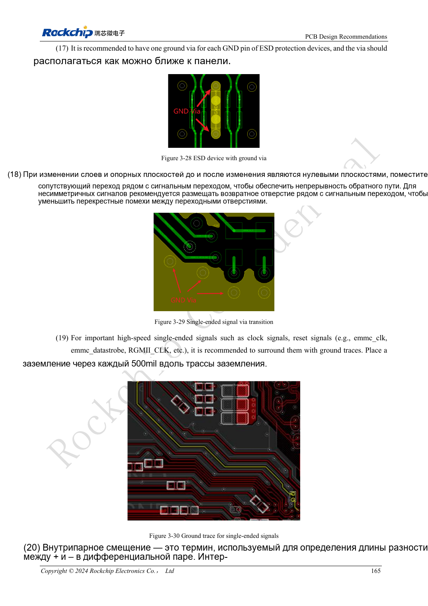

# Скоростные интерфейсы RK3576: совместная проверка схемы и PCB

## Область применения и источники

Это тематическое инженерное руководство, а не постраничный перевод всего PDF. Примеры источника не являются измерениями ArmSoM. Напряжения, выводы, SDK/BSP и ядро сверяйте с фактической ревизией платы.

**Rockchip:** `RK3576_Hardware_Design_Guide_V1.1_20240528_CN.pdf` · V1.1 · §2.1, §2–3

## Определите конечное устройство

В исходном руководстве §2.3 посвящён схемам интерфейсов, §3.4 — сигналам от 8GT/s, §3.5 — PCB отдельных блоков. Начинайте с периферии, режима, разъёма и кабеля. Ресурсы на блок-схеме чипа не обязательно выведены на модуль или доступны одновременно.

Для камер, дисплеев, накопителей и сети составьте список общего использования PHY, шин управления, питания и программных зависимостей. Сверьте его с выводами CM5 либо конкретной ревизией Sige5.

## Схема и трассировка проверяются вместе

| Область | Схема | PCB |
| --- | --- | --- |
| Дифференциальный канал | Направление, развязка, защита | Импеданс, опорные плоскости, переходы, площадки |
| Управление | Сброс, разрешение, шины, уровни | Разделение сигналов и контрольные точки |
| Разъём | Артикул, выводы, экран | Посадочное место, обратный ток, ориентация |
| Питание | Пиковый ток и последовательность | Развязка, токовые петли, теплоотвод |

Руководство рассматривает BGA-площадки, стеклоткань, переходы, разделительные конденсаторы, ESD и разъёмы. Локальное удаление меди опорного слоя служит коррекции конкретных паразитных параметров, а не произвольному разрезанию земли под скоростной трассой.

## Учитывайте весь канал

Включайте дорожки модуля, разъёмы, носитель, кабель и плату периферии. Согласование длин — лишь одно условие: ответвления переходов, смена опоры и ёмкость защиты также уменьшают запас. Численные ограничения берут для конкретного режима и рассчитанного изготовителем стека слоёв.

## Замкните цикл проверки

Испытайте интерфейс на целевой скорости отдельно, затем с соседними каналами и реальной нагрузкой. При сбоях совместной работы проверяйте также питание, нагрев, пропускную способность и драйверы. Фиксируйте кабели, периферию, BSP и ревизии. Снижение скорости помогает диагностике, но не заменяет приёмку целевого режима. После переноса прототипа CM5 или Sige5 в изделие канал проверяют заново.

## Иллюстрация из источника

Оригинал английского документа, общий для EN/RU/DE. Эталонный проект, а не схема платы ArmSoM.

`RK3576_Hardware_Design_Guide_V1.1_20240528_EN.pdf` · PDF p. 22.

## Продукты и документация

- **CM5** — [Страница продукта](https://www.armsom.org/cm5) · [Документация](https://docs.armsom.org/armsom-cm5)
- **Sige5** — [Страница продукта](https://www.armsom.org/sige5) · [Документация](https://docs.armsom.org/armsom-sige5)

## Другие статьи серии

- [Запуск платы RK3576: минимальная система и проверка первого включения](/ru/articles/rk3576-hardware-bringup/)
- [Плата-носитель ArmSoM CM5: питание, загрузка и планирование интерфейсов](/ru/articles/019-cm5-carrier-production/)
- [Аппаратное проектирование RK3588S: от эталонной схемы к носителю CM7s](/ru/articles/rk3588s-cm7s-carrier-design/)
- [RK3588 для периферийного ИИ: питание, охлаждение и расширение](/ru/articles/rk3588-edge-ai-hardware-design/)
- [Проверка скоростной PCB RK3588: слои, импеданс и трассировка](/ru/articles/rk3588-high-speed-pcb-review/)
- [Аппаратная часть HMI на RK3506: выбор пути с CM1 или Forge1](/ru/articles/rk3506-industrial-hmi-hardware/)
- [Варианты RK3308: аппаратная совместимость для аудиопроектов P2 Pro](/ru/articles/rk3308-hardware-variant-compatibility/)
- [RK3588S и RK3588S2: что проверить перед изменением платы](/ru/articles/rk3588s-rk3588s2-hardware-differences/)
- [От прототипа Rockchip к серии: технологические требования и испытания](/ru/articles/rockchip-hardware-production-checklist/)

<!-- rk3576-hardware-v11-rest-20261109 -->

## Скоростные интерфейсы RK3576: импеданс, возврат, ответвления и тракт

Основа — китайская и английская версии RK3576 Hardware Design Guide V1.1 (2024-05-28), для плат с SoC. Носители CM5 проектируют по интерфейсу модуля; Sige5 подходит для программной базы сравнения. Единого SDK/BSP или ядра для всех изделий руководство не задаёт: совместимость проверяют для каждой платы. Значения взяты из источника, а не измерены ArmSoM.

**RK3576_Hardware_Design_Guide_V1.1_20240528_EN.pdf** · §3.3–3.4

## Дифференциальные пары имеют разные правила

Эталонные значения: PCIe data 85Ω, REFCLK 100Ω, eDP 90Ω, отдельный DP 100Ω, общий с USB DP 95Ω. Ограничения задают по классам сетей, а не единым 100Ω. Длина включает переходы и корпус. Согласование внутри пары и между парами различается. W — ширина трассы, зазор — между краями, не центрами.

## Непрерывный возврат важнее красивой змейки

Не пересекайте разрывы опорной плоскости; общая рекомендация — не менее 40mil от края. При смене слоя добавляйте земляные переходы. Тестовые точки, разъёмы и площадки создают ответвления и скачки импеданса. Локальное удаление меди под большой площадкой требует исходной геометрии и моделирования, не удаления земли под всей парой. Хвосты via более 12mil требуют оценки SI.

## Свяжите схему и PCB

Резисторы демпфирования размещают по направлению источника конкретного интерфейса, не только имени TX/RX. ESD ставят у входа с коротким путём разряда. Рассматривайте SoC, корпус, PCB, защиту, разъём, кабель и приёмник как один тракт: расчёт, моделирование и образец. Исходная статья сохранена, этот раздел её дополняет.

## Параметры и проверочная таблица

| Параметр | Значение источника |
| --- | --- |
| Отступ от края плоскости | ≥40mil |
| Порог оценки хвоста via | >12mil |
| Расстояние тактового резистора | ≤400mil |
| Data / REFCLK PCIe | 85Ω / 100Ω |

## Исходные рисунки

Ниже страницы источника со схемами или временными диаграммами; нажмите для полного разрешения. Обозначения и номиналы относятся к эталонной схеме, не к схеме изделия ArmSoM.

Английский оригинал · PDF 180 · 3-18

Английский оригинал · PDF 184 · 3-29

## Разработка с ArmSoM

CM5 уменьшает объём повторной разработки вычислительного ядра; Sige5 подходит для первичной проверки ПО и периферии. Вывод интерфейсов, контакты, уровни и поддержка образа проверяются по документации платы, не по возможностям SoC.

- [ArmSoM CM5](https://www.armsom.org/cm5) · [CM5 Docs](https://docs.armsom.org/armsom-cm5)
- [ArmSoM Sige5](https://www.armsom.org/sige5) · [Sige5 Docs](https://docs.armsom.org/armsom-sige5)

## Читайте далее

- [RK3576: 30 тем аппаратного проектирования](/ru/articles/rk3576-hardware-design-series/)
- [Стек и fanout PCB RK3576: шесть/восемь слоёв и смешанный шаг BGA](/ru/articles/rk3576-pcb-stackup-fanout/)
- [PCB питания и PDN RK3576: RK806S-5, обратная связь и токовые петли](/ru/articles/rk3576-power-pcb-pdn-design/)
