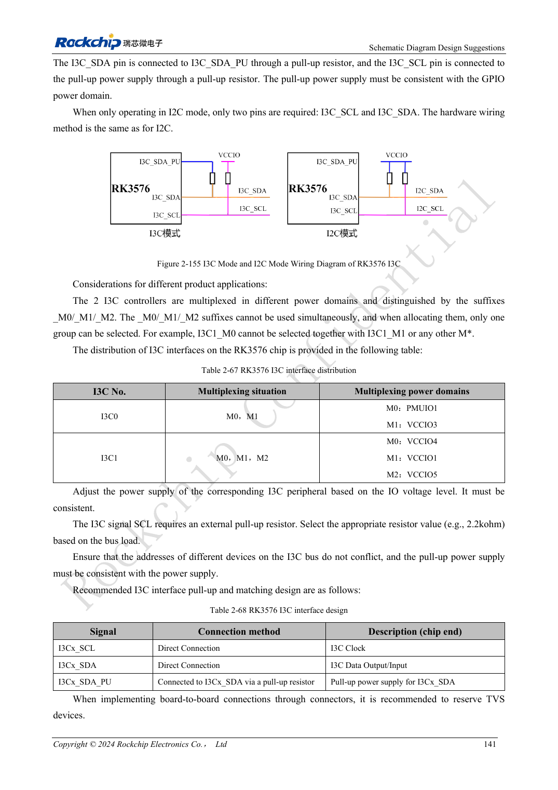
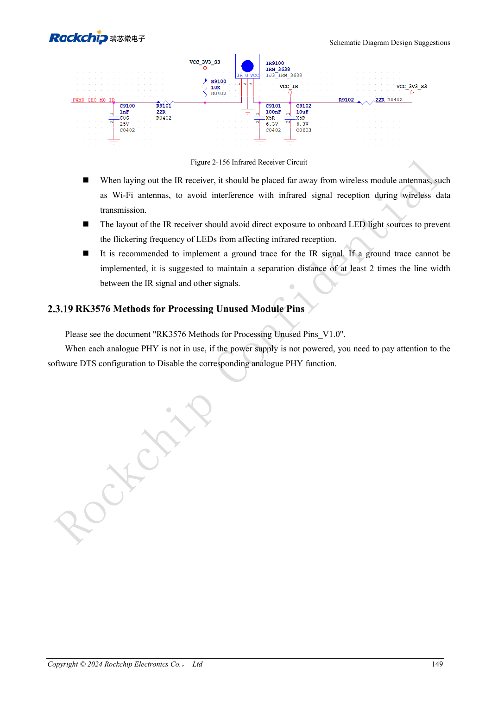

<!-- rk3576-hardware-v11-rest-20261109 -->

# Интерфейсы управления RK3576: UART, I2C/I3C, SPI, CAN и PWM

Основа — китайская и английская версии RK3576 Hardware Design Guide V1.1 (2024-05-28), для плат с SoC. Носители CM5 проектируют по интерфейсу модуля; Sige5 подходит для программной базы сравнения. Единого SDK/BSP или ядра для всех изделий руководство не задаёт: совместимость проверяют для каждой платы. Значения взяты из источника, а не измерены ArmSoM.

**RK3576_Hardware_Design_Guide_V1.1_20240528_EN.pdf** · §2.3.13–2.3.18

## Проверьте mux и физический уровень

Указаны 12 UART, пять обычных SPI, два CAN FD и два I3C. UART0_M0 — отладочный порт; UART0 без управления потоком, RTS/CTS остальных зависит от mux. UART не является электрическим RS232/RS485, а CAN TX/RX нельзя подключать как CAN_H/CAN_L. Нужны соответствующие трансиверы и уровни.

## Подтяжки I3C и I2C различаются

Смешанный I3C использует SCL, SDA и SDA_PU, подтягивая SDA к SDA_PU, а не автоматически к питанию. Только I2C использует обычные две линии с подтяжками. Эталонные 2.2kΩ проверяют по ёмкости и фронтам. I2C1 обслуживает PMIC; произвольно отдавать его периферии нельзя. SPI требует согласованной группы clock/data/CS.

## Проверьте управление при старте и сне

CAN TX использует внешние 4.7kΩ по эталону. PWM имеет 16 каналов, но ИК-пробуждение при отключённом LOGIC доступно только PWM0_CH0/1. Проверяйте исходные уровни, обратное питание и восстановление. Промышленные испытания включают кабель, терминацию и защиту; работа контроллера не доказывает помехоустойчивость изделия.

## Параметры и проверочная таблица

| Параметр | Значение источника |
| --- | --- |
| UART / SPI | 12 / 5 |
| I3C | 2; 12.5Mbit/s |
| Эталон I2C | 400kbit/s; 2.2kΩ |
| Подтяжка CAN TX | 4.7kΩ |
| PWM | 2 + 6 + 8 channels |

## Исходные рисунки

Ниже страницы источника со схемами или временными диаграммами; нажмите для полного разрешения. Обозначения и номиналы относятся к эталонной схеме, не к схеме изделия ArmSoM.

Английский оригинал · PDF 160 · 2-155

Английский оригинал · PDF 168 · 2-156

## Разработка с ArmSoM

CM5 уменьшает объём повторной разработки вычислительного ядра; Sige5 подходит для первичной проверки ПО и периферии. Вывод интерфейсов, контакты, уровни и поддержка образа проверяются по документации платы, не по возможностям SoC.

- [ArmSoM CM5](https://www.armsom.org/cm5) · [CM5 Docs](https://docs.armsom.org/armsom-cm5)
- [ArmSoM Sige5](https://www.armsom.org/sige5) · [Sige5 Docs](https://docs.armsom.org/armsom-sige5)

## Читайте далее

- [RK3576: 30 тем аппаратного проектирования](/ru/articles/rk3576-hardware-design-series/)
- [GPIO и SARADC RK3576: домены, обратное питание и кнопки](/ru/articles/rk3576-gpio-saradc-hardware/)
- [FlexBus и DSMC RK3576: FPGA, PSRAM и параллельная разводка](/ru/articles/rk3576-flexbus-dsmc-hardware/)
