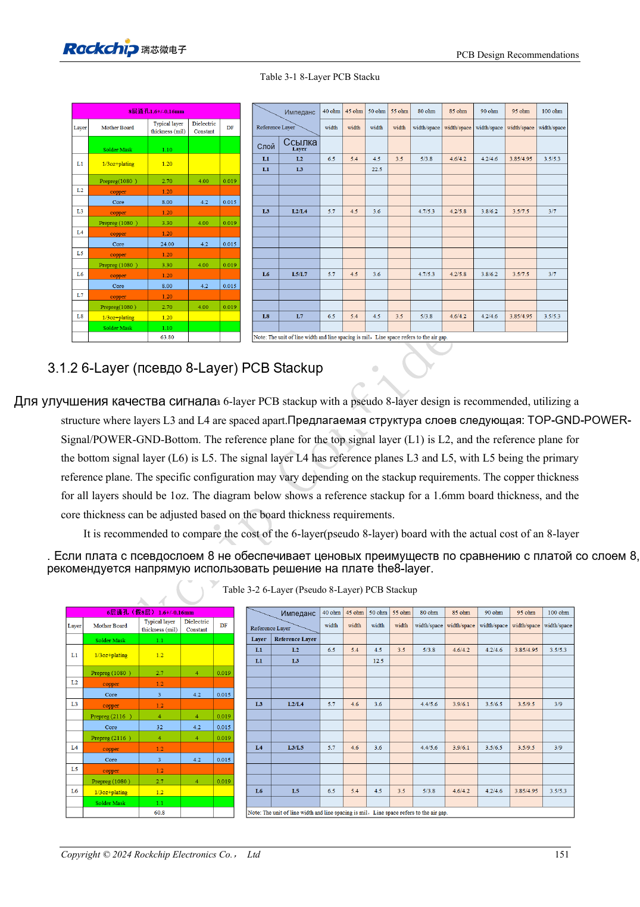
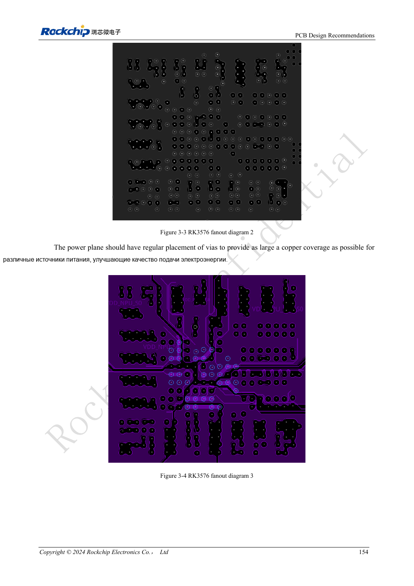

<!-- rk3576-hardware-v11-rest-20261109 -->

# Стек и fanout PCB RK3576: шесть/восемь слоёв и смешанный шаг BGA

Основа — китайская и английская версии RK3576 Hardware Design Guide V1.1 (2024-05-28), для плат с SoC. Носители CM5 проектируют по интерфейсу модуля; Sige5 подходит для программной базы сравнения. Единого SDK/BSP или ядра для всех изделий руководство не задаёт: совместимость проверяют для каждой платы. Значения взяты из источника, а не измерены ArmSoM.

**RK3576_Hardware_Design_Guide_V1.1_20240528_EN.pdf** · §3.1–3.2

## Стек должен обеспечивать все импедансы

Представлены шесть слоёв, псевдовосемь на шести и восемь слоёв, а не единая обязательная толщина. Сохраняют симметрию диэлектрика, меди и рисунка; возле компонентов — сплошная земля, возле питания — земля. Материалы и толщина фабрики меняют ширины/зазоры; импедансы внутренних и внешних слоёв пересчитывают.

## Смешанный шаг требует локального fanout

RK3576 имеет 698 шаров с шагом 0.55/0.60/0.65mm. Две внешние линии и часть третьей локально выходят шириной минимум 3.5mil, затем переходят к расчётной ширине. Внутренние переходы располагают регулярно, оставляя каналы через 2–4 ряда для земли и питания. Минимальная ширина fanout не относится ко всей скоростной трассе.

## Объедините технологическую и электрическую проверку

Восемь слоёв эталона: TOP-GND-POWER-POWER/SIGNAL-GND-SIGNAL-GND-BOTTOM; 1.6mm и 1oz относятся к этому примеру. Для шести слоёв сравнивайте цену и возвратные пути, не только число слоёв. До производства согласуйте сверление, маску, медь и импеданс, проверьте узкие участки питания между переходами.

## Параметры и проверочная таблица

| Параметр | Значение источника |
| --- | --- |
| BGA | 698 balls |
| Шаг шаров | 0.55 / 0.60 / 0.65mm |
| Ширина fanout | ≥3.5mil |
| Число слоёв эталона | 6 / 8 layers |
| Медь эталона | 1oz |

## Исходные рисунки

Ниже страницы источника со схемами или временными диаграммами; нажмите для полного разрешения. Обозначения и номиналы относятся к эталонной схеме, не к схеме изделия ArmSoM.

Английский оригинал · PDF 170 · Table 3-1

Английский оригинал · PDF 173 · 3-3 / 3-4

## Разработка с ArmSoM

CM5 уменьшает объём повторной разработки вычислительного ядра; Sige5 подходит для первичной проверки ПО и периферии. Вывод интерфейсов, контакты, уровни и поддержка образа проверяются по документации платы, не по возможностям SoC.

- [ArmSoM CM5](https://www.armsom.org/cm5) · [CM5 Docs](https://docs.armsom.org/armsom-cm5)
- [ArmSoM Sige5](https://www.armsom.org/sige5) · [Sige5 Docs](https://docs.armsom.org/armsom-sige5)

## Читайте далее

- [RK3576: 30 тем аппаратного проектирования](/ru/articles/rk3576-hardware-design-series/)
- [FlexBus и DSMC RK3576: FPGA, PSRAM и параллельная разводка](/ru/articles/rk3576-flexbus-dsmc-hardware/)
- [Скоростные интерфейсы RK3576: импеданс, возврат, ответвления и тракт](/ru/articles/rk3576-high-speed-interface-design/)
