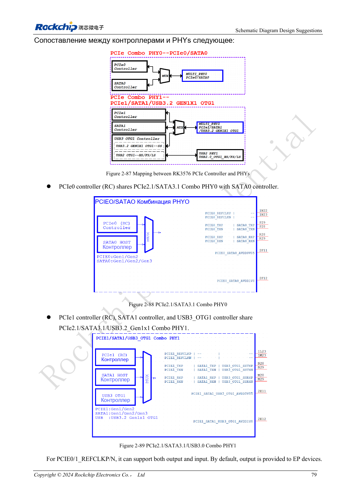
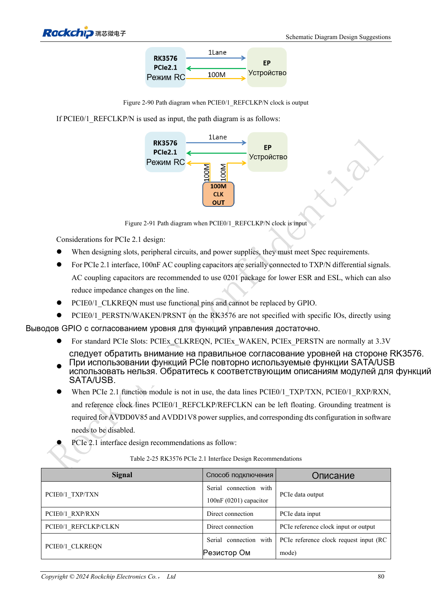

<!-- rk3576-hardware-v11-rest-20261109 -->

# PCIe RK3576: режим RC, общие PHY и питание устройств

Основа — китайская и английская версии RK3576 Hardware Design Guide V1.1 (2024-05-28), для плат с SoC. Носители CM5 проектируют по интерфейсу модуля; Sige5 подходит для программной базы сравнения. Единого SDK/BSP или ядра для всех изделий руководство не задаёт: совместимость проверяют для каждой платы. Значения взяты из источника, а не измерены ArmSoM.

**RK3576_Hardware_Design_Guide_V1.1_20240528_EN.pdf** · §2.3.6; PCIe PCB

## Сначала распределите интерфейсы

RK3576 имеет два PCIe 2.1 x1 в режиме Root Complex, без Endpoint. PCIe0 делит Combo PHY0 с SATA0; PCIe1 делит Combo PHY1 с SATA1 и USB3 OTG1. До выбора разъёмов, тактов и device tree определите функцию каждого PHY. Общие функции нельзя считать одновременно доступными портами.

## Управление и разделительные конденсаторы

TX требует 100nF, RX соединяют напрямую; REFCLK подключают по эталону с проверкой направления. CLKREQN должен использовать аппаратную функцию, не обычный GPIO. PERSTN, WAKEN и PRSNT допускают подходящие GPIO по руководству. Управление стандартного слота — 3.3V: проверьте домен SoC. Отключение питания неиспользуемого PHY допустимо лишь когда весь PHY не задействован.

## Обнаружение устройства — только начало

Для данных требуется 85Ω, для такта — 100Ω; единое правило неверно. До длительного DMA проверьте питание устройства, сброс, такт и выход из сна. Запишите ширину, скорость и ошибки линии. Одно успешное обнаружение не доказывает долговременную стабильность накопителя или сети.

## Параметры и проверочная таблица

| Параметр | Значение источника |
| --- | --- |
| Data Zdiff | 85Ω ±10% |
| REFCLK Zdiff | 100Ω ±10% |
| Разница внутри пары данных | <6mil |
| Разница пары REFCLK | <12mil |
| Длина трассы | <6inch |
| TX AC | 100nF ±20% |

## Исходные рисунки

Ниже страницы источника со схемами или временными диаграммами; нажмите для полного разрешения. Обозначения и номиналы относятся к эталонной схеме, не к схеме изделия ArmSoM.

Английский оригинал · PDF 98 · 2-87

Английский оригинал · PDF 99 · 2-90

## Разработка с ArmSoM

CM5 уменьшает объём повторной разработки вычислительного ядра; Sige5 подходит для первичной проверки ПО и периферии. Вывод интерфейсов, контакты, уровни и поддержка образа проверяются по документации платы, не по возможностям SoC.

- [ArmSoM CM5](https://www.armsom.org/cm5) · [CM5 Docs](https://docs.armsom.org/armsom-cm5)
- [ArmSoM Sige5](https://www.armsom.org/sige5) · [Sige5 Docs](https://docs.armsom.org/armsom-sige5)

## Читайте далее

- [RK3576: 30 тем аппаратного проектирования](/ru/articles/rk3576-hardware-design-series/)
- [SD-карты и SDIO Wi-Fi RK3576: переключение уровней, питание и RF](/ru/articles/rk3576-sdio-wifi-hardware/)
- [SATA RK3576: общие PHY, развязка и питание накопителя](/ru/articles/rk3576-sata-hardware-design/)
