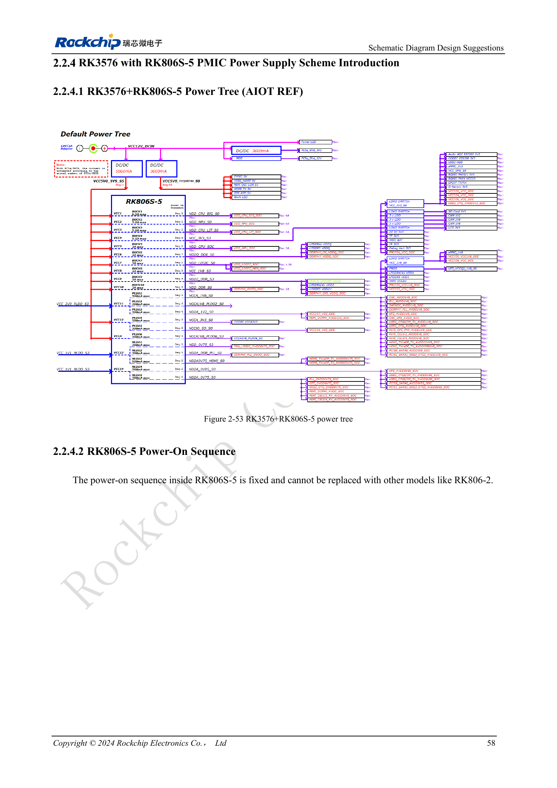

<!-- rk3576-hardware-v11-deep-20261109 -->

# Питание RK3576: домены CPU, GPU, NPU, LOGIC и развязка

Напряжение, переходные токи, расположение развязки и сон проверяют совместно. Значения ниже относятся к руководству и примерам производителя, а не ко входу CM5 или измерениям ArmSoM.

Основа — китайская и английская версии RK3576 Hardware Design Guide V1.1 (2024-05-28), для плат с SoC. Носители CM5 проектируют по интерфейсу модуля; Sige5 подходит для программной базы сравнения. Единого SDK/BSP или ядра для всех изделий руководство не задаёт: совместимость проверяют для каждой платы. Значения взяты из источника, а не измерены ArmSoM.

**RK3576_Hardware_Design_Guide_V1.1_20240528_EN.pdf** · §2.2.1–2.2.4

## Нельзя отключать домены только по назначению приложения

NPU требуется при первом включении даже без AI; GPU допускает условное отключение. Носитель определяет обязательные IO: eMMC/FSPI0 — VCCIO0, SDMMC0/FSPI1_M0 — VCCIO1, FSPI1_M1 — VCCIO3; UFS также требует VCCIO7, генератор и PHY. PMUIO0/1 обязательны. Прочие домены отключают только с учётом последовательности, пробуждения и периферии.

## Конденсаторы работают на нагрузку

Общая ёмкость больших CPU должна превышать 130μF, малых — 88μF; основная развязка GPU — 66μF, NPU — 90μF, общая LOGIC — 88μF. Различайте выходные конденсаторы PMIC и развязку около SoC, не сосредотачивая всё у преобразователя. Учитывайте снижение ёмкости от смещения, петли, переходные процессы и измерение. LOGIC_MEM обычно объединён с LOGIC; отдельное питание требует проверки DVFS.

## Не складывайте пики модулей в мощность платы

Таблица 2-19 получена при отдельных предельных нагрузках модулей, 25°C, без радиатора, после 15 минут стабильной работы. Это не одновременный режим всей платы. Для питания и охлаждения нужны измерения реальной совместной нагрузки с разделением пикового, постоянного тока и входной мощности.

## Параметры и проверочная таблица

| Параметр | Значение/сеть | Проверка |
| --- | --- | --- |
| Большие CPU | BUCK1; >4A; >130μF | Исходное напряжение 0.85V |
| Малые CPU | BUCK3; >2A; >88μF | Общая развязка |
| Графика | BUCK5; 3A; >66μF | Основная развязка около SoC |
| NPU | BUCK2; >4A; >90μF | Не исключать питание старта при отсутствии AI |
| Логика | BUCK7; >2A; >88μF | Согласовать совместное питание LOGIC_MEM |

## Исходные схемы и рисунки

Ниже страницы источника со схемами или временными диаграммами; нажмите для полного разрешения. Обозначения и номиналы относятся к эталонной схеме, не к схеме изделия ArmSoM.

Английский оригинал · PDF 77 · 2-53

## Продукты ArmSoM и путь разработки

CM5 позволяет использовать готовый вычислительный модуль на своём носителе; Sige5 подходит для первичной проверки Linux и периферии. Наличие интерфейса в SoC не означает его вывод на обоих продуктах. До покупки или разводки проверьте разъёмы, ревизию и образ системы.

- [ArmSoM CM5](https://www.armsom.org/cm5) · [CM5 Docs](https://docs.armsom.org/armsom-cm5)
- [ArmSoM Sige5](https://www.armsom.org/sige5) · [Sige5 Docs](https://docs.armsom.org/armsom-sige5)

## Порядок чтения серии

- [Серия по аппаратному проектированию RK3576: от минимальной системы до DDR и USB](/ru/articles/rk3576-hardware-design-series/)
- [Минимальная система RK3576: от проверки схемы до повторяемого запуска](/ru/articles/rk3576-hardware-bringup/)
- [Тактирование RK3576: кварц 24MHz, режим 32kHz и такты периферии](/ru/articles/rk3576-clock-circuit-design/)
- [Сброс RK3576: NPOR, RK806S-5, watchdog и температурная защита](/ru/articles/rk3576-reset-watchdog-design/)
- [Загрузка и отладка RK3576: конфигурация, Maskrom, UART и JTAG](/ru/articles/rk3576-boot-debug-design/)
- [RK3576 и RK806S-5: выбор PMIC, управляющие выводы и обратная связь](/ru/articles/rk3576-rk806s5-pmic-design/)
- [Питание и сон RK3576: последовательность, удерживаемые шины и пробуждение](/ru/articles/rk3576-power-sequencing-standby/)
- [DDR RK3576: схемы и питание LPDDR4, LPDDR4X и LPDDR5](/ru/articles/rk3576-ddr-circuit-power/)
- [Трассировка DDR RK3576: импеданс, длина, возвратный ток и PDN](/ru/articles/rk3576-ddr-pcb-routing/)
- [Аппаратное дополнение USB/Type-C RK3576: мультиплексирование и защита](/ru/articles/168-rockchip-rk3576-usb/)
