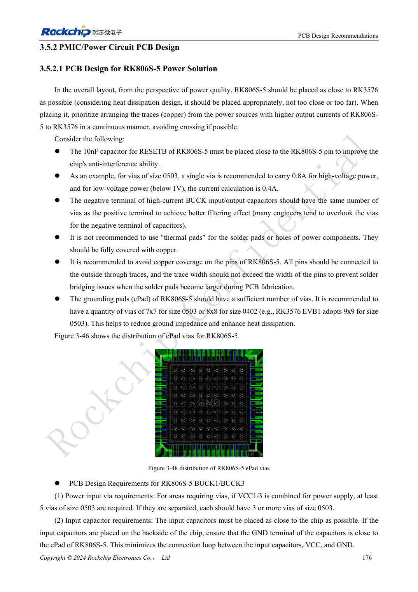
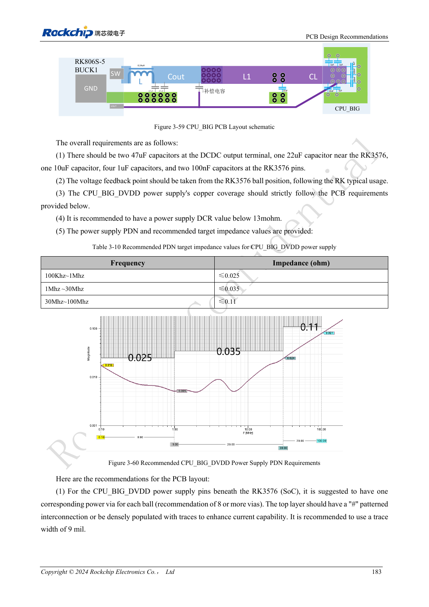

<!-- rk3576-hardware-v11-rest-20261109 -->

# PCB питания и PDN RK3576: RK806S-5, обратная связь и токовые петли

Основа — китайская и английская версии RK3576 Hardware Design Guide V1.1 (2024-05-28), для плат с SoC. Носители CM5 проектируют по интерфейсу модуля; Sige5 подходит для программной базы сравнения. Единого SDK/BSP или ядра для всех изделий руководство не задаёт: совместимость проверяют для каждой платы. Значения взяты из источника, а не измерены ArmSoM.

**RK3576_Hardware_Design_Guide_V1.1_20240528_EN.pdf** · §3.5.2

## Начните с входной и земляной петли

Разместите RK806S-5 для прямых сильноточных BUCK-путей к SoC. Входные конденсаторы близко к чипу, с достаточными переходами на обоих концах; только положительные via не создают низкий импеданс. Эталон ePad: минимум 7×7 типа 0503 либо 8×8 типа 0402, RESETB 10nF рядом. Конструкцию отверстий и допустимый ток сверяют с производством.

## Не смешивайте схемы обратной связи

Локальная, обычная удалённая и использующая индуктивность PCB обратная связь требуют разных конденсаторов и компенсации. Последняя переносит основной конденсатор к нагрузке, а не просто удаляет выходной. CPU_BIG сохраняет обычную удалённую схему с DCR менее 13mΩ, CPU_LIT — менее 20mΩ. Каждую шину проверяют по её шаблону, не копируя NPU на все BUCK.

## Проверяйте PDN при скачках нагрузки

Целевые импедансы CPU_BIG 0.025/0.035/0.11Ω по диапазонам ниже — требования источника, не измерения ArmSoM. Проверьте сужения меди, via, возврат конденсаторов и скачки нагрузки. Измеряйте у нагрузки, записывая щуп, полосу и режим; напряжения у PMIC в покое недостаточно.

## Параметры и проверочная таблица

| Параметр | Значение источника |
| --- | --- |
| CPU_BIG DCR | <13mΩ |
| CPU_LIT DCR | <20mΩ |
| CPU_BIG 100kHz–1MHz | ≤0.025Ω |
| CPU_BIG 1–30MHz | ≤0.035Ω |
| CPU_BIG 30–100MHz | ≤0.11Ω |

## Исходные рисунки

Ниже страницы источника со схемами или временными диаграммами; нажмите для полного разрешения. Обозначения и номиналы относятся к эталонной схеме, не к схеме изделия ArmSoM.

Английский оригинал · PDF 195 · 3-48

Английский оригинал · PDF 202 · 3-59

## Разработка с ArmSoM

CM5 уменьшает объём повторной разработки вычислительного ядра; Sige5 подходит для первичной проверки ПО и периферии. Вывод интерфейсов, контакты, уровни и поддержка образа проверяются по документации платы, не по возможностям SoC.

- [ArmSoM CM5](https://www.armsom.org/cm5) · [CM5 Docs](https://docs.armsom.org/armsom-cm5)
- [ArmSoM Sige5](https://www.armsom.org/sige5) · [Sige5 Docs](https://docs.armsom.org/armsom-sige5)

## Читайте далее

- [RK3576: 30 тем аппаратного проектирования](/ru/articles/rk3576-hardware-design-series/)
- [Скоростные интерфейсы RK3576: импеданс, возврат, ответвления и тракт](/ru/articles/rk3576-high-speed-interface-design/)
- [Тепловой проект RK3576: сопротивление, PCB и длительная нагрузка](/ru/articles/rk3576-thermal-hardware-design/)
