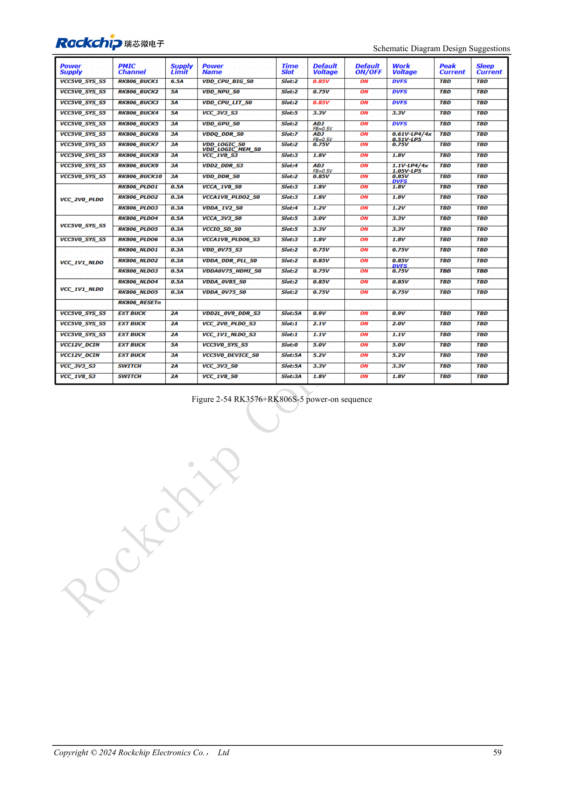
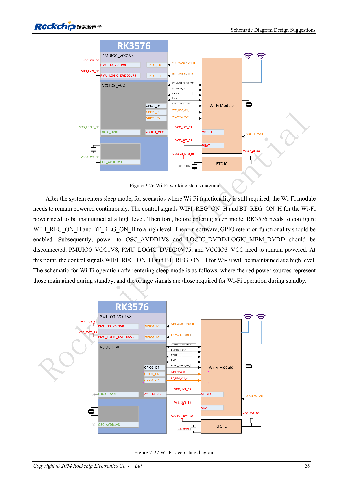

<!-- rk3576-hardware-v11-deep-20261109 -->

# Питание и сон RK3576: последовательность, удерживаемые шины и пробуждение

Правило «сначала низкое напряжение» не заменяет требований конкретных PHY. Составьте зависимости шин, затем отдельно проверьте старт, выключение и каждый режим сна/пробуждения.

Основа — китайская и английская версии RK3576 Hardware Design Guide V1.1 (2024-05-28), для плат с SoC. Носители CM5 проектируют по интерфейсу модуля; Sige5 подходит для программной базы сравнения. Единого SDK/BSP или ядра для всех изделий руководство не задаёт: совместимость проверяют для каждой платы. Значения взяты из источника, а не измерены ArmSoM.

**RK3576_Hardware_Design_Guide_V1.1_20240528_EN.pdf** · §2.2.1; §2.2.4

## Исключения последовательности и сброс

DDRPHY: DVDD→CKE_VDDQ→VDDQ/CK_VDDQ; USB2: 0.75→1.8→3.3V; UFS и USB3/DP: 0.85→1.8V. Для MIPIDCPHY действует особый порядок низкое напряжение→1.8→1.2V, а не сортировка номиналов. RESET_L отпускают минимум через 1ms после стабилизации последней шины. Практический диапазон руководства 5–200ms всё равно согласуют с внешними устройствами.

## Сохраняемые шины зависят от пробуждения

Минимальный сон сохраняет DDRPHY_CKE_VDDQ, PMU_LOGIC_DVDD0V75, PMUIO0_VCC1V8 и PMUIO1_VCC, преимущественно для прерываний PMUIO. USB HID требует также генератор и питание USB2 PHY. Прерывания VCCIO0–7 требуют соответствующий IO, LOGIC и LOGIC_MEM. Минимальный набор не подходит всем изделиям.

## Удержание GPIO и выключение

В примере Wi-Fi сначала выставляют WIFI_REG_ON_H/BT_REG_ON_H в единицу и включают GPIO retention, затем отключают соответствующее основное питание и генератор, сохраняя питание периферии и IO. Это не подтверждает настройку любого BSP. Перед выключением активируют RESET_L. Разности GPIO3.3V–PMUIO0_1.8V и USB3.3V–USB1.8V ограничивают 2V по руководству. Проверяют обратное питание от оставшейся включённой периферии.

## Параметры и проверочная таблица

| Параметр | Значение/сеть | Проверка |
| --- | --- | --- |
| Последняя шина → сброс | ≥1ms | Практический ориентир 5–200ms |
| Начало выключения | RESET_L = LOW | Затем отключать шины по требованиям |
| Порядок PMIC | RK806S-5 | Фиксированная конфигурация; не RK806-2 |

## Исходные схемы и рисунки

Ниже страницы источника со схемами или временными диаграммами; нажмите для полного разрешения. Обозначения и номиналы относятся к эталонной схеме, не к схеме изделия ArmSoM.

Английский оригинал · PDF 78 · 2-54

Английский оригинал · PDF 58 · 2-26 / 2-27

## Продукты ArmSoM и путь разработки

CM5 позволяет использовать готовый вычислительный модуль на своём носителе; Sige5 подходит для первичной проверки Linux и периферии. Наличие интерфейса в SoC не означает его вывод на обоих продуктах. До покупки или разводки проверьте разъёмы, ревизию и образ системы.

- [ArmSoM CM5](https://www.armsom.org/cm5) · [CM5 Docs](https://docs.armsom.org/armsom-cm5)
- [ArmSoM Sige5](https://www.armsom.org/sige5) · [Sige5 Docs](https://docs.armsom.org/armsom-sige5)

## Порядок чтения серии

- [Серия по аппаратному проектированию RK3576: от минимальной системы до DDR и USB](/ru/articles/rk3576-hardware-design-series/)
- [Минимальная система RK3576: от проверки схемы до повторяемого запуска](/ru/articles/rk3576-hardware-bringup/)
- [Тактирование RK3576: кварц 24MHz, режим 32kHz и такты периферии](/ru/articles/rk3576-clock-circuit-design/)
- [Сброс RK3576: NPOR, RK806S-5, watchdog и температурная защита](/ru/articles/rk3576-reset-watchdog-design/)
- [Загрузка и отладка RK3576: конфигурация, Maskrom, UART и JTAG](/ru/articles/rk3576-boot-debug-design/)
- [Питание RK3576: домены CPU, GPU, NPU, LOGIC и развязка](/ru/articles/rk3576-power-domain-design/)
- [RK3576 и RK806S-5: выбор PMIC, управляющие выводы и обратная связь](/ru/articles/rk3576-rk806s5-pmic-design/)
- [DDR RK3576: схемы и питание LPDDR4, LPDDR4X и LPDDR5](/ru/articles/rk3576-ddr-circuit-power/)
- [Трассировка DDR RK3576: импеданс, длина, возвратный ток и PDN](/ru/articles/rk3576-ddr-pcb-routing/)
- [Аппаратное дополнение USB/Type-C RK3576: мультиплексирование и защита](/ru/articles/168-rockchip-rk3576-usb/)
