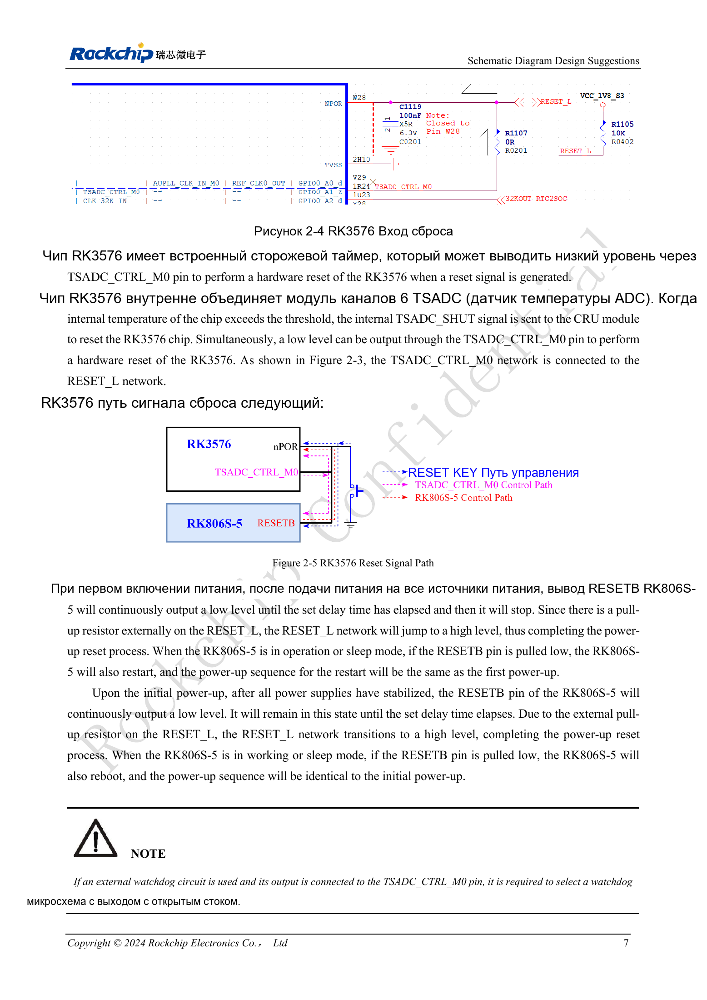

<!-- rk3576-hardware-v11-deep-20261109 -->

# Сброс RK3576: NPOR, RK806S-5, watchdog и температурная защита

Цепь сброса объединяет SoC, PMIC, watchdog и температурную защиту. Проверяют направления сигналов, домены питания, длительность низкого уровня и общую ёмкость сети, а не только наличие кнопки.

Основа — китайская и английская версии RK3576 Hardware Design Guide V1.1 (2024-05-28), для плат с SoC. Носители CM5 проектируют по интерфейсу модуля; Sige5 подходит для программной базы сравнения. Единого SDK/BSP или ядра для всех изделий руководство не задаёт: совместимость проверяют для каждой платы. Значения взяты из источника, а не измерены ArmSoM.

**RK3576_Hardware_Design_Guide_V1.1_20240528_EN.pdf** · §2.1.2; §2.2.3

## Временные требования NPOR

NPOR (Pin W28) активен низким уровнем. Источник требует минимум 100 периодов 24MHz и одновременно пишет «не менее 4μs». Поскольку 100/24MHz≈4.167μs, основным остаётся требование 100 периодов; ровно 4.000μs недостаточно. Интервал ≥1ms между стабилизацией последнего питания и снятием RESET_L — отдельное требование запуска.

## Роль RESETB меняется

При включении RK806S-5 удерживает RESETB в нуле, затем отпускает после стабилизации и задержки; внешний резистор поднимает уровень. Низкий RESETB во время работы или сна перезапускает PMIC с повторной последовательностью питания. Подтяжка RESET_L подключается к PMUIO0_VCC1V8. Рекомендованы 100nF, но суммарная ёмкость сети должна быть ≤0.3μF: нельзя добавлять конденсатор на каждой ветви.

## Watchdog и защита температуры

TSADC1 имеет шесть каналов. При заданном пороге он может передать TSADC_SHUT в CRU и опустить TSADC_CTRL_M0. Подключённый к этой сети внешний watchdog должен иметь открытый сток во избежание конфликта драйверов. При проверке одновременно фиксируют сброс, перезапуск питания и UART; сверяют пороги, маршрутизацию и восстановление в BSP. Универсальный непроверенный порог здесь не задаётся.

## Параметры и проверочная таблица

| Параметр | Значение/сеть | Проверка |
| --- | --- | --- |
| Внешний сброс | NPOR / W28 | Активен нулём; минимум 100×период 24MHz |
| Питание подтяжки | PMUIO0_VCC1V8 | Не подключать произвольно к 3.3V |
| Общая ёмкость | ≤0.3μF | Включая ветви SoC, PMIC и внешнего сброса |

## Исходные схемы и рисунки

Ниже страницы источника со схемами или временными диаграммами; нажмите для полного разрешения. Обозначения и номиналы относятся к эталонной схеме, не к схеме изделия ArmSoM.

Английский оригинал · PDF 26 · 2-4

## Продукты ArmSoM и путь разработки

CM5 позволяет использовать готовый вычислительный модуль на своём носителе; Sige5 подходит для первичной проверки Linux и периферии. Наличие интерфейса в SoC не означает его вывод на обоих продуктах. До покупки или разводки проверьте разъёмы, ревизию и образ системы.

- [ArmSoM CM5](https://www.armsom.org/cm5) · [CM5 Docs](https://docs.armsom.org/armsom-cm5)
- [ArmSoM Sige5](https://www.armsom.org/sige5) · [Sige5 Docs](https://docs.armsom.org/armsom-sige5)

## Порядок чтения серии

- [Серия по аппаратному проектированию RK3576: от минимальной системы до DDR и USB](/ru/articles/rk3576-hardware-design-series/)
- [Минимальная система RK3576: от проверки схемы до повторяемого запуска](/ru/articles/rk3576-hardware-bringup/)
- [Тактирование RK3576: кварц 24MHz, режим 32kHz и такты периферии](/ru/articles/rk3576-clock-circuit-design/)
- [Загрузка и отладка RK3576: конфигурация, Maskrom, UART и JTAG](/ru/articles/rk3576-boot-debug-design/)
- [Питание RK3576: домены CPU, GPU, NPU, LOGIC и развязка](/ru/articles/rk3576-power-domain-design/)
- [RK3576 и RK806S-5: выбор PMIC, управляющие выводы и обратная связь](/ru/articles/rk3576-rk806s5-pmic-design/)
- [Питание и сон RK3576: последовательность, удерживаемые шины и пробуждение](/ru/articles/rk3576-power-sequencing-standby/)
- [DDR RK3576: схемы и питание LPDDR4, LPDDR4X и LPDDR5](/ru/articles/rk3576-ddr-circuit-power/)
- [Трассировка DDR RK3576: импеданс, длина, возвратный ток и PDN](/ru/articles/rk3576-ddr-pcb-routing/)
- [Аппаратное дополнение USB/Type-C RK3576: мультиплексирование и защита](/ru/articles/168-rockchip-rk3576-usb/)
