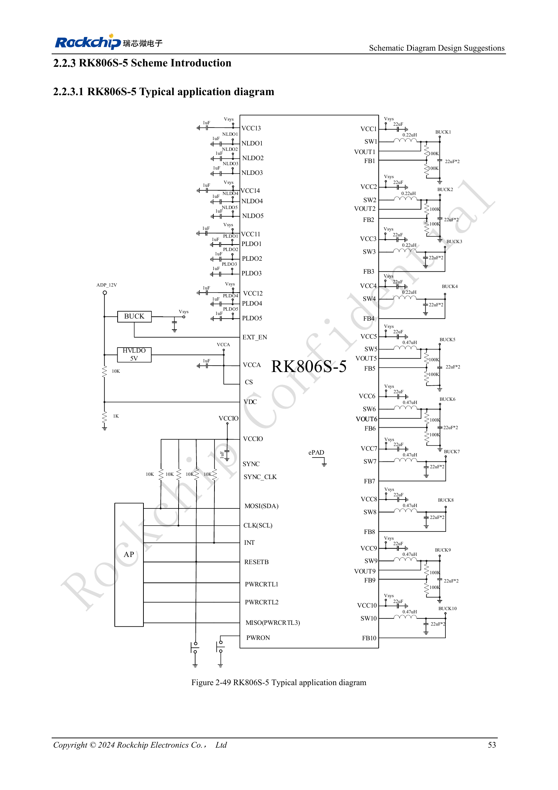
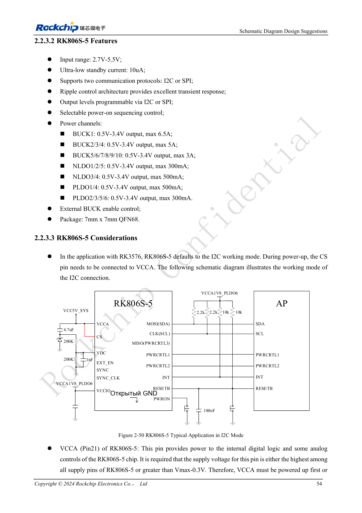

<!-- rk3576-hardware-v11-deep-20261109 -->

# RK3576 и RK806S-5: выбор PMIC, управляющие выводы и обратная связь

Одинаковый корпус не гарантирует одинаковый запуск. RK806S-5 имеет фиксированную последовательность для RK3576 и не заменяется напрямую RK806-2. Сначала проверяют полную маркировку, OTP и схему, затем номиналы.

Основа — китайская и английская версии RK3576 Hardware Design Guide V1.1 (2024-05-28), для плат с SoC. Носители CM5 проектируют по интерфейсу модуля; Sige5 подходит для программной базы сравнения. Единого SDK/BSP или ядра для всех изделий руководство не задаёт: совместимость проверяют для каждой платы. Значения взяты из источника, а не измерены ArmSoM.

**RK3576_Hardware_Design_Guide_V1.1_20240528_EN.pdf** · §2.2.3–2.2.4

## Связь и входы питания

В примере используется I2C, CS при запуске подключён к VCCA. VCCA (Pin21) должен быть максимальным питанием либо выше Vmax−0.3V и включаться раньше или одновременно с другими входами. PLDO6 питает интерфейс связи и должен соответствовать AP. Диапазон 2.7–5.5V не отменяет условий старта: описание VDC требует VCCA/VCC1/VCC2 выше 3.0V.

## Управление питанием связано со сбросом

Порог VDC — 0.8V; рекомендуется больше 1V, но не выше VCCA. Постоянный высокий уровень может мешать выключению; проверяйте исходную RC-схему автозапуска. PWRON имеет внутреннюю подтяжку около 45kΩ: по умолчанию 20ms низкого уровня включает, удержание 6s выключает принудительно; доступны 6/8/10/12s. После EXT_EN питания VCCA/VCC1/VCC2 должны превысить 3V за 100ms. Общая ёмкость RESETB ≤0.3μF.

## Обратная связь и противоречие источника

Выбор FB или VOUT зависит от BUCK и OTP; нельзя одинаково переподключать все каналы. Пример делителя: Vout=(R1/R2+1)×0.5V, резисторы 10kΩ–1MΩ. На рисунке 2-49 для BUCK1–4 указано 0.22μH, в тексте — 0.24μH. Оба значения сохранены; выбор уточняют по актуальному BOM, спецификации PMIC и у производителя. Для COT совместно проверяют разводку и пульсации.

## Параметры и проверочная таблица

| Параметр | Значение/сеть | Проверка |
| --- | --- | --- |
| Вход/корпус | 2.7–5.5V; QFN68 7×7mm | Спецификация PMIC, не вход платы |
| Пределы BUCK | 1:6.5A; 2–4:5A; 5–10:3A | Максимум не равен постоянной нагрузке |
| Исходный интерфейс | I2C / CS→VCCA | Согласовать OTP, уровни AP и старт |

## Исходные схемы и рисунки

Ниже страницы источника со схемами или временными диаграммами; нажмите для полного разрешения. Обозначения и номиналы относятся к эталонной схеме, не к схеме изделия ArmSoM.

Английский оригинал · PDF 72 · 2-49

Английский оригинал · PDF 73 · 2-50

## Продукты ArmSoM и путь разработки

CM5 позволяет использовать готовый вычислительный модуль на своём носителе; Sige5 подходит для первичной проверки Linux и периферии. Наличие интерфейса в SoC не означает его вывод на обоих продуктах. До покупки или разводки проверьте разъёмы, ревизию и образ системы.

- [ArmSoM CM5](https://www.armsom.org/cm5) · [CM5 Docs](https://docs.armsom.org/armsom-cm5)
- [ArmSoM Sige5](https://www.armsom.org/sige5) · [Sige5 Docs](https://docs.armsom.org/armsom-sige5)

## Порядок чтения серии

- [Серия по аппаратному проектированию RK3576: от минимальной системы до DDR и USB](/ru/articles/rk3576-hardware-design-series/)
- [Минимальная система RK3576: от проверки схемы до повторяемого запуска](/ru/articles/rk3576-hardware-bringup/)
- [Тактирование RK3576: кварц 24MHz, режим 32kHz и такты периферии](/ru/articles/rk3576-clock-circuit-design/)
- [Сброс RK3576: NPOR, RK806S-5, watchdog и температурная защита](/ru/articles/rk3576-reset-watchdog-design/)
- [Загрузка и отладка RK3576: конфигурация, Maskrom, UART и JTAG](/ru/articles/rk3576-boot-debug-design/)
- [Питание RK3576: домены CPU, GPU, NPU, LOGIC и развязка](/ru/articles/rk3576-power-domain-design/)
- [Питание и сон RK3576: последовательность, удерживаемые шины и пробуждение](/ru/articles/rk3576-power-sequencing-standby/)
- [DDR RK3576: схемы и питание LPDDR4, LPDDR4X и LPDDR5](/ru/articles/rk3576-ddr-circuit-power/)
- [Трассировка DDR RK3576: импеданс, длина, возвратный ток и PDN](/ru/articles/rk3576-ddr-pcb-routing/)
- [Аппаратное дополнение USB/Type-C RK3576: мультиплексирование и защита](/ru/articles/168-rockchip-rk3576-usb/)
