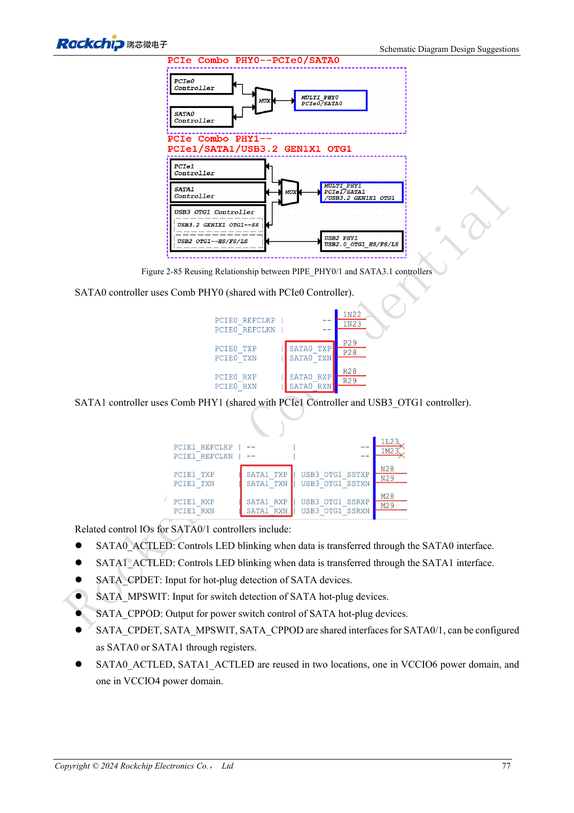
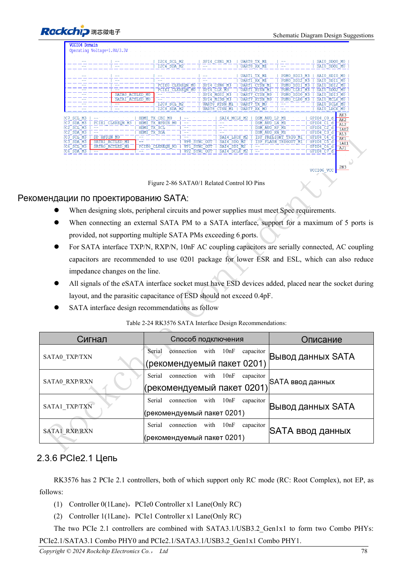

<!-- rk3576-hardware-v11-rest-20261109 -->

# SATA RK3576: общие PHY, развязка и питание накопителя

Основа — китайская и английская версии RK3576 Hardware Design Guide V1.1 (2024-05-28), для плат с SoC. Носители CM5 проектируют по интерфейсу модуля; Sige5 подходит для программной базы сравнения. Единого SDK/BSP или ядра для всех изделий руководство не задаёт: совместимость проверяют для каждой платы. Значения взяты из источника, а не измерены ArmSoM.

**RK3576_Hardware_Design_Guide_V1.1_20240528_EN.pdf** · §2.3.5; SATA PCB

## Контроллер SATA не заменяет весь интерфейс диска

Два SATA 3.1 поддерживают 1.5/3/6Gbps. Указана поддержка множителя портов до пяти устройств, но нужны проверки ПО, устройств и полосы. SATA0 делит PHY0 с PCIe0; SATA1 — PHY1 с PCIe1/USB3 OTG1. Питание диска и пусковой ток обеспечиваются отдельно от сигнальных линий.

## Не копируйте подключение RX из PCIe

В эталоне SATA и TX, и RX используют 10nF, предпочтительно 0201. Ёмкость защиты eSATA — не более 0.4pF. CPDET/MPSWIT/CPPOD являются выбираемыми общими ресурсами, а не двумя независимыми комплектами. Для ACTLED проверяют домен IO и внешнюю схему управления.

## Учитывайте кабель и худший режим питания

Предпочтительно 100Ω дифференциально. При ограничениях стека источник допускает условный нижний уровень 90Ω±10%; оценивайте тракт вместе с кабелем и приёмником. Сохраняйте землю, ограничивайте переходы, защиту ставьте у разъёма. Проверяйте старт, два диска, длительную запись и восстановление с измерением просадки питания.

## Параметры и проверочная таблица

| Параметр | Значение источника |
| --- | --- |
| Скорость интерфейса | 1.5 / 3 / 6Gbps |
| TX + RX AC | 10nF |
| Разница внутри пары | <6mil |
| Длина трассы | <6inch |
| Зазор | ≥4W |
| Рекомендуемые переходы | ≤2 |

## Исходные рисунки

Ниже страницы источника со схемами или временными диаграммами; нажмите для полного разрешения. Обозначения и номиналы относятся к эталонной схеме, не к схеме изделия ArmSoM.

Английский оригинал · PDF 96 · 2-85

Английский оригинал · PDF 97 · 2-86

## Разработка с ArmSoM

CM5 уменьшает объём повторной разработки вычислительного ядра; Sige5 подходит для первичной проверки ПО и периферии. Вывод интерфейсов, контакты, уровни и поддержка образа проверяются по документации платы, не по возможностям SoC.

- [ArmSoM CM5](https://www.armsom.org/cm5) · [CM5 Docs](https://docs.armsom.org/armsom-cm5)
- [ArmSoM Sige5](https://www.armsom.org/sige5) · [Sige5 Docs](https://docs.armsom.org/armsom-sige5)

## Читайте далее

- [RK3576: 30 тем аппаратного проектирования](/ru/articles/rk3576-hardware-design-series/)
- [PCIe RK3576: режим RC, общие PHY и питание устройств](/ru/articles/rk3576-pcie-hardware-design/)
- [Камеры RK3576: группы CSI, режимы DCPHY и питание](/ru/articles/rk3576-camera-hardware-design/)
