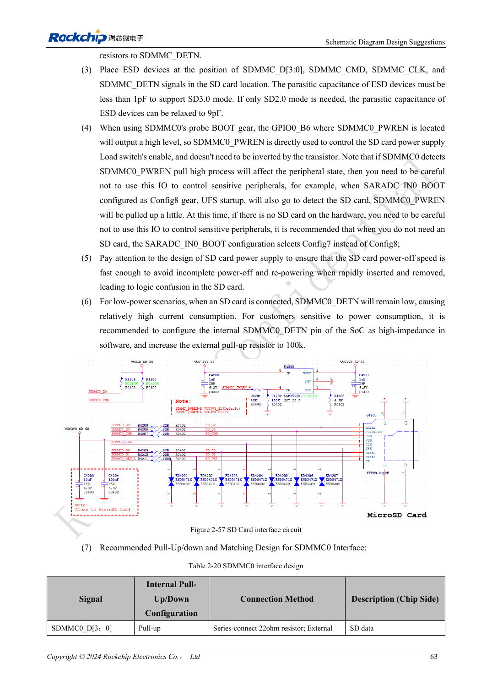
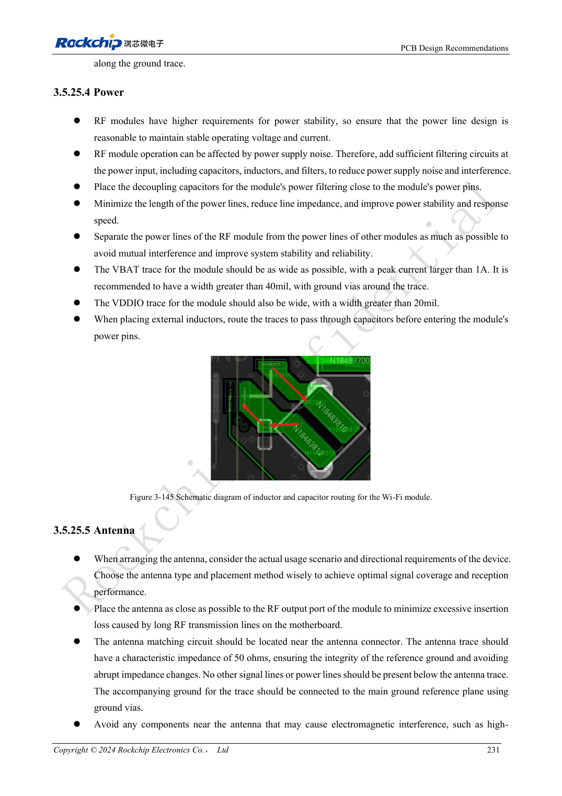

<!-- rk3576-hardware-v11-rest-20261109 -->

# SD-карты и SDIO Wi-Fi RK3576: переключение уровней, питание и RF

Основа — китайская и английская версии RK3576 Hardware Design Guide V1.1 (2024-05-28), для плат с SoC. Носители CM5 проектируют по интерфейсу модуля; Sige5 подходит для программной базы сравнения. Единого SDK/BSP или ядра для всех изделий руководство не задаёт: совместимость проверяют для каждой платы. Значения взяты из источника, а не измерены ArmSoM.

**RK3576_Hardware_Design_Guide_V1.1_20240528_EN.pdf** · §2.3.1; SDMMC/SDIO PCB; §3.5.25

## Различайте загрузочный SDMMC0 и SDMMC1

Оба контроллера поддерживают четырёхбитный SDIO 3.0/MMC 4.51 и такт SDR104 до 200MHz. SDMMC0 на VCCIO1 допускает загрузку; SDMMC1 на VCCIO3 или VCCIO4 — не равнозначный загрузочный порт. Питание карты остаётся 3.3V. После согласования SD 3.0 переключают уровень IO, а не питание карты на 1.8V.

## Питание и подключение карты

В эталоне D/CMD/CLK имеют 22Ω, DETN — 100Ω; ёмкость защиты SD 3.0 должна быть менее 1pF. Загрузочный поиск поднимает GPIO0_B6/PWREN: нужен неинвертирующий ключ и разряд питания перед повторной вставкой. Во сне DETN может стать высокоомным; питание внешней подтяжки выбирают по схеме пробуждения.

## Для Wi-Fi проверяют RF и пиковый ток

Согласуйте VDDIO, уровень 32.768kHz и направления UART/PCM. Удалите модуль от DDR, HDMI и силовых дросселей. RF ведут на 50Ω без ответвлений, с местом для согласования; свободную область антенны задаёт изготовитель. Питание рассчитывают по пиковому, не среднему току модуля. Одновременно запускайте Wi-Fi и соседнюю скоростную периферию, фиксируя скорость, потери, обрывы и просадки.

## Параметры и проверочная таблица

| Параметр | Значение источника |
| --- | --- |
| SD Z | 50Ω ±10% |
| CLK ↔ DATA | <120mil |
| Длина трассы | <4inch |
| RF Z | 50Ω ±10% |
| SD3 ESD | <1pF |

## Исходные рисунки

Ниже страницы источника со схемами или временными диаграммами; нажмите для полного разрешения. Обозначения и номиналы относятся к эталонной схеме, не к схеме изделия ArmSoM.

Английский оригинал · PDF 82 · 2-57

Английский оригинал · PDF 250 · 3-145

## Разработка с ArmSoM

CM5 уменьшает объём повторной разработки вычислительного ядра; Sige5 подходит для первичной проверки ПО и периферии. Вывод интерфейсов, контакты, уровни и поддержка образа проверяются по документации платы, не по возможностям SoC.

- [ArmSoM CM5](https://www.armsom.org/cm5) · [CM5 Docs](https://docs.armsom.org/armsom-cm5)
- [ArmSoM Sige5](https://www.armsom.org/sige5) · [Sige5 Docs](https://docs.armsom.org/armsom-sige5)

## Читайте далее

- [RK3576: 30 тем аппаратного проектирования](/ru/articles/rk3576-hardware-design-series/)
- [Загрузка RK3576 через FSPI: NOR/NAND, напряжение и состояние CS](/ru/articles/rk3576-fspi-boot-hardware/)
- [PCIe RK3576: режим RC, общие PHY и питание устройств](/ru/articles/rk3576-pcie-hardware-design/)
