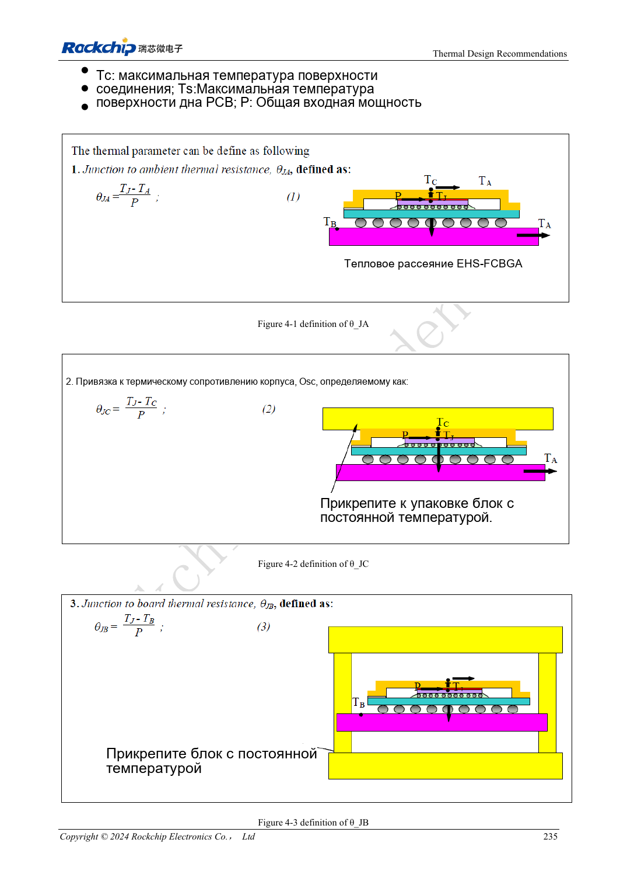

<!-- rk3576-hardware-v11-rest-20261109 -->

# Тепловой проект RK3576: сопротивление, PCB и длительная нагрузка

Основа — китайская и английская версии RK3576 Hardware Design Guide V1.1 (2024-05-28), для плат с SoC. Носители CM5 проектируют по интерфейсу модуля; Sige5 подходит для программной базы сравнения. Единого SDK/BSP или ядра для всех изделий руководство не задаёт: совместимость проверяют для каждой платы. Значения взяты из источника, а не измерены ArmSoM.

**RK3576_Hardware_Design_Guide_V1.1_20240528_EN.pdf** · Chapter 4

## Тепловые параметры имеют условия

Источник приводит моделирование JEDEC 2S2P при естественной конвекции без радиатора. Это не прямые данные CM5, Sige5 или корпуса изделия. θJA, θJB, θJC и ψJT описывают разные пути или условия и не взаимозаменяемы. θJC, умноженный на мощность всей системы, не даёт нагрев кристалла относительно среды.

## Совместно оптимизируйте тепло и питание

Расстояние PMIC–SoC в рекомендации 20–50mm балансирует потери и тепловую связь. Медь питания/земли, тепловые via и контактный материал составляют единый путь; одной пластины недостаточно. Носитель модуля учитывает высоты и крепление, исключая давление на неподходящие компоненты.

## Фиксируйте установившийся режим и троттлинг

Используйте итоговый корпус, положение и температуру среды для CPU, NPU, видео и реальной совместной нагрузки. Записывайте температуру, частоту, мощность и производительность до стабилизации. Короткий пик не равен длительной работе. Сохраняйте тепловую защиту ядра. Новые измерения ArmSoM здесь не заявляются.

## Параметры и проверочная таблица

| Параметр | Значение источника |
| --- | --- |
| θJA | 15.84°C/W |
| θJB | 6.96°C/W |
| θJC | 0.67°C/W |
| ψJT | 0.031°C/W |
| Расстояние PMIC–SoC | 20–50mm |

## Исходные рисунки

Ниже страницы источника со схемами или временными диаграммами; нажмите для полного разрешения. Обозначения и номиналы относятся к эталонной схеме, не к схеме изделия ArmSoM.

Английский оригинал · PDF 254 · 4-1

## Разработка с ArmSoM

CM5 уменьшает объём повторной разработки вычислительного ядра; Sige5 подходит для первичной проверки ПО и периферии. Вывод интерфейсов, контакты, уровни и поддержка образа проверяются по документации платы, не по возможностям SoC.

- [ArmSoM CM5](https://www.armsom.org/cm5) · [CM5 Docs](https://docs.armsom.org/armsom-cm5)
- [ArmSoM Sige5](https://www.armsom.org/sige5) · [Sige5 Docs](https://docs.armsom.org/armsom-sige5)

## Читайте далее

- [RK3576: 30 тем аппаратного проектирования](/ru/articles/rk3576-hardware-design-series/)
- [PCB питания и PDN RK3576: RK806S-5, обратная связь и токовые петли](/ru/articles/rk3576-power-pcb-pdn-design/)
- [ESD и EMI RK3576: разряд у разъёмов, сброс и подготовка производства](/ru/articles/rk3576-esd-emi-reliability-design/)
