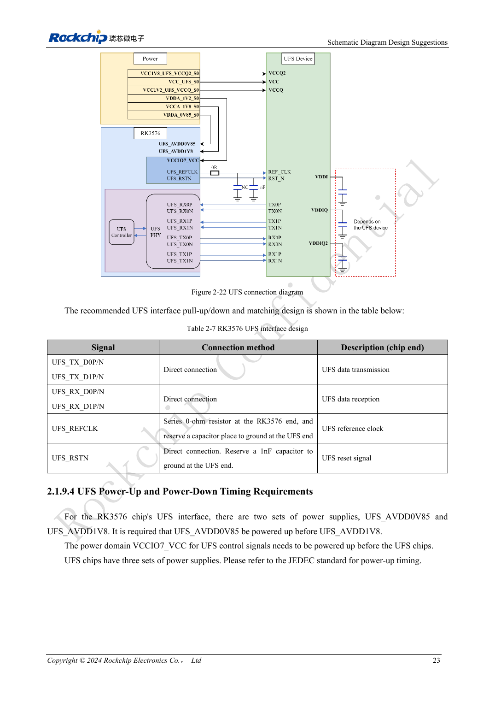
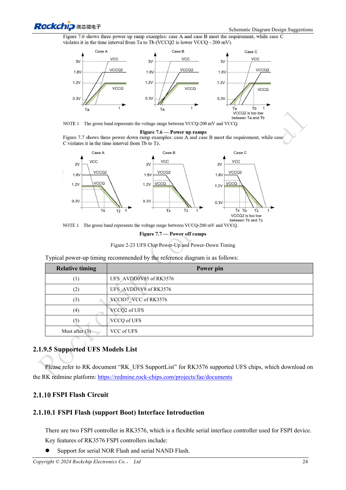

<!-- rk3576-hardware-v11-rest-20261109 -->

# UFS RK3576: совместимость памяти, последовательность питания и разводка

Основа — китайская и английская версии RK3576 Hardware Design Guide V1.1 (2024-05-28), для плат с SoC. Носители CM5 проектируют по интерфейсу модуля; Sige5 подходит для программной базы сравнения. Единого SDK/BSP или ядра для всех изделий руководство не задаёт: совместимость проверяют для каждой платы. Значения взяты из источника, а не измерены ArmSoM.

**RK3576_Hardware_Design_Guide_V1.1_20240528_EN.pdf** · §2.1.9; UFS PCB

## Версия памяти не равна режиму работы

Контроллер RK3576 — UFS 2.0 с двумя линиями до 5.8Gbps каждая. Руководство перечисляет память UFS 2.0/2.1/2.2/3.0/3.1 и исключает UFS 4.0. Новый накопитель не превращает хост в UFS 3.x. Скорость линии не является скоростью файловых операций.

## Перепроверьте питание выбранной памяти

RSTN и REFCLK имеют уровень 1.2V; VCCIO7 при UFS также равен 1.2V. VCCQ/VCCQ2/VCC: 1.2/1.8/3.3V для UFS 2.0, NC/1.8/3.3V для 2.1/2.2, 1.2/NC/2.5 либо 3.3V для 3.0/3.1; решающей остаётся спецификация микросхемы. Последовательность источника: AVDD0V85→AVDD1V8→VCCIO7→VCCQ2→VCCQ; VCC памяти следует после VCCIO7. Отсутствующую шину нельзя подключать механически по примеру.

## Дифференциальный тракт и восстановление

TX/RX соединяют напрямую. REFCLK: 0Ω у SoC и место для конденсатора у памяти; RSTN напрямую с резервом 1nF. Сохраняйте сплошную землю и проверяйте возврат REFCLK; расстояние до земляного перехода по эталону — до 25mil. Проверьте циклы питания, выход из сна и длительную запись. Сначала исключите ошибки последовательности питания, затем меняйте драйвер.

## Параметры и проверочная таблица

| Параметр | Значение источника |
| --- | --- |
| Zdiff | 100Ω ±10% |
| Разница внутри пары | <6mil |
| Разница между парами | <100mil |
| Длина трассы | <4inch |
| Зазор | ≥4W; other ≥5W |
| Рекомендуемые переходы | ≤2 |

## Исходные рисунки

Ниже страницы источника со схемами или временными диаграммами; нажмите для полного разрешения. Обозначения и номиналы относятся к эталонной схеме, не к схеме изделия ArmSoM.

Английский оригинал · PDF 42 · 2-22

Английский оригинал · PDF 43 · 2-23

## Разработка с ArmSoM

CM5 уменьшает объём повторной разработки вычислительного ядра; Sige5 подходит для первичной проверки ПО и периферии. Вывод интерфейсов, контакты, уровни и поддержка образа проверяются по документации платы, не по возможностям SoC.

- [ArmSoM CM5](https://www.armsom.org/cm5) · [CM5 Docs](https://docs.armsom.org/armsom-cm5)
- [ArmSoM Sige5](https://www.armsom.org/sige5) · [Sige5 Docs](https://docs.armsom.org/armsom-sige5)

## Читайте далее

- [RK3576: 30 тем аппаратного проектирования](/ru/articles/rk3576-hardware-design-series/)
- [Аппаратный интерфейс eMMC RK3576: питание, подтяжки и HS400](/ru/articles/rk3576-emmc-hardware-design/)
- [Загрузка RK3576 через FSPI: NOR/NAND, напряжение и состояние CS](/ru/articles/rk3576-fspi-boot-hardware/)
