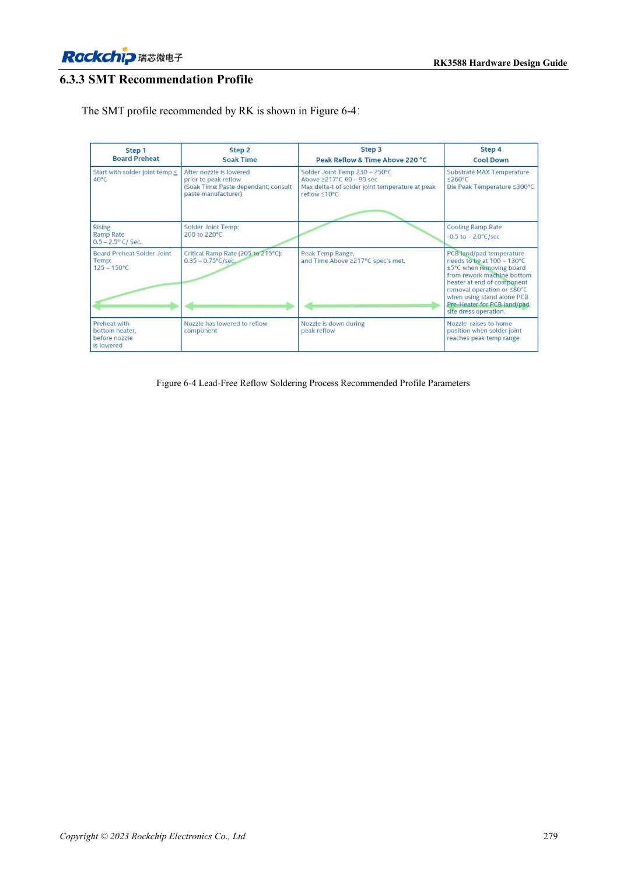
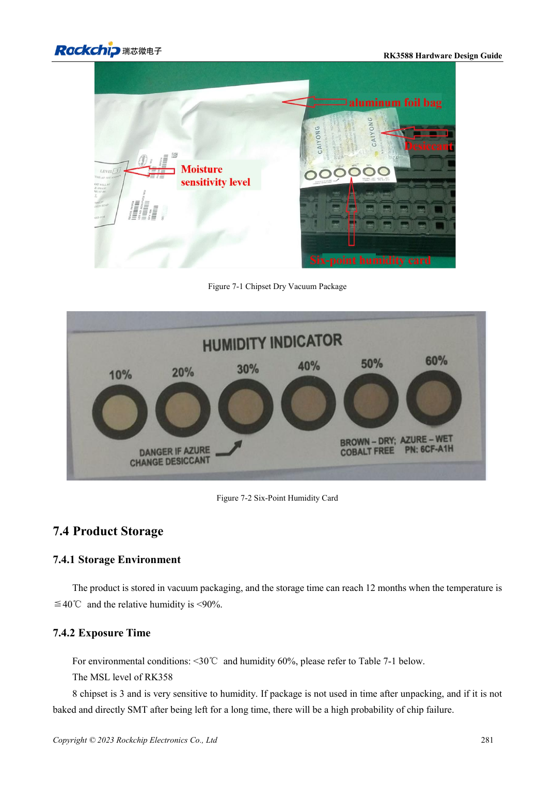

<!-- rk3588-hardware-v13-20261109 -->

# Монтаж и хранение RK3588: оплавление, MSL3 и сушка

Основа — китайская и английская версии RK3588 Hardware Design Guide V1.3 (2023-02-13), для проверки плат SoC и носителей. Носители AIM7 и LM7 проектируют по интерфейсу модуля; Sige7 служит базой проверки ПО и периферии. Возможности SoC не равны перечню разъёмов платы. Проверяйте SDK/BSP, ядро, ревизию и прошивку. Значения взяты из источника, не из измерений ArmSoM.

**RK3588 Hardware Design Guide V1.3 (2023-02-13), EN** · §6–7

## Параметры относятся к корпусу

Профиль оплавления относится к RK3588, не даёт общего разрешения перепаивать готовый модуль ArmSoM. Эталон пасты: 2–10°C хранения, 3–4 часа при комнатной температуре с учётом времени. Производство согласует сплав, флюс, теплоёмкость PCB и ограничения деталей. Для LM7 LGA нужен профиль модуля.

## Учитывайте суммарную экспозицию

RK3588 — MSL3, 168 часов при ≤30°C/60%RH. Записывайте карту влажности, открытие и хранение; повторная упаковка не обнуляет время автоматически. Таблица 7-2 различает превышение срока более/не более 72 часов и температуру, для толщины ≤1.4mm. Строка MSL1 с 300°C подозрительна и не используется как производственный режим.

## Параметры и проверочная таблица

| Параметр | Значение источника |
| --- | --- |
| Срок вне упаковки MSL3 | 168h при ≤30°C /60%RH |
| Сушка 125°C +10/-0°C (превышение >72h / ≤72h) | 9h /7h |
| Сушка 90°C +8/-0°C (превышение >72h / ≤72h) | 33h /23h |
| Сушка 40°C +5/-0°C (превышение >72h / ≤72h) | 13 суток /9 суток |
| Ограничение корпуса таблицы сушки | Толщина ≤1.4mm |

## Исходные рисунки

Ниже страницы источника со схемами или временными диаграммами; нажмите для полного разрешения. Обозначения и номиналы относятся к эталонной схеме, не к схеме изделия ArmSoM.

Английский оригинал · PDF 301 · 6-4

Английский оригинал · PDF 303 · 7-2

## Разработка с ArmSoM

AIM7 подходит для носителей вычислительного модуля, LM7 — для интеграции LGA, Sige7 — для первичной оценки ПО и периферии. До разработки носителя определите уже встроенные цепи питания, DDR и загрузки. Не дублируйте схемы SoC без необходимости. Разъёмы, выведенные интерфейсы, уровни и поддержку системы сверяйте с документацией изделия.

- [ArmSoM AIM7](https://www.armsom.org/aim7) · [AIM7 Docs](https://docs.armsom.org/armsom-aim7)
- [ArmSoM Sige7](https://www.armsom.org/sige7) · [Sige7 Docs](https://docs.armsom.org/armsom-sige7)
- [ArmSoM LM7](https://www.armsom.org/lm7) · [LM7 Docs](https://docs.armsom.org/armsom-lm7)

## Читайте далее

- [RK3588: 30 тем аппаратного проектирования](/ru/articles/rk3588-hardware-design-series/)
- [ESD и EMI RK3588: защита интерфейсов и возврат тока](/ru/articles/rk3588-esd-emi-hardware-design/)
