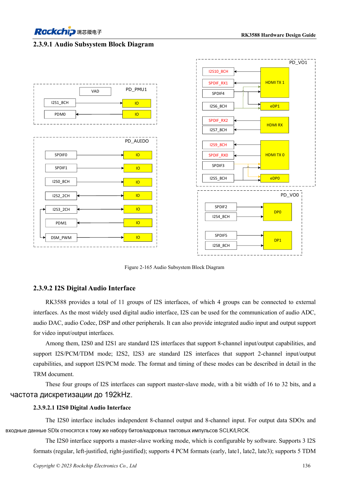
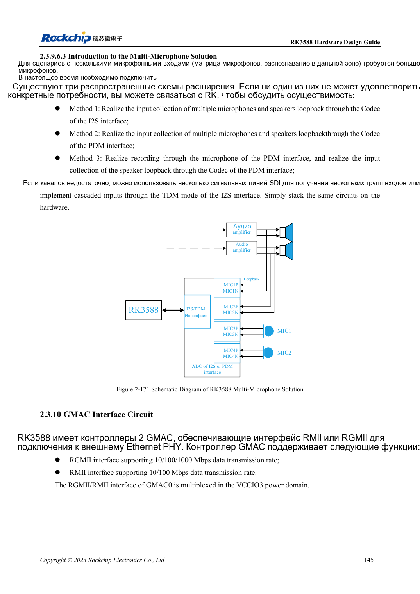

<!-- rk3588-hardware-v13-20261109 -->

# Аудио RK3588: I2S, PDM и массивы микрофонов

Основа — китайская и английская версии RK3588 Hardware Design Guide V1.3 (2023-02-13), для проверки плат SoC и носителей. Носители AIM7 и LM7 проектируют по интерфейсу модуля; Sige7 служит базой проверки ПО и периферии. Возможности SoC не равны перечню разъёмов платы. Проверяйте SDK/BSP, ядро, ревизию и прошивку. Значения взяты из источника, не из измерений ArmSoM.

**RK3588 Hardware Design Guide V1.3 (2023-02-13), EN** · §2.3.9; §3.4.20

## Различайте внутренние и внешние интерфейсы

Из 11 I2S наружу выведены четыре, остальные обслуживают видео. I2S0/1: восемь каналов, I2S/PCM/TDM; I2S2/3: два, I2S/PCM. Внутреннее число не равно портам носителя. После Codec/ADC/DAC определяют master/slave, MCLK, SCLK/LRCK, разрядность и частоту.

## Проверьте такты и аналоговые пути

Для нескольких I2S/PDM используют последовательную топологию такта без длинных ветвей. Рекомендуются 22Ω у SoC и отдельная земляная защита тактов. Микрофоны и усилители удаляют от DDR, дисплея, RF и дросселей. Массив с обратным каналом требует проверки синхронизации и программного отображения.

## Параметры и проверочная таблица

| Параметр | Значение источника |
| --- | --- |
| Внешние I2S | 4 группы |
| I2S0/1; I2S2/3 | 8 каналы; 2 каналы |
| Разрядность/частота источника | 16–32bit / до 192kHz |
| Резистор такта | 22Ω |

## Исходные рисунки

Ниже страницы источника со схемами или временными диаграммами; нажмите для полного разрешения. Обозначения и номиналы относятся к эталонной схеме, не к схеме изделия ArmSoM.

Английский оригинал · PDF 158 · 2-165

Английский оригинал · PDF 167 · 2-171

## Разработка с ArmSoM

AIM7 подходит для носителей вычислительного модуля, LM7 — для интеграции LGA, Sige7 — для первичной оценки ПО и периферии. До разработки носителя определите уже встроенные цепи питания, DDR и загрузки. Не дублируйте схемы SoC без необходимости. Разъёмы, выведенные интерфейсы, уровни и поддержку системы сверяйте с документацией изделия.

- [ArmSoM AIM7](https://www.armsom.org/aim7) · [AIM7 Docs](https://docs.armsom.org/armsom-aim7)
- [ArmSoM Sige7](https://www.armsom.org/sige7) · [Sige7 Docs](https://docs.armsom.org/armsom-sige7)
- [ArmSoM LM7](https://www.armsom.org/lm7) · [LM7 Docs](https://docs.armsom.org/armsom-lm7)

## Читайте далее

- [RK3588: 30 тем аппаратного проектирования](/ru/articles/rk3588-hardware-design-series/)
- [DP и eDP RK3588: PHY, AUX и развязка](/ru/articles/rk3588-dp-edp-hardware-design/)
- [Ethernet RK3588: GMAC, PHY и направление такта](/ru/articles/rk3588-gmac-hardware-design/)
