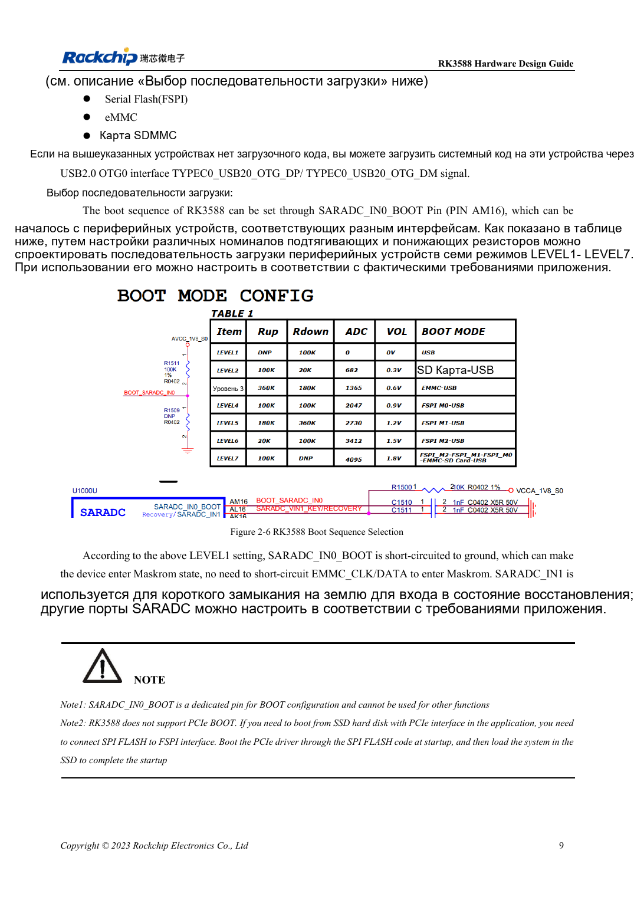
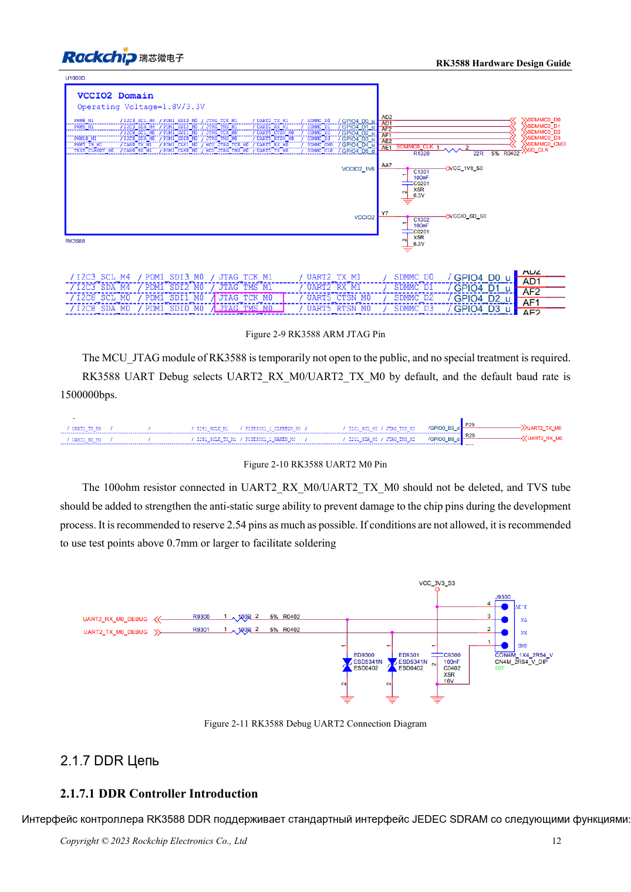

<!-- rk3588-hardware-v13-20261109 -->

# Загрузка RK3588: Maskrom, JTAG и UART

Основа — китайская и английская версии RK3588 Hardware Design Guide V1.3 (2023-02-13), для проверки плат SoC и носителей. Носители AIM7 и LM7 проектируют по интерфейсу модуля; Sige7 служит базой проверки ПО и периферии. Возможности SoC не равны перечню разъёмов платы. Проверяйте SDK/BSP, ядро, ревизию и прошивку. Значения взяты из источника, не из измерений ArmSoM.

**RK3588 Hardware Design Guide V1.3 (2023-02-13), EN** · §2.1.4–2.1.6; §2.3.2

## Оставьте путь восстановления

SARADC_IN0_BOOT на AM16 выделен для загрузки; LEVEL1 выбирает Maskrom. Сохраните USB2.0 OTG0 для прошивки. ROM не стартует прямо с PCIe SSD: код FSPI Flash сначала инициализирует PCIe, затем загружает систему. Система на NVMe не означает прямую загрузку ROM с NVMe.

## Сохраните отладку и подтяжки

SDMMC_DET стабилизируют до конца сброса: ноль — SDMMC, единица — ARM JTAG. Журнал использует UART2_M0, 1500000bps; сохраняют 100Ω RX/TX и TVS. 10kΩ на SARADC_IN1 предотвращает неопределённый recovery-вход. Для модуля проверяют разъём и уровни, не используя координаты шаров SoC.

## Параметры и проверочная таблица

| Параметр | Значение источника |
| --- | --- |
| Загрузочный контакт | SARADC_IN0_BOOT / AM16 |
| Отладка | UART2_M0 / 1500000bps |
| SDMMC_DET | 0: SDMMC; 1: ARM JTAG |
| Подтяжка восстановления | SARADC_IN1: 10kΩ |

## Исходные рисунки

Ниже страницы источника со схемами или временными диаграммами; нажмите для полного разрешения. Обозначения и номиналы относятся к эталонной схеме, не к схеме изделия ArmSoM.

Английский оригинал · PDF 31 · 2-6

Английский оригинал · PDF 34 · 2-10

## Разработка с ArmSoM

AIM7 подходит для носителей вычислительного модуля, LM7 — для интеграции LGA, Sige7 — для первичной оценки ПО и периферии. До разработки носителя определите уже встроенные цепи питания, DDR и загрузки. Не дублируйте схемы SoC без необходимости. Разъёмы, выведенные интерфейсы, уровни и поддержку системы сверяйте с документацией изделия.

- [ArmSoM AIM7](https://www.armsom.org/aim7) · [AIM7 Docs](https://docs.armsom.org/armsom-aim7)
- [ArmSoM Sige7](https://www.armsom.org/sige7) · [Sige7 Docs](https://docs.armsom.org/armsom-sige7)
- [ArmSoM LM7](https://www.armsom.org/lm7) · [LM7 Docs](https://docs.armsom.org/armsom-lm7)

## Читайте далее

- [RK3588: 30 тем аппаратного проектирования](/ru/articles/rk3588-hardware-design-series/)
- [Сброс, watchdog и термозащита RK3588](/ru/articles/rk3588-reset-watchdog-hardware/)
- [Питание RK3588: запуск и неиспользуемые PHY](/ru/articles/rk3588-power-rail-planning/)
