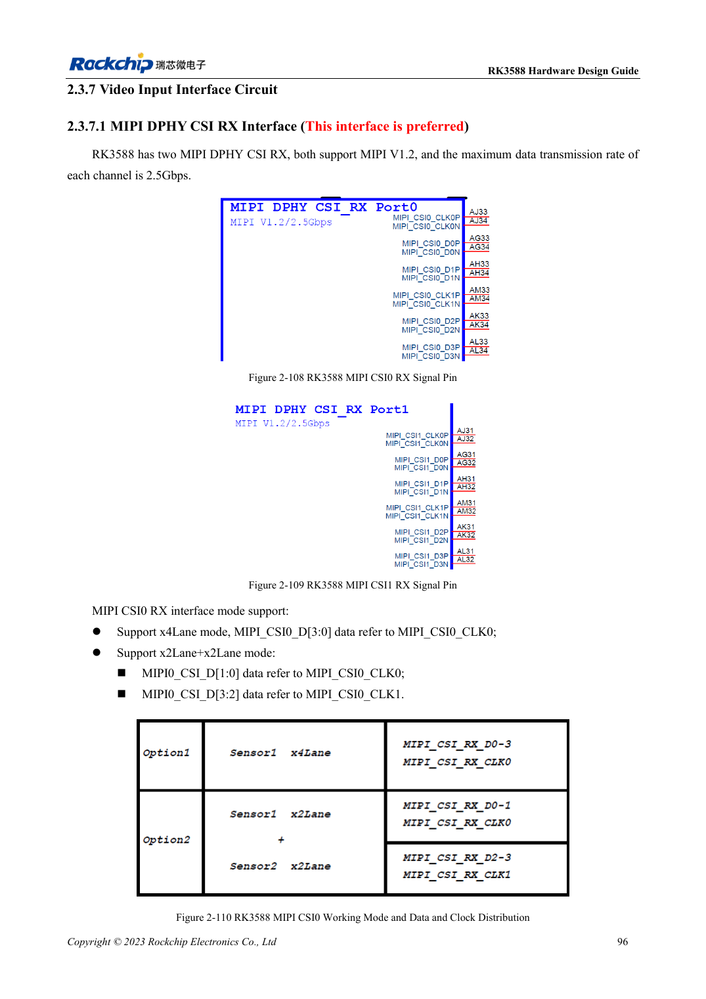
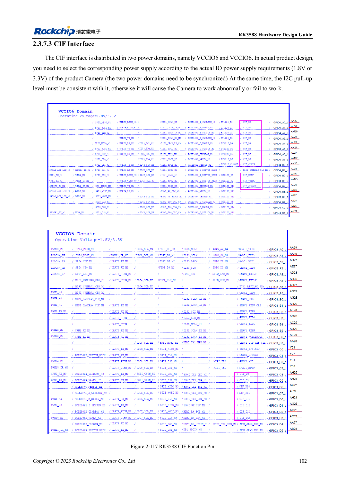

<!-- rk3588-hardware-v13-20261109 -->

# Камеры RK3588: CSI, D/C PHY и CIF

Основа — китайская и английская версии RK3588 Hardware Design Guide V1.3 (2023-02-13), для проверки плат SoC и носителей. Носители AIM7 и LM7 проектируют по интерфейсу модуля; Sige7 служит базой проверки ПО и периферии. Возможности SoC не равны перечню разъёмов платы. Проверяйте SDK/BSP, ядро, ревизию и прошивку. Значения взяты из источника, не из измерений ArmSoM.

**RK3588 Hardware Design Guide V1.3 (2023-02-13), EN** · §2.3.7.1–2.3.7.3; §3.4.12; §3.4.24

## Распределяйте по датчику и PHY

Предпочтительны выделенные MIPI DPHY CSI RX. Два интерфейса допускают четыре Lane или две группы по две с правильными тактами. D/C Combo PHY имеет дополнительные ограничения: свободные контакты не разрешают любые сочетания. Сверяют формат, скорость, питание, reset, MCLK и I2C до выбора разъёма.

## Уровни CIF и проверка системы

CIF использует VCCIO5/VCCIO6: оба питания согласуют с IO датчика и подтяжками I2C. Соединение MIPI не означает поддержку датчика в BSP: нужны драйвер, device tree и ISP. Начинают с одного потока, затем проверяют многопоточность, длительность, потерю кадров, такт и нагрев.

## Параметры и проверочная таблица

| Параметр | Значение источника |
| --- | --- |
| Скорость отдельного DPHY RX | 2.5Gbps/lane |
| Целевой импеданс DPHY | 100Ω ±10%; резерв 95Ω ±10% |
| DPHY пара / такт-данные | <6mil / <12mil |

## Исходные рисунки

Ниже страницы источника со схемами или временными диаграммами; нажмите для полного разрешения. Обозначения и номиналы относятся к эталонной схеме, не к схеме изделия ArmSoM.

Английский оригинал · PDF 118 · 2-110

Английский оригинал · PDF 124 · 2-117

## Разработка с ArmSoM

AIM7 подходит для носителей вычислительного модуля, LM7 — для интеграции LGA, Sige7 — для первичной оценки ПО и периферии. До разработки носителя определите уже встроенные цепи питания, DDR и загрузки. Не дублируйте схемы SoC без необходимости. Разъёмы, выведенные интерфейсы, уровни и поддержку системы сверяйте с документацией изделия.

- [ArmSoM AIM7](https://www.armsom.org/aim7) · [AIM7 Docs](https://docs.armsom.org/armsom-aim7)
- [ArmSoM Sige7](https://www.armsom.org/sige7) · [Sige7 Docs](https://docs.armsom.org/armsom-sige7)
- [ArmSoM LM7](https://www.armsom.org/lm7) · [LM7 Docs](https://docs.armsom.org/armsom-lm7)

## Читайте далее

- [RK3588: 30 тем аппаратного проектирования](/ru/articles/rk3588-hardware-design-series/)
- [PCIe RK3588: линии, опорные такты и питание](/ru/articles/rk3588-pcie-hardware-design/)
- [HDMI RX RK3588: вход захвата, CEC и DDC](/ru/articles/rk3588-hdmi-rx-hardware-design/)
