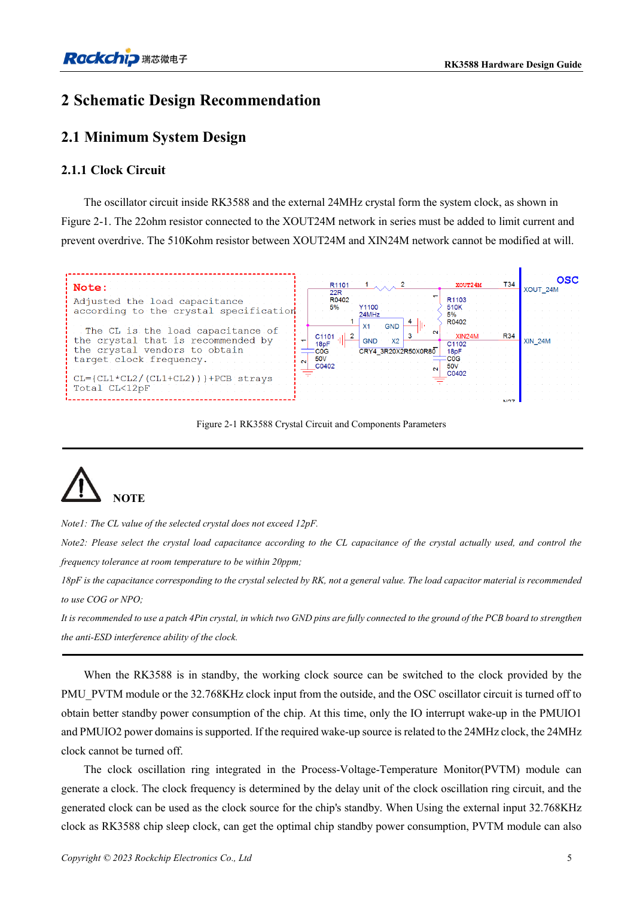
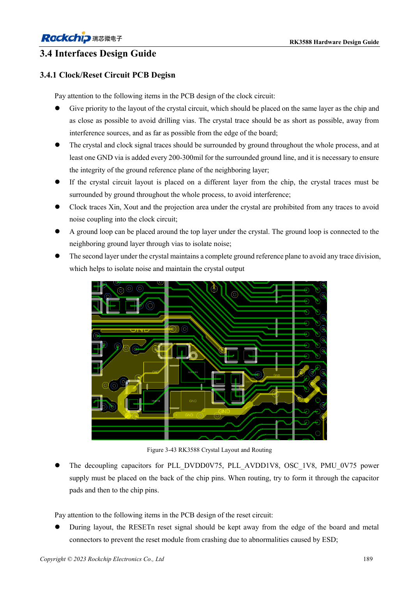

<!-- rk3588-hardware-v13-20261109 -->

# Тактовые цепи RK3588: 24MHz, 32kHz и размещение

Основа — китайская и английская версии RK3588 Hardware Design Guide V1.3 (2023-02-13), для проверки плат SoC и носителей. Носители AIM7 и LM7 проектируют по интерфейсу модуля; Sige7 служит базой проверки ПО и периферии. Возможности SoC не равны перечню разъёмов платы. Проверяйте SDK/BSP, ядро, ревизию и прошивку. Значения взяты из источника, не из измерений ArmSoM.

**RK3588 Hardware Design Guide V1.3 (2023-02-13), EN** · §2.1.1; §3.4.1

## Подберите нагрузку кварца

22Ω у XOUT24M ограничивает возбуждение; 510kΩ между XOUT24M и XIN24M нельзя менять произвольно. CL кварца ≤12pF. Показанные 18pF относятся к эталону: нагрузку определяют по CL и паразитам, предпочтительно C0G/NP0 и четырёхконтактный кварц. Ёмкость щупа также влияет на генерацию.

## Проверьте пробуждение и PCB

Перед остановкой 24MHz проверьте зависимости источников пробуждения. Малопотребляющий путь использует PMU_PVTM или внешние 32.768kHz и соответствующие IO PMUIO1/2. Кварц размещают рядом с SoC на той же стороне; под кварцем/XIN/XOUT не проводят другие сигналы, сохраняют землю и ставят земляные переходы через 200–300mil.

## Параметры и проверочная таблица

| Параметр | Значение источника |
| --- | --- |
| Допуск 24MHz | ≤20ppm |
| Допуск 32.768kHz | ±30ppm |
| Скважность 32kHz | 45–55% |
| Амплитуда 32kHz | 0.7×VDD … VDD; VDD=PMUIO1 |

## Исходные рисунки

Ниже страницы источника со схемами или временными диаграммами; нажмите для полного разрешения. Обозначения и номиналы относятся к эталонной схеме, не к схеме изделия ArmSoM.

Английский оригинал · PDF 27 · 2-1

Английский оригинал · PDF 211 · 3-43

## Разработка с ArmSoM

AIM7 подходит для носителей вычислительного модуля, LM7 — для интеграции LGA, Sige7 — для первичной оценки ПО и периферии. До разработки носителя определите уже встроенные цепи питания, DDR и загрузки. Не дублируйте схемы SoC без необходимости. Разъёмы, выведенные интерфейсы, уровни и поддержку системы сверяйте с документацией изделия.

- [ArmSoM AIM7](https://www.armsom.org/aim7) · [AIM7 Docs](https://docs.armsom.org/armsom-aim7)
- [ArmSoM Sige7](https://www.armsom.org/sige7) · [Sige7 Docs](https://docs.armsom.org/armsom-sige7)
- [ArmSoM LM7](https://www.armsom.org/lm7) · [LM7 Docs](https://docs.armsom.org/armsom-lm7)

## Читайте далее

- [RK3588: 30 тем аппаратного проектирования](/ru/articles/rk3588-hardware-design-series/)
- [Аппаратура edge AI на RK3588: от нагрузки к проверке](/ru/articles/rk3588-edge-ai-hardware-design/)
- [Сброс, watchdog и термозащита RK3588](/ru/articles/rk3588-reset-watchdog-hardware/)
