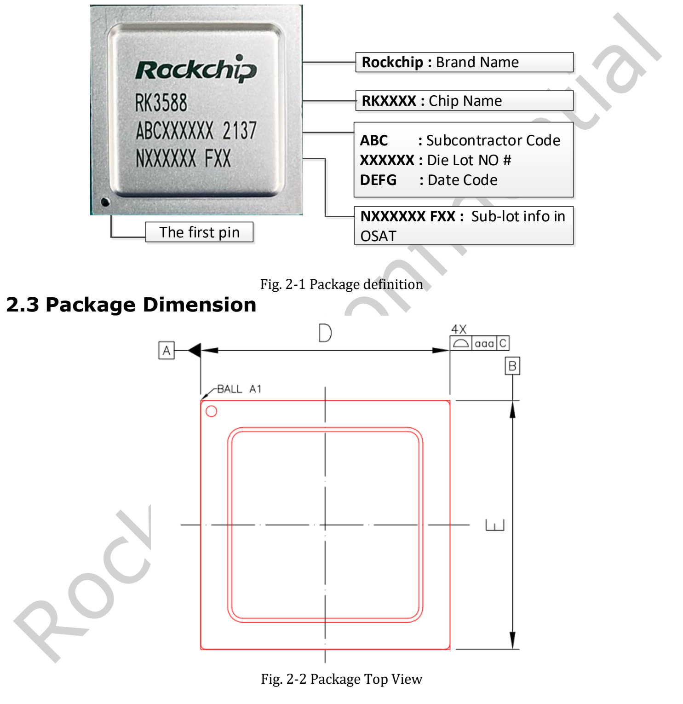
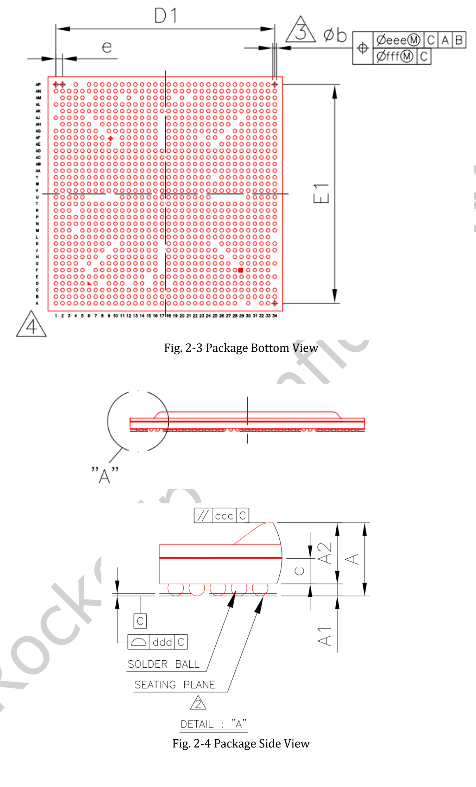
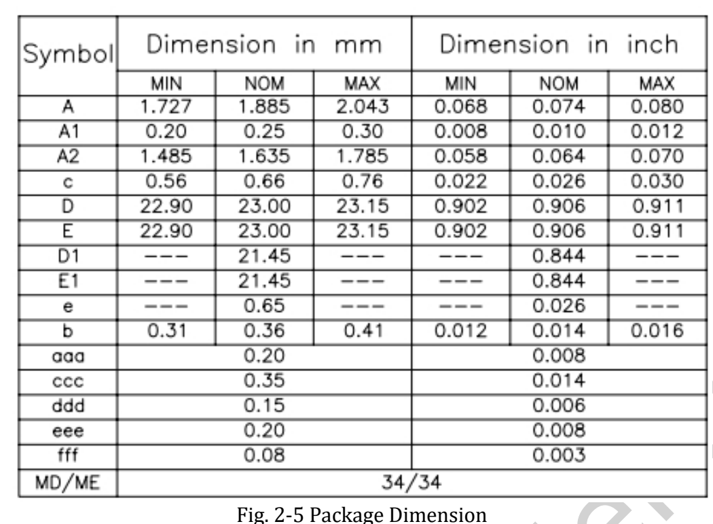

**RK3588 Datasheet V1.4 от 2022-05-24 содержит 34 страницы** о функциях, корпусе, выводах, электрических и тепловых условиях. Это путеводитель по документу, а не построчный перевод. Полный оригинал доступен отдельно.

[Скачать исходный PDF](/assets/rk3588/Rockchip-RK3588-Datasheet-V1.4-20220524.pdf)

## Карта документа

| Страницы | Содержание | Назначение |
|---|---|---|
| 6–16 | CPU, память, NPU, видео, экран, интерфейсы | Архитектура и функции |
| 16 | Блок-схема | Блоки и мультиплексирование |
| 17–19 | Маркировка, размеры, MSL, материал шариков | Корпус и производство |
| 19–27 | Таблица выводов | Сигналы и домены питания SoC |
| 28 | Absolute Ratings | Предельные, не рабочие значения |
| 29–33 | Рекомендуемые условия и характеристики | Питание и сигналы |
| 34 | Тепловое управление | Условная расчётная справка |

## Архитектура и вычисления

Четыре A76 и четыре A55 делят 3MB L3; каждый A76 имеет 512KB L2, A55 — 128KB L2. Четыре канала 16-bit поддерживают LPDDR4/4X/5 и адресацию до 32GB. Трёхъядерный NPU указан до 6 TOPS; перечислены INT4/INT8/INT16, FP16, BF16 и TF32. Это не гарантия каждой комбинации операторов во всех версиях инструментов.

## Видео, ISP и неоднозначности

Декодирование: H.265/VP9/AVS2 8K60, H.264 8K30, AV1 4K60. Кодирование H.264/H.265 — 8K30. Режимы ISP: два ISP 48M@15 и 32M@30, один ISP 16M@30. Учитывайте полное разрешение и конкретный режим.

Подраздел JPEG Decoder на странице 9 заканчивается «Embedded four encoder units», что расходится с заголовком. Текст не исправляется молча на четыре декодера; перед проектным решением требуется уточнение. Публичные страницы и PDF также различаются в описании графических API, ISP и DP. Статья опирается на названную редакцию и не объявляет её последней.

## Корпус и размеры

FCBGA1088L: 23×23mm, номинальный диаметр шарика 0.36mm, шаг 0.65mm, MSL3, SnAgCu. Технические изменения V1.4 включают размеры корпуса и схему. Для посадочного места нужны полные допуски и официальные проектные файлы.

## Электрические и тепловые условия

Страница 30 указывает максимум CPU 2.2–2.4GHz, GPU/NPU 1000MHz и окружающую температуру 0–80°C. Это условия данной редакции, не гарантия постоянной максимальной частоты любой платы.

Страница 34 требует температуры перехода ниже 125°C и даёт θJA=8.7, θJB=3.5, θJC=0.12°C/W. Это расчётные ориентиры для 10-слойной платы 114×101mm при окружающих 25°C, требующие физической проверки. Нельзя напрямую переносить их на произвольные радиаторы, корпуса или модули LM7/AIM7. Температура перехода отличается от окружающей.

## Применение с ArmSoM

Для Sige7 начните с питания и охлаждения платы. Для AIM7 нужны определения модульного разъёма, для LM7 — LGA-посадочное место модуля и его питание. Шарики SoC не равны контактам модуля. Электрические параметры здесь повторно не измерялись; исходный PDF и обозначения рисунков сохранены.

## Статьи серии и продукты

- [RK3588: восьмиядерный CPU, NPU 6 TOPS и скоростные интерфейсы](/ru/articles/rk3588-chip-guide/)
- [AIM7 как альтернатива Jetson Nano/Orin: аппаратура и перенос на RKNN](/ru/articles/aim7-jetson-nano-orin-alternative/)
- [Sige7 и LM7: шесть путей от прототипа RK3588 к изделию](/ru/articles/sige7-lm7-rk3588-applications/)
- [ArmSoM AIM7](https://docs.armsom.org/armsom-aim7) · [Sige7](https://docs.armsom.org/armsom-sige7) · [LM7](https://docs.armsom.org/armsom-lm7)

## Источники

- [Rockchip RK3588](https://www.rock-chips.com/a/en/products/RK35_Series/2022/0926/1660.html)
- [ArmSoM AIM7](https://docs.armsom.org/armsom-aim7)
- [ArmSoM Sige7](https://docs.armsom.org/armsom-sige7)
- [ArmSoM LM7](https://docs.armsom.org/armsom-lm7)
- [NVIDIA Jetson modules](https://developer.nvidia.com/embedded/jetson-modules)
- [RKNN-Toolkit2](https://github.com/airockchip/rknn-toolkit2)

<!-- datasheet-related-20261110 -->
## Другие datasheet

Ссылки предназначены для сравнения платформ; электрические условия и выводы не взаимозаменяемы.

- [RK3506B](/ru/articles/rk3506b-datasheet-v10/)
- [RK3576](/ru/articles/rk3576-datasheet-v10/)
- [RK3528](/ru/articles/rk3528-datasheet-v10/)
- [RK3568](/ru/articles/rk3568-datasheet-v12/)
- [RK730](/ru/articles/rk730-audio-codec-design/)
