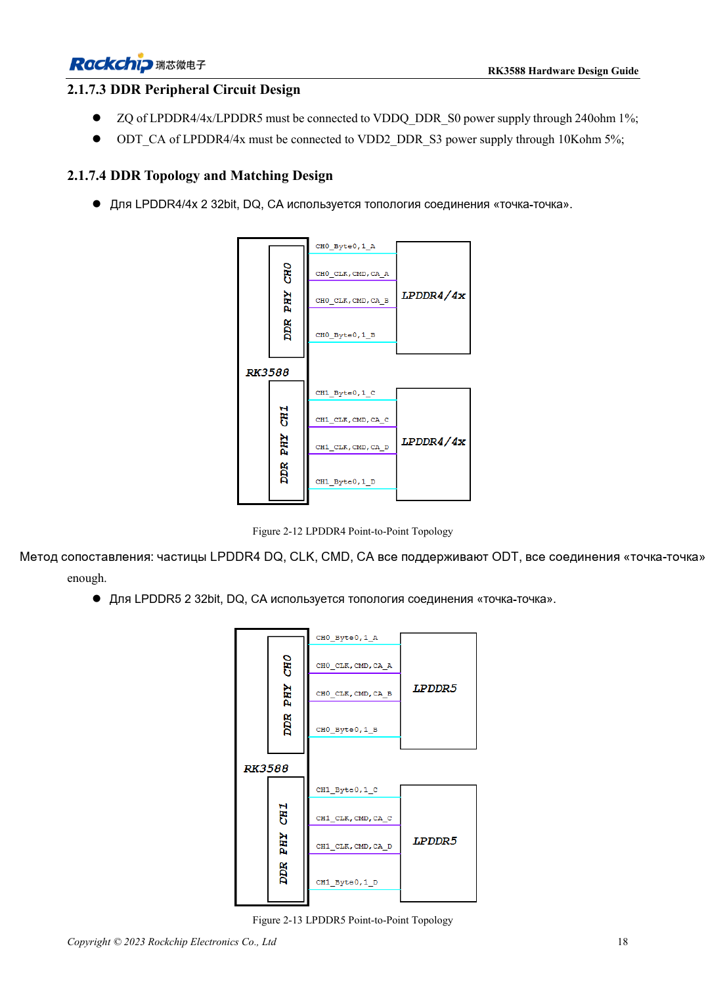
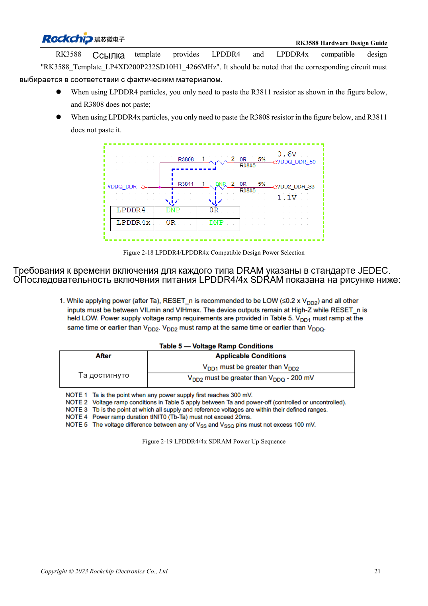

<!-- rk3588-hardware-v13-20261109 -->

# DDR RK3588: LPDDR4/4X/5 и конфигурация памяти

Основа — китайская и английская версии RK3588 Hardware Design Guide V1.3 (2023-02-13), для проверки плат SoC и носителей. Носители AIM7 и LM7 проектируют по интерфейсу модуля; Sige7 служит базой проверки ПО и периферии. Возможности SoC не равны перечню разъёмов платы. Проверяйте SDK/BSP, ядро, ревизию и прошивку. Значения взяты из источника, не из измерений ArmSoM.

**RK3588 Hardware Design Guide V1.3 (2023-02-13), EN** · §2.1.7

## Выбирайте ёмкость и шаблон вместе

V1.3 описывает четыре 16-битных канала, всего 64 бита, до 8GB на канал и 32GB суммарно. 32-битные CH0/CH1 не должны иметь разную ёмкость, например 4GB+2GB. Это область данной версии, не других вариантов или BSP. Деталь памяти, корпус, прошивку и шаблон проверяют вместе.

## Напряжение и сигналы — не переименование

Две 32-битные детали используют DQ/CA точка-точка. В совместимом шаблоне LPDDR4: R3811 установлен, R3808 нет; LPDDR4X — наоборот. Обозначения относятся к эталону, на другой схеме сверяют сети. LPDDR5 требует своего WCK, сигналов и питания. AIM7/LM7 уже содержат DDR, носитель проверяют по входу, интерфейсам и охлаждению.

## Параметры и проверочная таблица

| Параметр | Значение источника |
| --- | --- |
| Шина V1.3 | 4×16bit =64bit |
| Адресация V1.3 | 8GB/канал; 32GB всего |
| CH0 / CH1 | Одинаковая ёмкость |

## Исходные рисунки

Ниже страницы источника со схемами или временными диаграммами; нажмите для полного разрешения. Обозначения и номиналы относятся к эталонной схеме, не к схеме изделия ArmSoM.

Английский оригинал · PDF 40 · 2-12

Английский оригинал · PDF 43 · 2-18

## Разработка с ArmSoM

AIM7 подходит для носителей вычислительного модуля, LM7 — для интеграции LGA, Sige7 — для первичной оценки ПО и периферии. До разработки носителя определите уже встроенные цепи питания, DDR и загрузки. Не дублируйте схемы SoC без необходимости. Разъёмы, выведенные интерфейсы, уровни и поддержку системы сверяйте с документацией изделия.

- [ArmSoM AIM7](https://www.armsom.org/aim7) · [AIM7 Docs](https://docs.armsom.org/armsom-aim7)
- [ArmSoM Sige7](https://www.armsom.org/sige7) · [Sige7 Docs](https://docs.armsom.org/armsom-sige7)
- [ArmSoM LM7](https://www.armsom.org/lm7) · [LM7 Docs](https://docs.armsom.org/armsom-lm7)

## Читайте далее

- [RK3588: 30 тем аппаратного проектирования](/ru/articles/rk3588-hardware-design-series/)
- [RK3588 и RK806: один или два PMIC](/ru/articles/rk3588-rk806-pmic-design/)
- [Трассировка DDR RK3588: длина и задержка](/ru/articles/rk3588-ddr-pcb-routing/)
