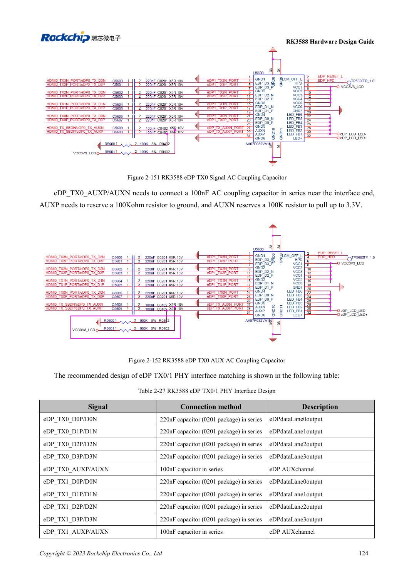
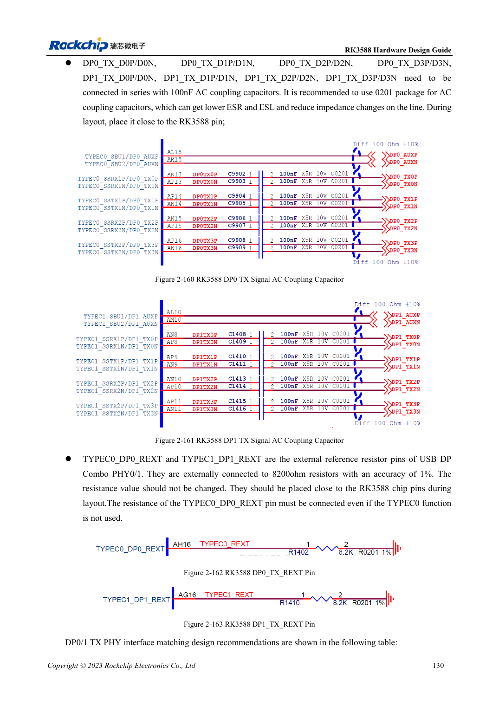

<!-- rk3588-hardware-v13-20261109 -->

# DP и eDP RK3588: PHY, AUX и развязка

Основа — китайская и английская версии RK3588 Hardware Design Guide V1.3 (2023-02-13), для проверки плат SoC и носителей. Носители AIM7 и LM7 проектируют по интерфейсу модуля; Sige7 служит базой проверки ПО и периферии. Возможности SoC не равны перечню разъёмов платы. Проверяйте SDK/BSP, ядро, ревизию и прошивку. Значения взяты из источника, не из измерений ArmSoM.

**RK3588 Hardware Design Guide V1.3 (2023-02-13), EN** · §2.3.8.1; §2.3.8.3; §3.4.4; §3.4.13

## Похожие названия не означают одинаковую схему

DP0/1 делят PHY с USB Type-C, eDP — с HDMI TX. Основной DP использует 100nF, eDP — 220nF, AUX — 100nF. Импеданс, развязка и контакты не взаимозаменяемы. Кабель, разъём, дисплей и BSP входят в канал.

## Для TYPEC0 есть обязательные цепи

Даже без использования TYPEC0 сохраняют три питания TYPEC0_DP0 и REXT 8.2kΩ, 1%. AUX eDP развязывают у интерфейса, сохраняя эталонное смещение. Заголовок источника пишет eDP1.4, текст V1.3; здесь используются явные электрические параметры без добавленных протокольных обещаний.

## Параметры и проверочная таблица

| Параметр | Значение источника |
| --- | --- |
| Импеданс DP / USB-DP | 100Ω / 95Ω; ±10% |
| Импеданс eDP | 90Ω ±10%; согласовать с кабелем |
| Связь основной линии DP / eDP | 100nF / 220nF |
| Связь AUX | 100nF |
| Длина/разница пары | <6in / <6mil |

## Исходные рисунки

Ниже страницы источника со схемами или временными диаграммами; нажмите для полного разрешения. Обозначения и номиналы относятся к эталонной схеме, не к схеме изделия ArmSoM.

Английский оригинал · PDF 146 · 2-151

Английский оригинал · PDF 152 · 2-160

## Разработка с ArmSoM

AIM7 подходит для носителей вычислительного модуля, LM7 — для интеграции LGA, Sige7 — для первичной оценки ПО и периферии. До разработки носителя определите уже встроенные цепи питания, DDR и загрузки. Не дублируйте схемы SoC без необходимости. Разъёмы, выведенные интерфейсы, уровни и поддержку системы сверяйте с документацией изделия.

- [ArmSoM AIM7](https://www.armsom.org/aim7) · [AIM7 Docs](https://docs.armsom.org/armsom-aim7)
- [ArmSoM Sige7](https://www.armsom.org/sige7) · [Sige7 Docs](https://docs.armsom.org/armsom-sige7)
- [ArmSoM LM7](https://www.armsom.org/lm7) · [LM7 Docs](https://docs.armsom.org/armsom-lm7)

## Читайте далее

- [RK3588: 30 тем аппаратного проектирования](/ru/articles/rk3588-hardware-design-series/)
- [Дисплеи MIPI RK3588: D-PHY, C-PHY и панели](/ru/articles/rk3588-mipi-display-hardware/)
- [Аудио RK3588: I2S, PDM и массивы микрофонов](/ru/articles/rk3588-audio-hardware-design/)
