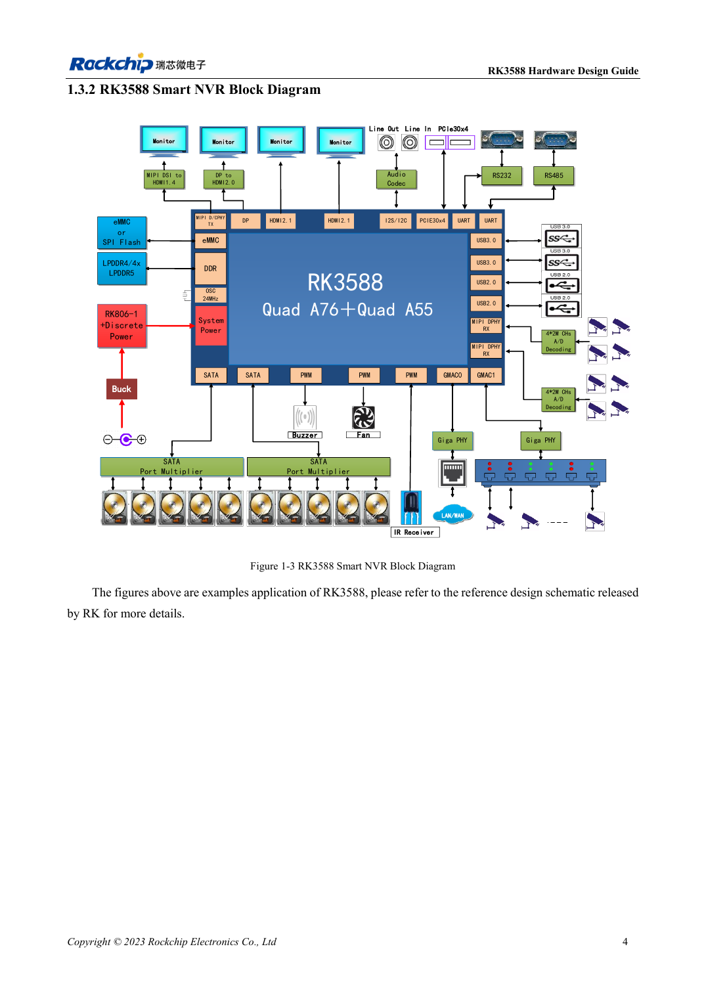

# RK3588 для периферийного ИИ: питание, охлаждение и расширение

## Область применения и источники

Это тематическое инженерное руководство, а не постраничный перевод всего PDF. Примеры источника не являются измерениями ArmSoM. Напряжения, выводы, SDK/BSP и ядро сверяйте с фактической ревизией платы.

**Rockchip:** `RK3588 Hardware Design Guide-CN-V1.3-20230213.pdf` · V1.3 · §2–5

## Сначала определите нагрузку

Устройство выполняет не только модель: захват, предобработка, NPU, дисплей, сеть и накопитель делят ресурсы. Задайте число входов, разрешение, задержку, длительность работы и температуру среды до выбора платы. Примеры ниже — планирование, а не результаты ArmSoM.

В V1.3 глава 2 посвящена схемам, глава 4 — теплу, глава 5 — ESD/EMI. Параметры EVB и тепловое моделирование производителя нельзя выдавать за измерения AIM7, Sige7 или LM7.

## Превратите сценарии в испытания

| Сценарий | Ресурсы | Что наблюдать |
| --- | --- | --- |
| Визуальный контроль | Камера, память, NPU, сеть | Потери кадров, сквозную задержку, переходные процессы питания |
| Мультимедийный терминал | Декодер, дисплей, звук, сенсор | Комбинации экранов, нагрев, длительную стабильность |
| Сбор данных | Сеть, накопитель, внешние IO | Длительную запись, отключение питания и восстановление |

Бюджет включает плату, пусковые пики периферии и потери преобразования. Проверьте падение напряжения в кабеле и разъёмах. Типичная мощность процессора не задаёт блок питания всего изделия; параметры разных топологий нельзя смешивать.

## Охлаждение — часть механики

Определите путь к радиатору, корпусу и воздуху. Проверьте термоинтерфейс, прижим, изоляцию и вентиляцию. Закрытый корпус отличается от стенда. Записывайте температуры, частоту, задержку модели и потери кадров во времени.

Снижение частоты показывает работу защиты. При падении скорости проверяют теплоотвод и питание, а не отключают защиту ради показателя.

## Путь разработки с ArmSoM

Сравните AIM7, Sige7 и LM7 по документированным интерфейсам и конструкции. До фиксации носителя или корпуса проверьте модель, видеотракт и периферию. При миграции с Jetson отдельно анализируют CUDA и развёртывание модели: сходство формы не означает программную совместимость.

Передавайте конфигурацию интерфейсов, версии BSP и модели, перечень кабелей и журналы длительной нагрузки. Заявленные возможности должны относиться к испытанной конфигурации.

## Иллюстрация из источника

Оригинал английского документа, общий для EN/RU/DE. Эталонный проект, а не схема платы ArmSoM.

`RK3588 hardware design guide-EN-V1.3-20230213.pdf` · PDF p. 25.

## Продукты и документация

- **AIM7** — [Страница продукта](https://www.armsom.org/aim7) · [Документация](https://docs.armsom.org/armsom-aim7)
- **Sige7** — [Страница продукта](https://www.armsom.org/sige7) · [Документация](https://docs.armsom.org/armsom-sige7)
- **LM7** — [Страница продукта](https://www.armsom.org/lm7) · [Документация](https://docs.armsom.org/armsom-lm7)

## Другие статьи серии

- [Запуск платы RK3576: минимальная система и проверка первого включения](/ru/articles/rk3576-hardware-bringup/)
- [Плата-носитель ArmSoM CM5: питание, загрузка и планирование интерфейсов](/ru/articles/019-cm5-carrier-production/)
- [Скоростные интерфейсы RK3576: совместная проверка схемы и PCB](/ru/articles/rk3576-high-speed-interface-design/)
- [Аппаратное проектирование RK3588S: от эталонной схемы к носителю CM7s](/ru/articles/rk3588s-cm7s-carrier-design/)
- [Проверка скоростной PCB RK3588: слои, импеданс и трассировка](/ru/articles/rk3588-high-speed-pcb-review/)
- [Аппаратная часть HMI на RK3506: выбор пути с CM1 или Forge1](/ru/articles/rk3506-industrial-hmi-hardware/)
- [Варианты RK3308: аппаратная совместимость для аудиопроектов P2 Pro](/ru/articles/rk3308-hardware-variant-compatibility/)
- [RK3588S и RK3588S2: что проверить перед изменением платы](/ru/articles/rk3588s-rk3588s2-hardware-differences/)
- [От прототипа Rockchip к серии: технологические требования и испытания](/ru/articles/rockchip-hardware-production-checklist/)

<!-- rk3588-hardware-v13-20261109 -->

## Аппаратура edge AI на RK3588: от нагрузки к проверке

Основа — китайская и английская версии RK3588 Hardware Design Guide V1.3 (2023-02-13), для проверки плат SoC и носителей. Носители AIM7 и LM7 проектируют по интерфейсу модуля; Sige7 служит базой проверки ПО и периферии. Возможности SoC не равны перечню разъёмов платы. Проверяйте SDK/BSP, ядро, ревизию и прошивку. Значения взяты из источника, не из измерений ArmSoM.

**RK3588 Hardware Design Guide V1.3 (2023-02-13), EN** · §1.3; §2.2.5.3; §4

## Сначала распределите ресурсы

NVR, машинное зрение и многодисплейные системы совместно используют память, накопители, сеть и питание. Схема NVR — пример SoC, не перечень разъёмов AIM7, Sige7 или LM7. Задайте камеры, форматы, инференс, трафик и запись, затем контроллеры, PHY, контакты и питание. Мультиплексирование PCIe/SATA/USB определяют до носителя.

## Проверяйте по этапам

Проверьте холодный старт, UART и восстановление, затем периферию отдельно и под общей нагрузкой. Таблица 2-12 относится к отдельным нагрузкам модулей при 100°C кристалла, без радиатора, после 15 минут стабильной работы. Сумма не является измеренной мощностью ArmSoM. Фиксируйте минимумы питания, температуру, частоты, потери кадров и ошибки.

## Параметры и проверочная таблица

| Параметр | Значение источника |
| --- | --- |
| Условия испытания источника | 100°C; 15 min; без радиатора |
| Пример CPU BIG0/BIG1 | 0.980V; 4.00A каждый |
| Пример GPU | 0.850V; 6.50A |

## Исходные рисунки

Ниже страницы источника со схемами или временными диаграммами; нажмите для полного разрешения. Обозначения и номиналы относятся к эталонной схеме, не к схеме изделия ArmSoM.

Английский оригинал · PDF 26 · 1-3

## Разработка с ArmSoM

AIM7 подходит для носителей вычислительного модуля, LM7 — для интеграции LGA, Sige7 — для первичной оценки ПО и периферии. До разработки носителя определите уже встроенные цепи питания, DDR и загрузки. Не дублируйте схемы SoC без необходимости. Разъёмы, выведенные интерфейсы, уровни и поддержку системы сверяйте с документацией изделия.

- [ArmSoM AIM7](https://www.armsom.org/aim7) · [AIM7 Docs](https://docs.armsom.org/armsom-aim7)
- [ArmSoM Sige7](https://www.armsom.org/sige7) · [Sige7 Docs](https://docs.armsom.org/armsom-sige7)
- [ArmSoM LM7](https://www.armsom.org/lm7) · [LM7 Docs](https://docs.armsom.org/armsom-lm7)

## Читайте далее

- [RK3588: 30 тем аппаратного проектирования](/ru/articles/rk3588-hardware-design-series/)
- [Тактовые цепи RK3588: 24MHz, 32kHz и размещение](/ru/articles/rk3588-clock-hardware-design/)
