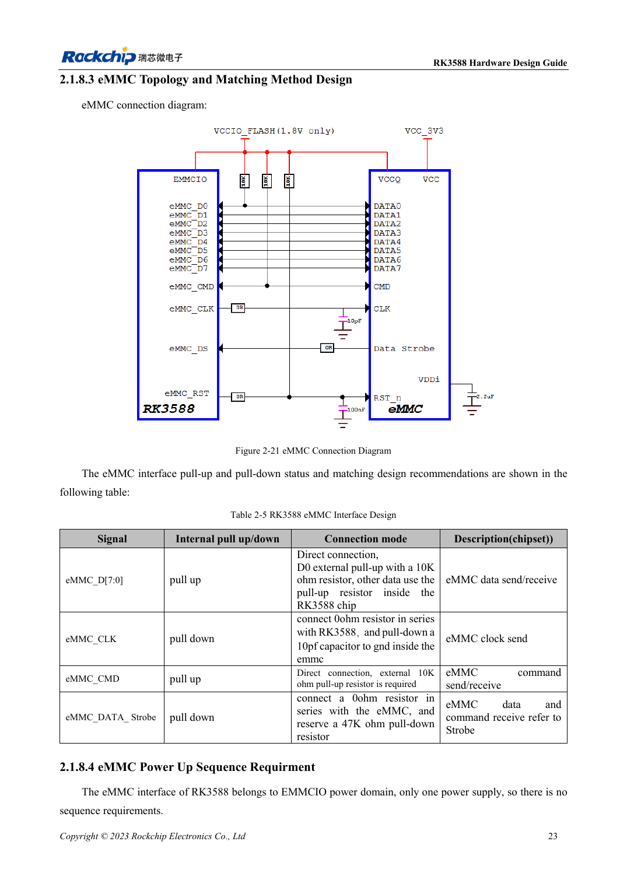
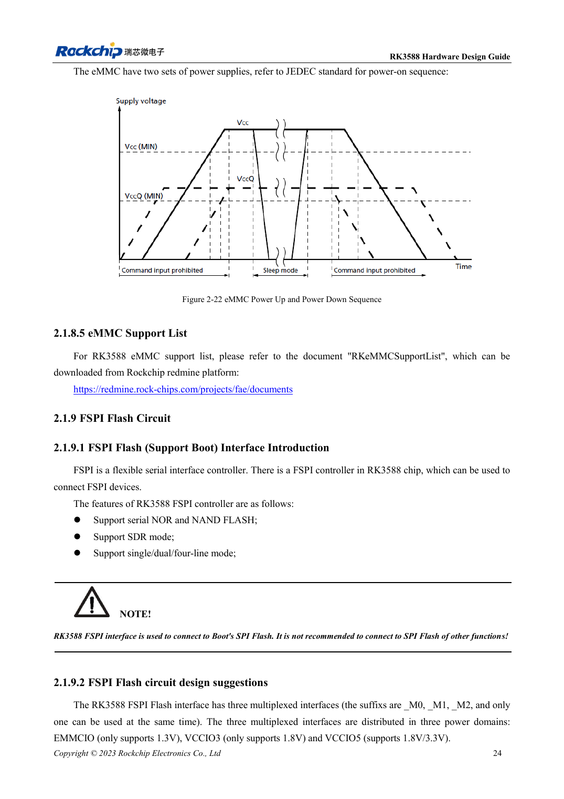

<!-- rk3588-hardware-v13-20261109 -->

# eMMC RK3588: такт, подтяжки и Strobe

Основа — китайская и английская версии RK3588 Hardware Design Guide V1.3 (2023-02-13), для проверки плат SoC и носителей. Носители AIM7 и LM7 проектируют по интерфейсу модуля; Sige7 служит базой проверки ПО и периферии. Возможности SoC не равны перечню разъёмов платы. Проверяйте SDK/BSP, ядро, ревизию и прошивку. Значения взяты из источника, не из измерений ArmSoM.

**RK3588 Hardware Design Guide V1.3 (2023-02-13), EN** · §2.1.8; §3.4.14

## Используйте CLK из V1.3

Таблица 2-5: 0Ω в CLK у RK3588, 10pF на землю у eMMC. D0/CMD имеют внешние 10kΩ вверх, остальные данные — внутренние подтяжки. Strobe: 0Ω у памяти и место для 47kΩ вниз. Сигналы не подключают по одному шаблону; расположение компонентов важно.

## Проверьте питание и режим

EMMCIO и два питания памяти — разные уровни; последовательность сверяют по конкретной детали. Проверяют список поддержки, Loader/BSP, целевой режим, холодный запуск, длительные передачи и восстановление после выключения. eMMC AIM7/LM7 находится на модуле; замену или внешний доступ уточняют по модулю, не по схеме SoC.

## Параметры и проверочная таблица

| Параметр | Значение источника |
| --- | --- |
| CLK | 0Ω у SoC; 10pF у eMMC |
| D0 / CMD | 10kΩ подтяжка вверх |
| Строб | 0Ω у eMMC; резерв 47kΩ подтяжка вниз |
| PCB: импеданс/длина | 50Ω ±10% / <3.5in |
| Разница такт/данные | <120mil |

## Исходные рисунки

Ниже страницы источника со схемами или временными диаграммами; нажмите для полного разрешения. Обозначения и номиналы относятся к эталонной схеме, не к схеме изделия ArmSoM.

Английский оригинал · PDF 45 · 2-21

Английский оригинал · PDF 46 · 2-22

## Разработка с ArmSoM

AIM7 подходит для носителей вычислительного модуля, LM7 — для интеграции LGA, Sige7 — для первичной оценки ПО и периферии. До разработки носителя определите уже встроенные цепи питания, DDR и загрузки. Не дублируйте схемы SoC без необходимости. Разъёмы, выведенные интерфейсы, уровни и поддержку системы сверяйте с документацией изделия.

- [ArmSoM AIM7](https://www.armsom.org/aim7) · [AIM7 Docs](https://docs.armsom.org/armsom-aim7)
- [ArmSoM Sige7](https://www.armsom.org/sige7) · [Sige7 Docs](https://docs.armsom.org/armsom-sige7)
- [ArmSoM LM7](https://www.armsom.org/lm7) · [LM7 Docs](https://docs.armsom.org/armsom-lm7)

## Читайте далее

- [RK3588: 30 тем аппаратного проектирования](/ru/articles/rk3588-hardware-design-series/)
- [Трассировка DDR RK3588: длина и задержка](/ru/articles/rk3588-ddr-pcb-routing/)
- [FSPI Flash RK3588: загрузка, питание и согласование](/ru/articles/rk3588-fspi-boot-hardware/)
