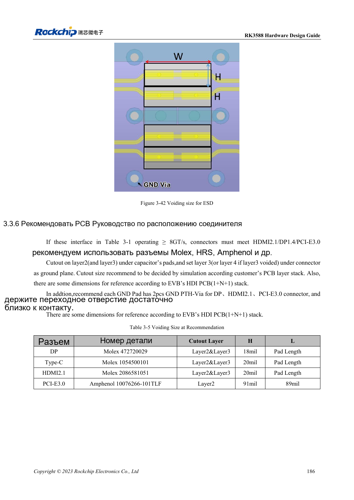

<!-- rk3588-hardware-v13-20261109 -->

# ESD и EMI RK3588: защита интерфейсов и возврат тока

Основа — китайская и английская версии RK3588 Hardware Design Guide V1.3 (2023-02-13), для проверки плат SoC и носителей. Носители AIM7 и LM7 проектируют по интерфейсу модуля; Sige7 служит базой проверки ПО и периферии. Возможности SoC не равны перечню разъёмов платы. Проверяйте SDK/BSP, ядро, ревизию и прошивку. Значения взяты из источника, не из измерений ArmSoM.

**RK3588 Hardware Design Guide V1.3 (2023-02-13), EN** · §5; §3.3.5

## Защита у места входа тока

TVS ставят у разъёма или точки разряда с коротким низкоимпедансным возвратом. Сброс, такт и прерывания удаляют от края минимум на рекомендованные 5mm. Ёмкость и площадки ESD входят в анализ сигнала; большие номиналы не всегда лучше.

## EMI ищут от источника и связи

Сначала проверяют разрывы возврата, длинные ответвления, общий режим и импульсное питание, затем фильтры и экраны. Радиатор может излучать: предусмотрите заземление и испытания. Общие рекомендации резисторов не отменяют USB/HDMI/PCIe. Проверяйте реальный корпус, кабели и условия сертификации; рекомендации не означают сертификат.

## Параметры и проверочная таблица

| Параметр | Значение источника |
| --- | --- |
| Отступ чувствительных сетей | ≥5mm |
| От такта до резистора | ≤400mil |
| Край слоя питания | 20H; H=диэлектрик питание/земля |
| Высокоскоростная ESD | Предел ёмкости по интерфейсу |

## Исходные рисунки

Ниже страницы источника со схемами или временными диаграммами; нажмите для полного разрешения. Обозначения и номиналы относятся к эталонной схеме, не к схеме изделия ArmSoM.

Английский оригинал · PDF 208 · 3-42

## Разработка с ArmSoM

AIM7 подходит для носителей вычислительного модуля, LM7 — для интеграции LGA, Sige7 — для первичной оценки ПО и периферии. До разработки носителя определите уже встроенные цепи питания, DDR и загрузки. Не дублируйте схемы SoC без необходимости. Разъёмы, выведенные интерфейсы, уровни и поддержку системы сверяйте с документацией изделия.

- [ArmSoM AIM7](https://www.armsom.org/aim7) · [AIM7 Docs](https://docs.armsom.org/armsom-aim7)
- [ArmSoM Sige7](https://www.armsom.org/sige7) · [Sige7 Docs](https://docs.armsom.org/armsom-sige7)
- [ArmSoM LM7](https://www.armsom.org/lm7) · [LM7 Docs](https://docs.armsom.org/armsom-lm7)

## Читайте далее

- [RK3588: 30 тем аппаратного проектирования](/ru/articles/rk3588-hardware-design-series/)
- [Тепловой расчёт RK3588: эталон и проверка системы](/ru/articles/rk3588-thermal-hardware-design/)
- [Монтаж и хранение RK3588: оплавление, MSL3 и сушка](/ru/articles/rk3588-assembly-storage-design/)
