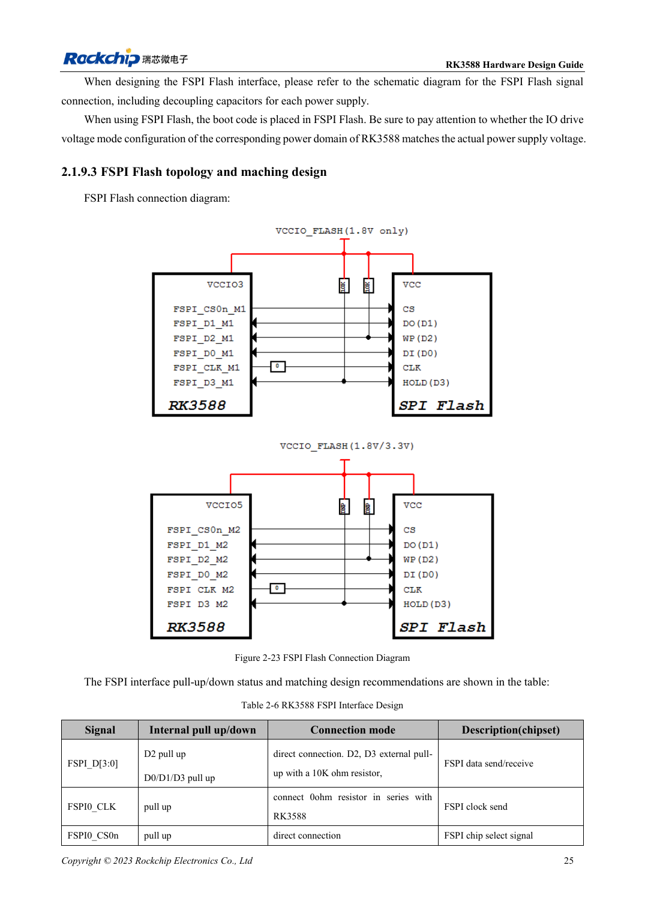

<!-- rk3588-hardware-v13-20261109 -->

# FSPI Flash RK3588: загрузка, питание и согласование

Основа — китайская и английская версии RK3588 Hardware Design Guide V1.3 (2023-02-13), для проверки плат SoC и носителей. Носители AIM7 и LM7 проектируют по интерфейсу модуля; Sige7 служит базой проверки ПО и периферии. Возможности SoC не равны перечню разъёмов платы. Проверяйте SDK/BSP, ядро, ревизию и прошивку. Значения взяты из источника, не из измерений ArmSoM.

**RK3588 Hardware Design Guide V1.3 (2023-02-13), EN** · §2.1.9; §2.1.4; §3.4.17

## Определите загрузку и домен

FSPI хранит ранний код, в том числе инициализацию PCIe перед загрузкой SSD. Группа мультиплексирования определяет IO-домен; Flash питается от той же цепи. Совпадение корпуса не гарантирует замену: проверяют деталь, ёмкость, загрузчик и запись.

## Сохраните проверку и восстановление

Таблица 2-6 резервирует 10kΩ на D2/D3, 0Ω в CLK у SoC и прямой CS. Проверяют положение, длину и включение, затем повторяют холодный старт и сравнение полного чтения. В серии сохраняют USB-восстановление для повреждённой Flash.

## Параметры и проверочная таблица

| Параметр | Значение источника |
| --- | --- |
| D2 / D3 | Резерв 10kΩ подтяжка вверх |
| CLK | 0Ω у SoC |
| Питание | Та же шина, что у выбранного FSPI IO |
| PCB: импеданс/длина | 50Ω ±10% / <4in |
| Разница такт/данные | <200mil |

## Исходные рисунки

Ниже страницы источника со схемами или временными диаграммами; нажмите для полного разрешения. Обозначения и номиналы относятся к эталонной схеме, не к схеме изделия ArmSoM.

Английский оригинал · PDF 47 · 2-23

## Разработка с ArmSoM

AIM7 подходит для носителей вычислительного модуля, LM7 — для интеграции LGA, Sige7 — для первичной оценки ПО и периферии. До разработки носителя определите уже встроенные цепи питания, DDR и загрузки. Не дублируйте схемы SoC без необходимости. Разъёмы, выведенные интерфейсы, уровни и поддержку системы сверяйте с документацией изделия.

- [ArmSoM AIM7](https://www.armsom.org/aim7) · [AIM7 Docs](https://docs.armsom.org/armsom-aim7)
- [ArmSoM Sige7](https://www.armsom.org/sige7) · [Sige7 Docs](https://docs.armsom.org/armsom-sige7)
- [ArmSoM LM7](https://www.armsom.org/lm7) · [LM7 Docs](https://docs.armsom.org/armsom-lm7)

## Читайте далее

- [RK3588: 30 тем аппаратного проектирования](/ru/articles/rk3588-hardware-design-series/)
- [eMMC RK3588: такт, подтяжки и Strobe](/ru/articles/rk3588-emmc-hardware-design/)
- [SDMMC и SDIO Wi-Fi RK3588: уровни и защита](/ru/articles/rk3588-sdmmc-sdio-wifi-design/)
