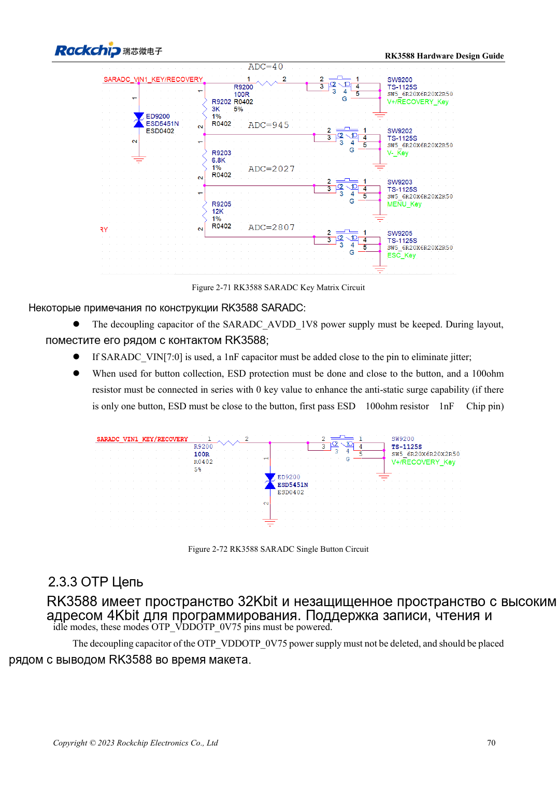

<!-- rk3588-hardware-v13-20261109 -->

# GPIO и SARADC RK3588: домены и кнопки

Основа — китайская и английская версии RK3588 Hardware Design Guide V1.3 (2023-02-13), для проверки плат SoC и носителей. Носители AIM7 и LM7 проектируют по интерфейсу модуля; Sige7 служит базой проверки ПО и периферии. Возможности SoC не равны перечню разъёмов платы. Проверяйте SDK/BSP, ядро, ревизию и прошивку. Значения взяты из источника, не из измерений ArmSoM.

**RK3588 Hardware Design Guide V1.3 (2023-02-13), EN** · §2.1.10; §2.3.2; §2.3.16

## Сначала проверьте домены

PMUIO1, EMMCIO, VCCIO1 и VCCIO3 фиксированы на 1.8V; PMUIO2, VCCIO2, VCCIO4/5/6 выбирают 1.8V или 3.3V. Фиксированные вспомогательные выводы и выбираемые не смешивают S0/S3. Автоопределение напряжения не разрешает 5V.

## Не все ADC свободны

SARADC: 12 бит, 1MS/s, 0–1.8V, восемь входов; IN0_BOOT выделен, IN1 сохраняет recovery и 10kΩ вверх. На используемых входах 1nF у SoC, ESD перед резистором кнопки. Соотношение ±35 кодов/123mV неясно рядом с 12 битами; пороги определяют по реальному масштабу драйвера и напряжению.

## Параметры и проверочная таблица

| Параметр | Значение источника |
| --- | --- |
| SARADC | 12bit; 1MS/s; 0–1.8V |
| Зарезервированные входы | IN0_BOOT; IN1 восстановление |
| Входной фильтр | 1nF |
| Подтяжка восстановления | 10kΩ |

## Исходные рисунки

Ниже страницы источника со схемами или временными диаграммами; нажмите для полного разрешения. Обозначения и номиналы относятся к эталонной схеме, не к схеме изделия ArmSoM.

Английский оригинал · PDF 92 · 2-71

## Разработка с ArmSoM

AIM7 подходит для носителей вычислительного модуля, LM7 — для интеграции LGA, Sige7 — для первичной оценки ПО и периферии. До разработки носителя определите уже встроенные цепи питания, DDR и загрузки. Не дублируйте схемы SoC без необходимости. Разъёмы, выведенные интерфейсы, уровни и поддержку системы сверяйте с документацией изделия.

- [ArmSoM AIM7](https://www.armsom.org/aim7) · [AIM7 Docs](https://docs.armsom.org/armsom-aim7)
- [ArmSoM Sige7](https://www.armsom.org/sige7) · [Sige7 Docs](https://docs.armsom.org/armsom-sige7)
- [ArmSoM LM7](https://www.armsom.org/lm7) · [LM7 Docs](https://docs.armsom.org/armsom-lm7)

## Читайте далее

- [RK3588: 30 тем аппаратного проектирования](/ru/articles/rk3588-hardware-design-series/)
- [Ethernet RK3588: GMAC, PHY и направление такта](/ru/articles/rk3588-gmac-hardware-design/)
- [Распределение UART, SPI, CAN, I2C и PWM RK3588](/ru/articles/rk3588-serial-control-hardware/)
