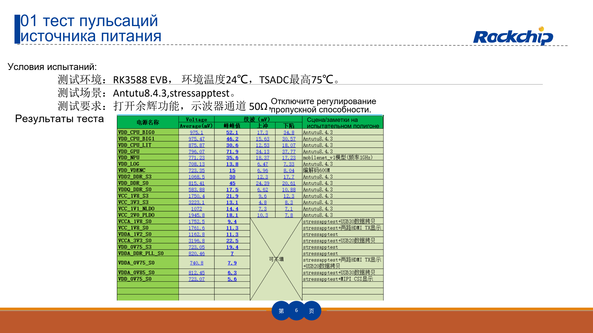
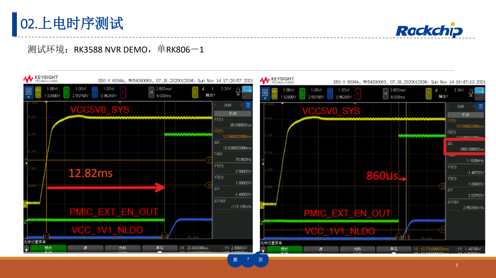
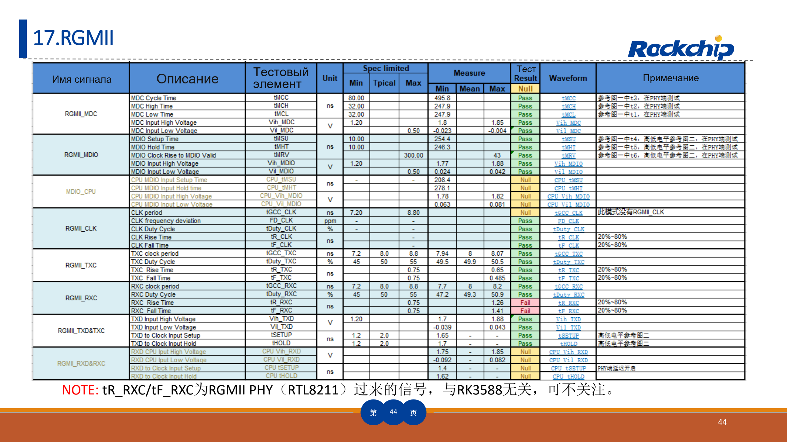

Это тематическое руководство по исходному документу: ключевые параметры, ограничения и оригинальные иллюстрации. Оно не заменяет полный перевод, таблицу выводов или регистров. Примеры производителя не являются измерениями ArmSoM. Перед применением проверьте ревизию платы, схему, SDK/BSP, ядро и драйверы; новых аппаратных испытаний для статьи не проводилось.

**Основной источник：** `RK3588_HW_Test_Report_Summary V1.3_20230215.pdf` · PDF 51 стр..

## Эталонная методика, а не одобрение вашей платы

Отчёт на 51 странице содержит 23 группы испытаний питания, DDR, накопителей, видео, сети и аудио. Он помогает определить измерения, сохранить условия и исследовать пограничные режимы. AIM7, Sige7 и LM7 документированы как продукты RK3588, но разные носители, охлаждение, питание и интерфейсы требуют собственных результатов.

Имя файла — V1.3_20230215, обложка — V1.2_20220829. Таблица изменений добавляет V1.3 и обновление RGMII на стр. 44. Здесь используется фактическое содержимое, расхождение версий сохранено.

## Как организовать 23 группы

| Номера источника | Группы | Сохраняемые условия и данные |
| --- | --- | --- |
| 01–03 | Пульсации, последовательность питания, потребление | Нагрузка, температура, шины питания, точки, пробники, запуск и граница измерения |
| 04–06 | LPDDR4, LPDDR5, eMMC | Компоненты/BOM, инициализация DDR, частота, температура, тайминги и длительный I/O |
| 07–09 | PCIe3.0, PCIe2.0, SATA3.0 | Режим, линии, кабели, глазковая диаграмма/сигнал и длительный трафик |
| 10–12 | HDMI TX, Type-C DP, eDP | Режим вывода, линии, дисплей/нагрузка, разъёмы и оснастка |
| 13–16 | MIPI D/C PHY, MIPI DPHY, USB3.0, USB2.0 | Скорость, направление, режим, нагрузка, кабель и точка измерения |
| 17–20 | RGMII, SDMMC, SPDIF, UART | Напряжение I/O, частота, направление, тайминги и ошибки |
| 21–23 | I2S, PDM, I2C | Такты, частота дискретизации/шины, нагрузка, подтяжки и фронты |

Сначала питание и запуск, затем память, отдельные интерфейсы и совместная нагрузка при температурных границах. Рабочий стол, сетевой линк или однократное видео не покрывают этот план.

*Пульсации питания и условия производителя — Оригинал на китайском; соответствующей английской иллюстрации в этой подборке нет. `RK3588_HW_Test_Report_Summary V1.3_20230215.pdf`, PDF p. 6.*

## Для пульсаций нужна определённая схема измерения

На стр. 6 использованы RK3588 EVB, окружающая температура 24℃, максимум TSADC 75℃ и нагрузки Antutu 8.4.3/stressapptest. Указаны также накопление осциллограммы, 50Ω и отключённое ограничение полосы. Это конкретная конфигурация, а не универсальная схема подключения. До использования входа 50Ω проверьте пробник и связь, чтобы не перегрузить шину питания.

Записывайте длину земли пробника, точку, полосу, размах пульсаций, среднее напряжение и повторы. Простой и импульсная нагрузка дают разные результаты. Скриншот без условий плохо воспроизводим.

*Пример включения RK3588 NVR DEMO — Оригинал на китайском; соответствующей английской иллюстрации в этой подборке нет. `RK3588_HW_Test_Report_Summary V1.3_20230215.pdf`, PDF p. 7.*

## Успешный запуск не доказывает правильность последовательности

Пример стр. 7 относится к RK3588 NVR DEMO с одним RK806-1. Сопоставьте сигналы со своей схемой питания, enable, reset и опорным тактом. Проверьте холодный старт, быстрый перезапуск, просадку и медленное отключение. Задержки примера не являются стандартными таймингами AIM7, Sige7 или LM7.

Сводка потребления на стр. 12 отдельно ссылается на `RK3588 Power Consumption Test Report V1.1_20220829_CN`. По одной сводке здесь не выбирается номинал блока питания. Пусковой ток периферии, потери преобразования и охлаждение тоже входят в расчёт.

## Раздельно принимать функцию, сигнал и стабильность

Обнаружение устройства подтверждает лишь часть работоспособности. Для PCIe/SATA/USB нужны согласованная скорость, снижение режима, ошибки и throughput после прогрева. Для дисплеев — формат пикселя, частота, джиттер и приёмник. Результат DDR относится к конкретной памяти, разводке и инициализации.

Испытанные LPDDR4/LPDDR5 и режимы не означают одинаковые компоненты всех ArmSoM. Замена памяти, носителя, разъёма или кабеля требует пересмотра затронутых испытаний; старый снимок не подтверждает новое железо.

*Исходная таблица RGMII и примечание — Оригинал на китайском; соответствующей английской иллюстрации в этой подборке нет. `RK3588_HW_Test_Report_Summary V1.3_20230215.pdf`, PDF p. 44.*

## RGMII показывает границу ответственности

Стр. 44 относит `tR_RXC/tF_RXC` к внешнему PHY RTL8211. Это объясняет источник сигнала, но не позволяет игнорировать приходящий на SoC такт при проверке системы. Определите передатчик, приёмник, настройки задержки и точку пробника до вывода о нарушении тайминга.

## Минимальный комплект доказательств

Сохраняйте ревизию платы/носителя, BOM, образ/ядро, температуру, приборы/калибровку, подключение, нагрузку, критерий, исходные данные и повторную проверку. Отделяйте заводской ориентир, цель проекта и измерение своей платы. Для отказов нужны шаги воспроизведения.

На Sige7 удобно начать проверку приложения и периферии. Для AIM7/LM7 включите носитель, соединения и охлаждение в тот же протокол. Форм-фактор и интерфейсы определяют выбор продукта, а не одно наличие заводского отчёта.

## Продукты и документация

- **AIM7** — [Продукт](https://www.armsom.org/aim7) · [Документация](https://docs.armsom.org/armsom-aim7)
- **Sige7** — [Продукт](https://www.armsom.org/sige7) · [Документация](https://docs.armsom.org/armsom-sige7)
- **LM7** — [Продукт](https://www.armsom.org/lm7) · [Документация](https://docs.armsom.org/armsom-lm7)

## Читайте также

- [Эталонная NVR-система RK3588](/ru/articles/rk3588-nvr-reference-design/)
- [Производство и контроль](/ru/articles/rockchip-hardware-production-checklist/)
