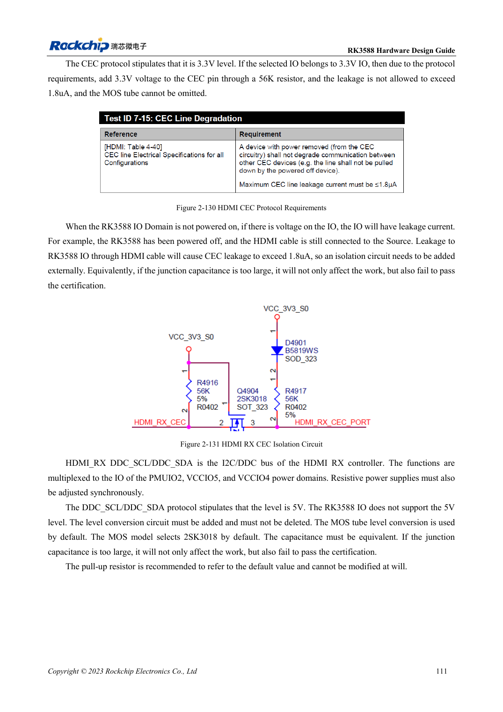

<!-- rk3588-hardware-v13-20261109 -->

# HDMI RX RK3588: вход захвата, CEC и DDC

Основа — китайская и английская версии RK3588 Hardware Design Guide V1.3 (2023-02-13), для проверки плат SoC и носителей. Носители AIM7 и LM7 проектируют по интерфейсу модуля; Sige7 служит базой проверки ПО и периферии. Возможности SoC не равны перечню разъёмов платы. Проверяйте SDK/BSP, ядро, ревизию и прошивку. Значения взяты из источника, не из измерений ArmSoM.

**RK3588 Hardware Design Guide V1.3 (2023-02-13), EN** · §2.3.7.4; §3.4.7

## RX — не TX наоборот

Таблица 2-24 задаёт 2.2Ω в данных/такте RX и 200Ω, 1% от REXT к земле. HPD передаётся от приёмника источнику через эталонную MOS-схему. Не копируйте TX-конденсаторы и смещение в RX. Сначала направления, опорный резистор и питание.

## Проверьте утечки при выключении

DDC HDMI использует 5V, IO RK3588 не допускает 5V: преобразование обязательно. CEC требует изоляции; в RX эталон 56kΩ, а не TX 27kΩ. Проверяют утечки при включённом источнике и выключенном приёмнике, HPD, EDID, формат захвата и кабель.

## Параметры и проверочная таблица

| Параметр | Значение источника |
| --- | --- |
| Резистор RX / REXT | 2.2Ω / 200Ω ±1% |
| Эталон RX CEC | 56kΩ |
| Дифференциальный импеданс/длина | 100Ω ±10% / <6in |
| Разница такт/данные | <480mil |

## Исходные рисунки

Ниже страницы источника со схемами или временными диаграммами; нажмите для полного разрешения. Обозначения и номиналы относятся к эталонной схеме, не к схеме изделия ArmSoM.

Английский оригинал · PDF 133 · 2-131

## Разработка с ArmSoM

AIM7 подходит для носителей вычислительного модуля, LM7 — для интеграции LGA, Sige7 — для первичной оценки ПО и периферии. До разработки носителя определите уже встроенные цепи питания, DDR и загрузки. Не дублируйте схемы SoC без необходимости. Разъёмы, выведенные интерфейсы, уровни и поддержку системы сверяйте с документацией изделия.

- [ArmSoM AIM7](https://www.armsom.org/aim7) · [AIM7 Docs](https://docs.armsom.org/armsom-aim7)
- [ArmSoM Sige7](https://www.armsom.org/sige7) · [Sige7 Docs](https://docs.armsom.org/armsom-sige7)
- [ArmSoM LM7](https://www.armsom.org/lm7) · [LM7 Docs](https://docs.armsom.org/armsom-lm7)

## Читайте далее

- [RK3588: 30 тем аппаратного проектирования](/ru/articles/rk3588-hardware-design-series/)
- [Камеры RK3588: CSI, D/C PHY и CIF](/ru/articles/rk3588-camera-hardware-design/)
- [HDMI TX RK3588: FRL, TMDS и совместимость](/ru/articles/rk3588-hdmi-tx-hardware-design/)
