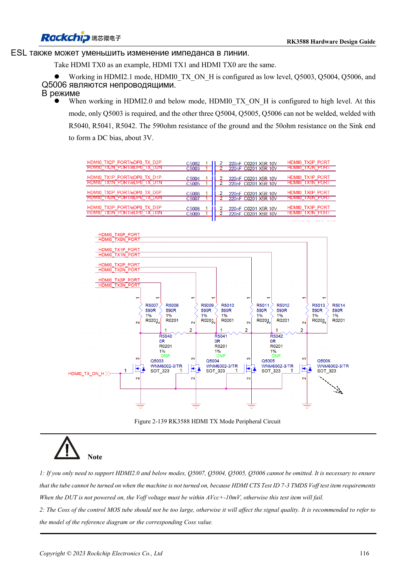
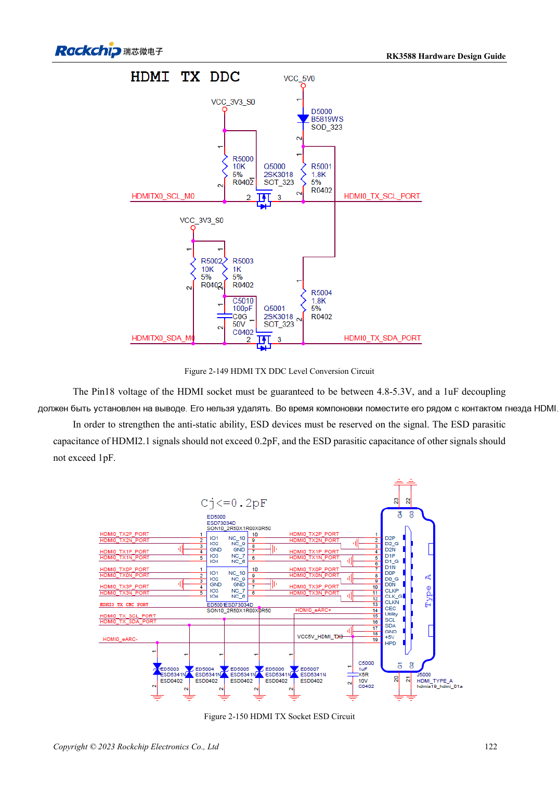

<!-- rk3588-hardware-v13-20261109 -->

# HDMI TX RK3588: FRL, TMDS и совместимость

Основа — китайская и английская версии RK3588 Hardware Design Guide V1.3 (2023-02-13), для проверки плат SoC и носителей. Носители AIM7 и LM7 проектируют по интерфейсу модуля; Sige7 служит базой проверки ПО и периферии. Возможности SoC не равны перечню разъёмов платы. Проверяйте SDK/BSP, ядро, ревизию и прошивку. Значения взяты из источника, не из измерений ArmSoM.

**RK3588 Hardware Design Guide V1.3 (2023-02-13), EN** · §2.3.8.1; §3.4.8

## FRL и TMDS требуют разных состояний

HDMI2.1 использует FRL, совместимость с HDMI2.0 и ниже — TMDS. Эталон включает 220nF и переключаемое смещение, для TMDS — 590Ω совместно с приёмником. Важны выключенное состояние MOS и паразитная ёмкость. Появление картинки не позволяет удалять управление. Общий PHY HDMI/eDP ограничивает одновременность.

## Проверьте управление и высокую скорость

REXT — 8.2kΩ, 1%. DDC требует преобразования 5V, CEC TX — эталон 27kΩ и изоляцию выключенного IO. Pin18 разъёма: 4.8–5.3V. ESD HDMI2.1 ≤0.2pF. Проверяют hot-plug, выключенное подключение, дисплеи и кабели. Историческая отметка отсутствия поддержки относится к версии источника, не ко всем BSP.

## Параметры и проверочная таблица

| Параметр | Значение источника |
| --- | --- |
| Связь/смещение TX | 220nF / 590Ω |
| REXT | 8.2kΩ ±1% |
| PCB: импеданс/длина | 100Ω ±10% / <4in |
| Переходы/зазор | Лучше без via / ≥7× ширина трассы |

## Исходные рисунки

Ниже страницы источника со схемами или временными диаграммами; нажмите для полного разрешения. Обозначения и номиналы относятся к эталонной схеме, не к схеме изделия ArmSoM.

Английский оригинал · PDF 138 · 2-139

Английский оригинал · PDF 144 · 2-150

## Разработка с ArmSoM

AIM7 подходит для носителей вычислительного модуля, LM7 — для интеграции LGA, Sige7 — для первичной оценки ПО и периферии. До разработки носителя определите уже встроенные цепи питания, DDR и загрузки. Не дублируйте схемы SoC без необходимости. Разъёмы, выведенные интерфейсы, уровни и поддержку системы сверяйте с документацией изделия.

- [ArmSoM AIM7](https://www.armsom.org/aim7) · [AIM7 Docs](https://docs.armsom.org/armsom-aim7)
- [ArmSoM Sige7](https://www.armsom.org/sige7) · [Sige7 Docs](https://docs.armsom.org/armsom-sige7)
- [ArmSoM LM7](https://www.armsom.org/lm7) · [LM7 Docs](https://docs.armsom.org/armsom-lm7)

## Читайте далее

- [RK3588: 30 тем аппаратного проектирования](/ru/articles/rk3588-hardware-design-series/)
- [HDMI RX RK3588: вход захвата, CEC и DDC](/ru/articles/rk3588-hdmi-rx-hardware-design/)
- [Дисплеи MIPI RK3588: D-PHY, C-PHY и панели](/ru/articles/rk3588-mipi-display-hardware/)
