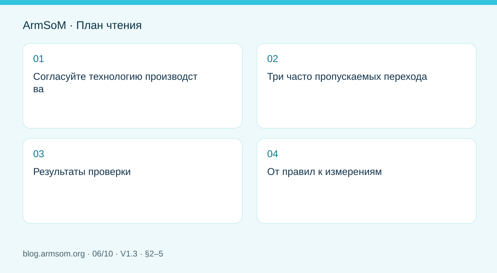
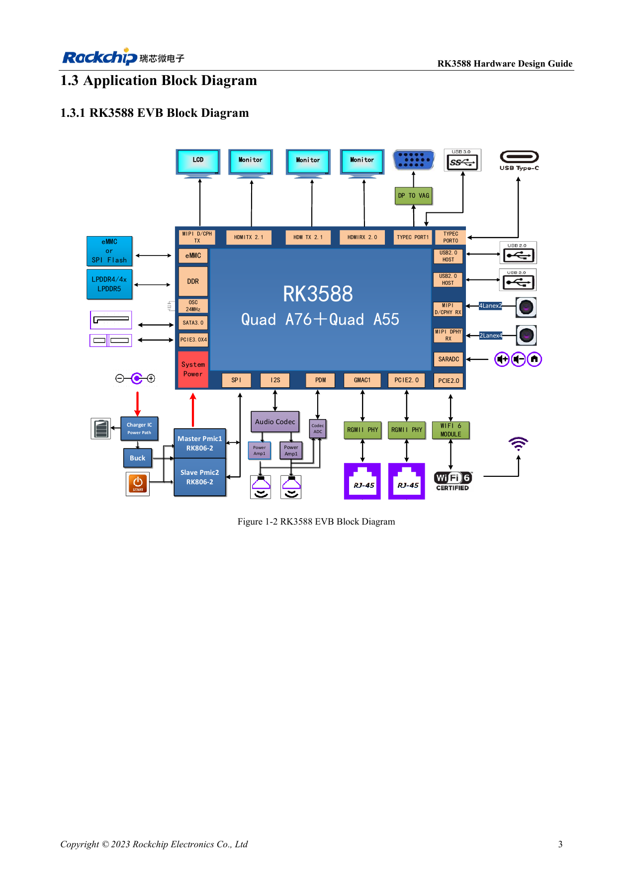

# Проверка скоростной PCB RK3588: слои, импеданс и трассировка

## Область применения и источники

Это тематическое инженерное руководство, а не постраничный перевод всего PDF. Примеры источника не являются измерениями ArmSoM. Напряжения, выводы, SDK/BSP и ядро сверяйте с фактической ревизией платы.

**Rockchip:** `RK3588 Hardware Design Guide-CN-V1.3-20230213.pdf` · V1.3 · §2–5

## Согласуйте технологию производства

Стек — не только число слоёв. Толщина диэлектрика, материал, медь и допуски определяют импеданс и потери. Согласуйте интерфейсы, опорные слои и геометрию с изготовителем, затем внесите их в ограничения. Копирование ширины дорожки эталонной платы не воспроизводит её импеданс.

§3.1 описывает слои и вывод трасс из BGA, §3.2 — общие правила, §3.3 — сигналы от 8GT/s, §3.4 — конкретные интерфейсы. Численные нормы берут из соответствующего раздела.

## Три часто пропускаемых перехода

1. **Площадки BGA и разъёмов:** локальная ёмкость меняет импеданс; обработку опорного слоя выбирают для реальных площадок и стека.
2. **Переходы между слоями:** проверяют остаточные ответвления и путь обратного тока, а не только сигнальное отверстие.
3. **Конденсаторы и защита:** важны и функция, и неоднородность площадок. Добавление ESD не гарантирует сохранение запаса канала.

В руководстве рассмотрено влияние стеклоткани. Оно зависит от материала и геометрии; одна компенсация длины на конце не доказывает решение проблемы.

## Результаты проверки

| Проверка | Документируемый результат |
| --- | --- |
| Непрерывность опоры | Просмотр критических трасс по всей длине |
| Импеданс и длина | Данные изготовителя, ограничения режима, запас |
| Переходы и разъёмы | Число, положение, артикулы и модели |
| Питание и возврат | Развязка, земля и экраны |
| Измерения | Доступ без существенного нарушения канала |

Не добавляйте длинные непроверенные ответвления к контрольным точкам. Не создавайте лишнюю связь и меандры только ради равной длины.

## От правил к измерениям

DRC проверяет записанные правила, но не доказывает запас канала. Нужны проверка целостности сигнала, обнаружения или обучения канала, целевой скорости и длительной передачи с реальными кабелями и корпусом. При отказе высокой скорости отдельно исследуют канал, питание и ПО.

Носитель — только часть канала модуля ArmSoM. Успех приложения на Sige7 также не сертифицирует другую PCB.

## Иллюстрация из источника

Оригинал английского документа, общий для EN/RU/DE. Эталонный проект, а не схема платы ArmSoM.

`RK3588 hardware design guide-EN-V1.3-20230213.pdf` · PDF p. 25.

## Продукты и документация

- **AIM7** — [Страница продукта](https://www.armsom.org/aim7) · [Документация](https://docs.armsom.org/armsom-aim7)
- **Sige7** — [Страница продукта](https://www.armsom.org/sige7) · [Документация](https://docs.armsom.org/armsom-sige7)
- **LM7** — [Страница продукта](https://www.armsom.org/lm7) · [Документация](https://docs.armsom.org/armsom-lm7)

## Другие статьи серии

- [Запуск платы RK3576: минимальная система и проверка первого включения](/ru/articles/rk3576-hardware-bringup/)
- [Плата-носитель ArmSoM CM5: питание, загрузка и планирование интерфейсов](/ru/articles/019-cm5-carrier-production/)
- [Скоростные интерфейсы RK3576: совместная проверка схемы и PCB](/ru/articles/rk3576-high-speed-interface-design/)
- [Аппаратное проектирование RK3588S: от эталонной схемы к носителю CM7s](/ru/articles/rk3588s-cm7s-carrier-design/)
- [RK3588 для периферийного ИИ: питание, охлаждение и расширение](/ru/articles/rk3588-edge-ai-hardware-design/)
- [Аппаратная часть HMI на RK3506: выбор пути с CM1 или Forge1](/ru/articles/rk3506-industrial-hmi-hardware/)
- [Варианты RK3308: аппаратная совместимость для аудиопроектов P2 Pro](/ru/articles/rk3308-hardware-variant-compatibility/)
- [RK3588S и RK3588S2: что проверить перед изменением платы](/ru/articles/rk3588s-rk3588s2-hardware-differences/)
- [От прототипа Rockchip к серии: технологические требования и испытания](/ru/articles/rockchip-hardware-production-checklist/)
