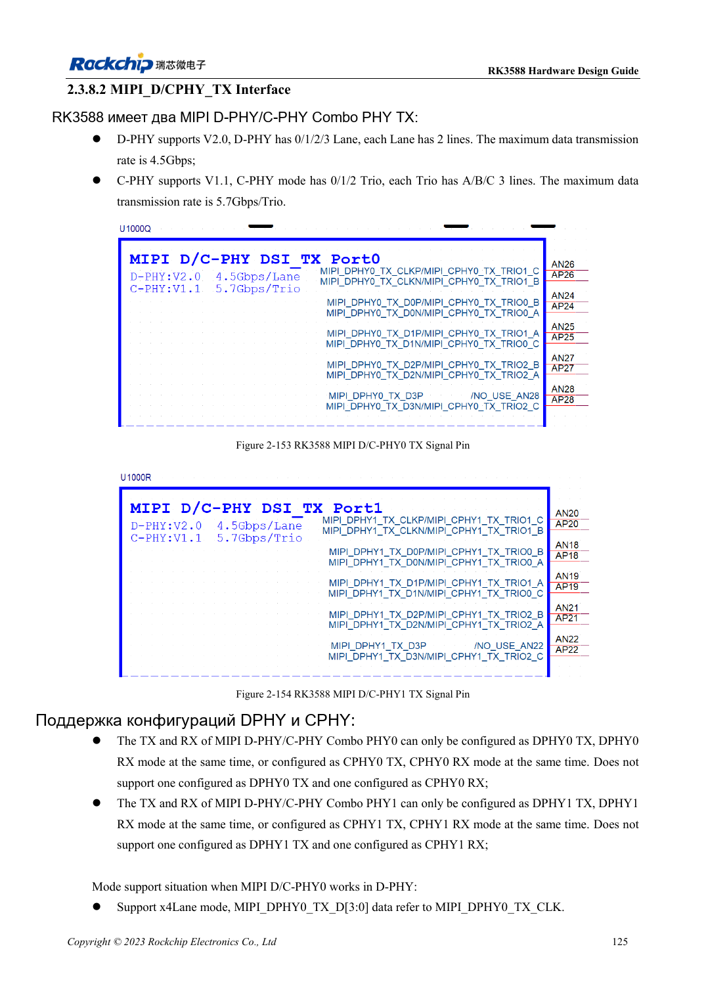
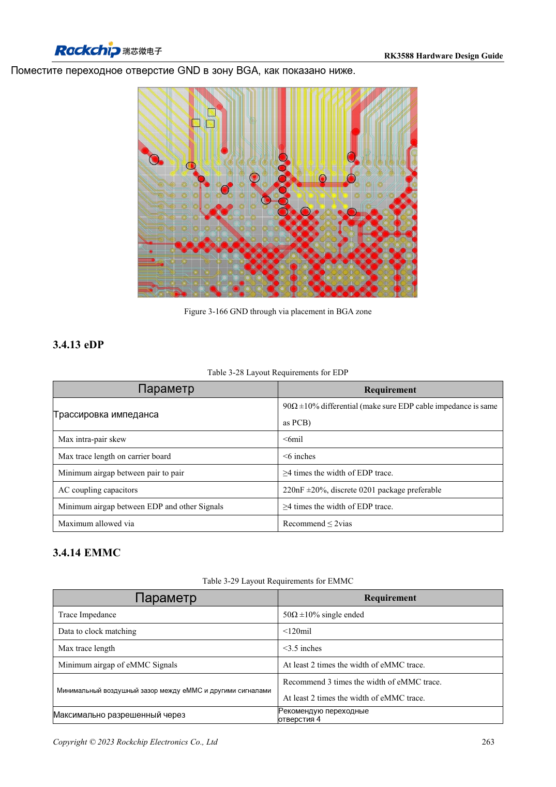

<!-- rk3588-hardware-v13-20261109 -->

# Дисплеи MIPI RK3588: D-PHY, C-PHY и панели

Основа — китайская и английская версии RK3588 Hardware Design Guide V1.3 (2023-02-13), для проверки плат SoC и носителей. Носители AIM7 и LM7 проектируют по интерфейсу модуля; Sige7 служит базой проверки ПО и периферии. Возможности SoC не равны перечню разъёмов платы. Проверяйте SDK/BSP, ядро, ревизию и прошивку. Значения взяты из источника, не из измерений ArmSoM.

**RK3588 Hardware Design Guide V1.3 (2023-02-13), EN** · §2.3.8.2; §3.4.12; §3.4.23

## Lane и Trio проектируют отдельно

Два D/C Combo PHY предоставляют четыре двухпроводных Lane D-PHY либо три Trio A/B/C C-PHY. TX/RX одного PHY должны оба быть D-PHY или C-PHY. Сначала проверяют протокол панели, число Lane/Trio и тайминги.

## Панели нужны не только данные

Питание подсветки, enable, reset, I2C касания и прерывание согласуют по напряжению и порядку. Дифференциальный D-PHY и однопроводный C-PHY требуют разных DRC. Проверяют инициализацию на реальном BSP, изменение яркости, сон, помехи касания и длительное отображение.

## Параметры и проверочная таблица

| Параметр | Значение источника |
| --- | --- |
| Скорость D-PHY источника | 4.5Gbps/lane |
| Скорость C-PHY источника | 5.7Gbps/trio |
| Импеданс C-PHY | 50Ω ±10% несимметрично |
| C-PHY внутри/между тройками | <6mil / <100mil |
| Длина C-PHY | <5in |

## Исходные рисунки

Ниже страницы источника со схемами или временными диаграммами; нажмите для полного разрешения. Обозначения и номиналы относятся к эталонной схеме, не к схеме изделия ArmSoM.

Английский оригинал · PDF 147 · 2-153

Английский оригинал · PDF 285 · 3-166

## Разработка с ArmSoM

AIM7 подходит для носителей вычислительного модуля, LM7 — для интеграции LGA, Sige7 — для первичной оценки ПО и периферии. До разработки носителя определите уже встроенные цепи питания, DDR и загрузки. Не дублируйте схемы SoC без необходимости. Разъёмы, выведенные интерфейсы, уровни и поддержку системы сверяйте с документацией изделия.

- [ArmSoM AIM7](https://www.armsom.org/aim7) · [AIM7 Docs](https://docs.armsom.org/armsom-aim7)
- [ArmSoM Sige7](https://www.armsom.org/sige7) · [Sige7 Docs](https://docs.armsom.org/armsom-sige7)
- [ArmSoM LM7](https://www.armsom.org/lm7) · [LM7 Docs](https://docs.armsom.org/armsom-lm7)

## Читайте далее

- [RK3588: 30 тем аппаратного проектирования](/ru/articles/rk3588-hardware-design-series/)
- [HDMI TX RK3588: FRL, TMDS и совместимость](/ru/articles/rk3588-hdmi-tx-hardware-design/)
- [DP и eDP RK3588: PHY, AUX и развязка](/ru/articles/rk3588-dp-edp-hardware-design/)
