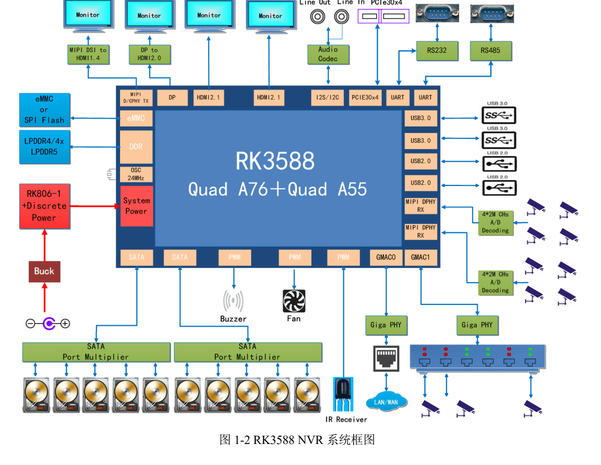
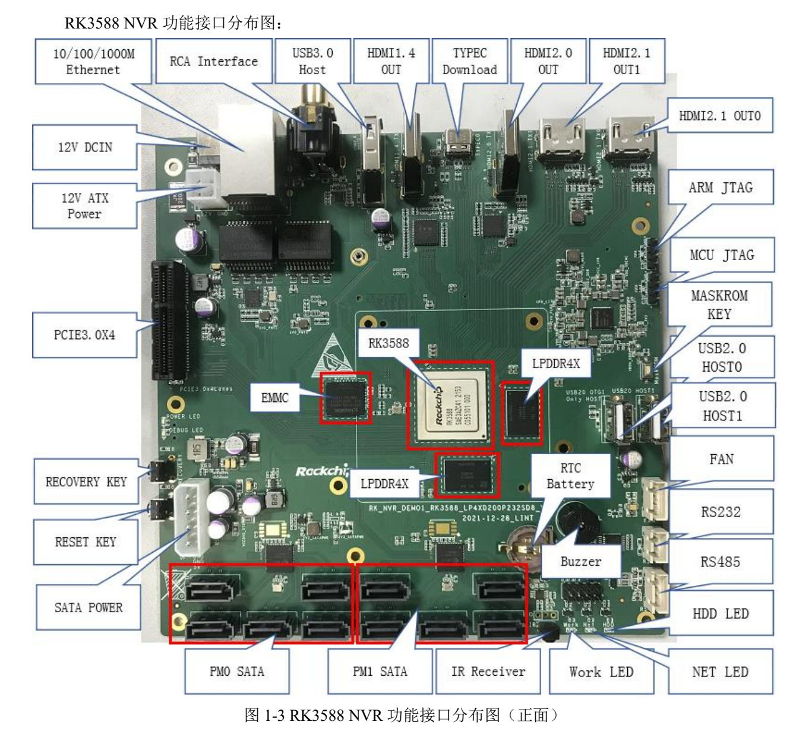

Это тематическое руководство по исходному документу: ключевые параметры, ограничения и оригинальные иллюстрации. Оно не заменяет полный перевод, таблицу выводов или регистров. Примеры производителя не являются измерениями ArmSoM. Перед применением проверьте ревизию платы, схему, SDK/BSP, ядро и драйверы; новых аппаратных испытаний для статьи не проводилось.

**Основной источник：** `Rockchip_RK3588_NVR_User_Guide_V1.0_CN_20220421.pdf` · PDF 49 стр..

## Эталонная плата производителя, не комплектация ArmSoM

Источник относится к `RK_NVR_DEMO1_RK3588_LP4XD200P232SD8_V21_20211228.DSN`: RK3588, один RK806-1, 4GB LPDDR4x и 32GB eMMC. Штатный адаптер — 12V/3A. Эти значения не определяют память, питание или число портов AIM7, Sige7 и LM7.

*Система RK3588 NVR — Оригинал на китайском; соответствующей английской иллюстрации в этой подборке нет. `Rockchip_RK3588_NVR_User_Guide_V1.0_CN_20220421.pdf`, PDF p. 12.*

## Проследить соединение за каждым разъёмом

| Функция | Реализация источника | Проверка для продукта |
| --- | --- | --- |
| SATA | 2 JMB575 расширяют подключение до 10 дисков | Общая полоса, драйверы, питание и параллельная запись |
| PCIe | PCIe3.0 x4; такт от PI6C557-05BLE | Режим, такт, reset, карта и длительный throughput |
| Сеть | 2 Gigabit RJ45 с RTL8211F-CG | Разделение камер/управления, потери и перегрузка |
| Камера | 2×4-lane или 4×2-lane MIPI DPHY RX через 80pin | Разъём, линии, питание и драйверы сенсора |
| Отладка/загрузка | MINI USB Debug; Type-C для прошивки | Различить порты до подключения |

Десять SATA создаются расширителями. Это не десять независимых встроенных контроллеров RK3588 и не гарантия пиковой скорости всех дисков одновременно. Пусковой ток и охлаждение нельзя считать автоматически обеспеченными штатным адаптером.

*Разъёмы эталонной RK3588 NVR — Оригинал на китайском; соответствующей английской иллюстрации в этой подборке нет. `Rockchip_RK3588_NVR_User_Guide_V1.0_CN_20220421.pdf`, PDF p. 14.*

## Отличать встроенный HDMI от преобразователей

Стр. 45–47 описывают MIPI → IT6161 → HDMI1.4b, DP → IT6563FN → HDMI2.0 и два HDMI2.1. Обзор стр. 12 говорит о трёх HDMI, таблица стр. 13 перечисляет один HDMI1.4, один HDMI2.0 и два HDMI2.1. Расхождение записано. Здесь рассматриваются отдельные пути без обещания четырёх одновременных выходов в любых режимах.

Для видеостены укажите разрешение, частоту, цветовой формат и источник каждого экрана. Совместно проверьте контроллер, мост, разъём и BSP. Максимум интерфейса не заменяет таблицу допустимых сочетаний.

## Рассчитать путь от камеры до файла

Разделите захват, декодирование/обработку, необязательный инференс, кодирование, запись и локальный показ. Для каждого этапа сохраните число потоков, битрейт, буферы, задержку и восстановление. Сетевые камеры и сырой MIPI используют разные полосы и программные пути.

Проверьте циклическую запись, полный диск, извлечение/отказ, внезапное отключение и восстановление индекса. При параллельной записи нужны суммарная скорость и самый медленный поток, не только тест одного диска. RAID и файловая система — последующий выбор проекта, не готовая функция этой инструкции.

## Сохранить конфигурацию до перепрошивки

Пример Windows-драйвера — `DriverAssitant_v5.1.1`. Loader: Type-C к PC, RECOVERY удерживается при включении/reset и отпускается после обнаружения. MASKROM использует соответствующую кнопку с подтверждением в инструменте. Loader, Parameter, Uboot и остальные файлы должны соответствовать плате и накопителю; сначала сделайте резервную копию.

Это порядок эталонной платы. Не переносите её ADC, питание 12V или метод замыкания на ArmSoM. Производственное восстановление требует доступного порта загрузки, последовательного журнала и учёта версий.

## I2C и напряжение до расширения

Стр. 23: ES8311 — I2C3, `0x18`, 1.8V; FUSB302BMPX — I2C6, `0x22`, 3.3V; HYM8563TS — I2C6, `0x51`, 3.3V. IT6161 записан как `0x98`; это не принимается автоматически за 7-битный адрес Linux. Проверьте формат адреса, мультиплексирование, домены и подтяжки.

На последней странице осталась шаблонная надпись «RK3588S EVB»; она не меняет модель RK3588 рассматриваемого NVR.

## Сократить разработку с ArmSoM

Sige7 удобен как готовая плата для приложения; AIM7 и LM7 — для оценки модульных решений с носителем. До выбора накопителей, видеовходов и охлаждения уточните реальные интерфейсы и ПО. Здесь не заявляются десять SATA или готовый NVR по умолчанию на этих продуктах.

## Продукты и документация

- **AIM7** — [Продукт](https://www.armsom.org/aim7) · [Документация](https://docs.armsom.org/armsom-aim7)
- **Sige7** — [Продукт](https://www.armsom.org/sige7) · [Документация](https://docs.armsom.org/armsom-sige7)
- **LM7** — [Продукт](https://www.armsom.org/lm7) · [Документация](https://docs.armsom.org/armsom-lm7)

## Читайте также

- [Испытания RK3588](/ru/articles/rk3588-hardware-test-report/)
