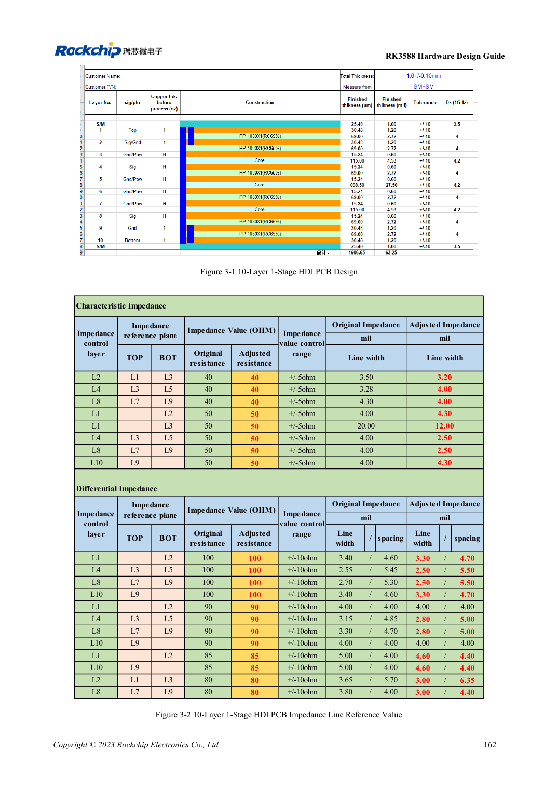
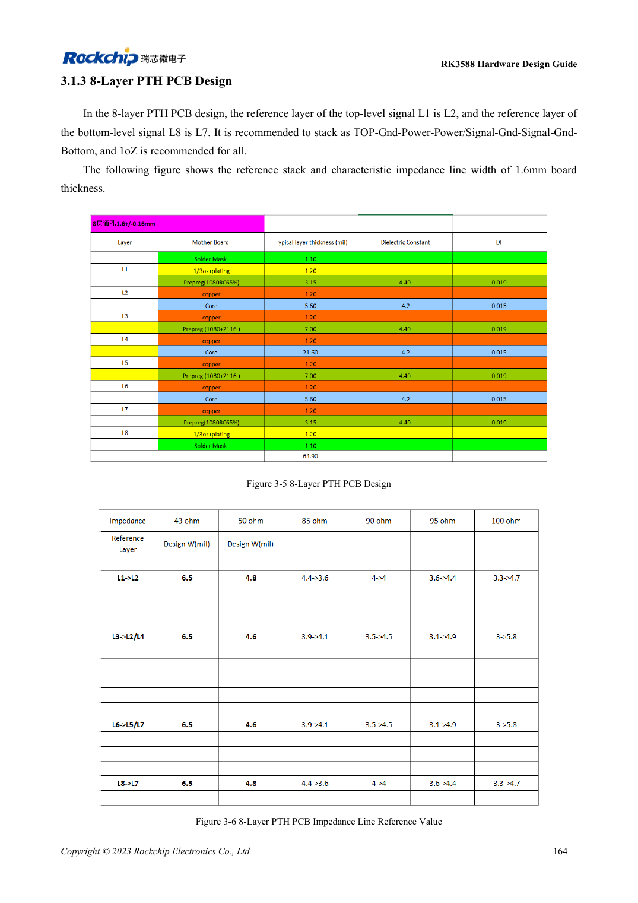
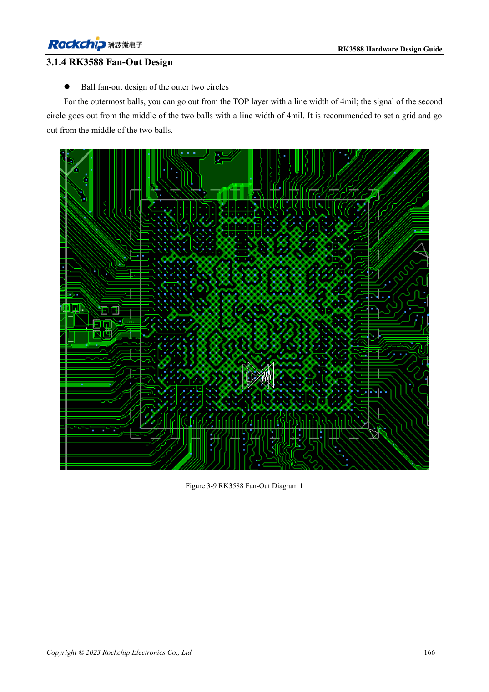

<!-- rk3588-hardware-v13-20261109 -->

# Стек и fanout RK3588: HDI и сквозные переходы

Основа — китайская и английская версии RK3588 Hardware Design Guide V1.3 (2023-02-13), для проверки плат SoC и носителей. Носители AIM7 и LM7 проектируют по интерфейсу модуля; Sige7 служит базой проверки ПО и периферии. Возможности SoC не равны перечню разъёмов платы. Проверяйте SDK/BSP, ядро, ревизию и прошивку. Значения взяты из источника, не из измерений ArmSoM.

**RK3588 Hardware Design Guide V1.3 (2023-02-13), EN** · §3.1; §3.2

## Число слоёв — не единственный критерий

Примеры: 10-слойный HDI первого/второго порядка и 8-слойный PTH. Стек должен обеспечить импеданс, возврат тока, медь, производство и стоимость. Предпочтительна земля рядом с сигналом, контроль соседних сигнальных слоёв и симметрия. После смены материала или толщины геометрию пересчитывают с производителем.

## Свяжите fanout с производством

Для двух внешних рядов показан выход 4mil, а не универсальная ширина импедансной линии. Проверяют переходы, antipad, питание и DDR-шаблон. Носители AIM7/LM7 используют разъём или LGA, не копируют BGA SoC; технологию выбирают по документации модуля.

## Параметры и проверочная таблица

| Параметр | Значение источника |
| --- | --- |
| Эталонные стеки | 10-слойный HDI; 8-слойный PTH |
| Пример толщины платы | 1.6mm |
| Локальный fanout внешнего ряда | 4mil |
| Область длины трасс | PCB + переходы + корпус |

## Исходные рисунки

Ниже страницы источника со схемами или временными диаграммами; нажмите для полного разрешения. Обозначения и номиналы относятся к эталонной схеме, не к схеме изделия ArmSoM.

Английский оригинал · PDF 184 · 3-1

Английский оригинал · PDF 186 · 3-5

Английский оригинал · PDF 188 · 3-9

## Разработка с ArmSoM

AIM7 подходит для носителей вычислительного модуля, LM7 — для интеграции LGA, Sige7 — для первичной оценки ПО и периферии. До разработки носителя определите уже встроенные цепи питания, DDR и загрузки. Не дублируйте схемы SoC без необходимости. Разъёмы, выведенные интерфейсы, уровни и поддержку системы сверяйте с документацией изделия.

- [ArmSoM AIM7](https://www.armsom.org/aim7) · [AIM7 Docs](https://docs.armsom.org/armsom-aim7)
- [ArmSoM Sige7](https://www.armsom.org/sige7) · [Sige7 Docs](https://docs.armsom.org/armsom-sige7)
- [ArmSoM LM7](https://www.armsom.org/lm7) · [LM7 Docs](https://docs.armsom.org/armsom-lm7)

## Читайте далее

- [RK3588: 30 тем аппаратного проектирования](/ru/articles/rk3588-hardware-design-series/)
- [Распределение UART, SPI, CAN, I2C и PWM RK3588](/ru/articles/rk3588-serial-control-hardware/)
- [Высокоскоростная PCB RK3588: площадки и переходы от 8GT/s](/ru/articles/rk3588-high-speed-pcb-review/)
