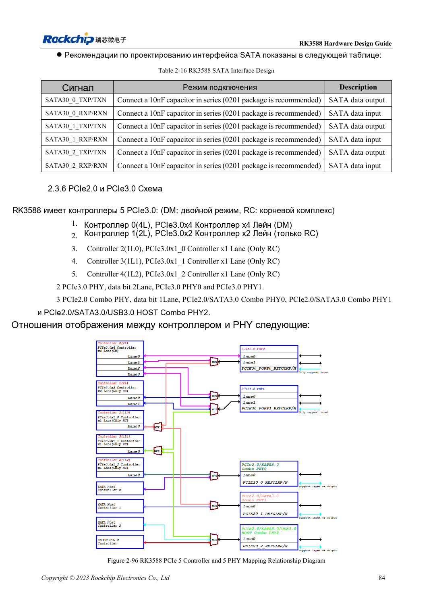
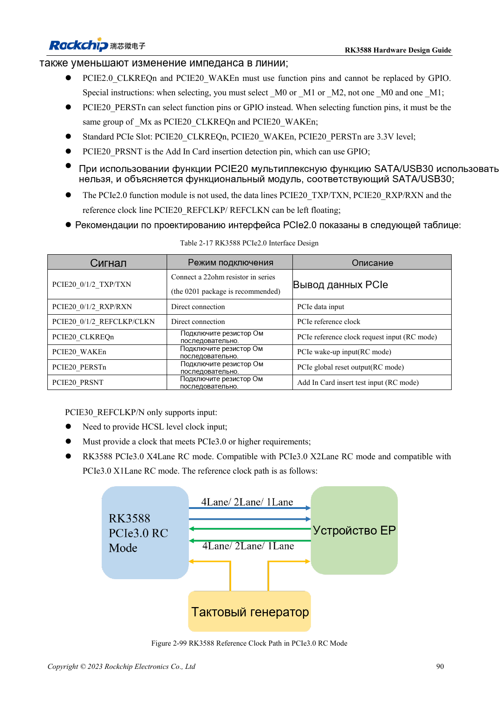

<!-- rk3588-hardware-v13-20261109 -->

# PCIe RK3588: линии, опорные такты и питание

Основа — китайская и английская версии RK3588 Hardware Design Guide V1.3 (2023-02-13), для проверки плат SoC и носителей. Носители AIM7 и LM7 проектируют по интерфейсу модуля; Sige7 служит базой проверки ПО и периферии. Возможности SoC не равны перечню разъёмов платы. Проверяйте SDK/BSP, ядро, ревизию и прошивку. Значения взяты из источника, не из измерений ArmSoM.

**RK3588 Hardware Design Guide V1.3 (2023-02-13), EN** · §2.3.6; §2.2.2.16; §3.4.5–3.4.6

## Контроллеры не равны независимым портам

Пять контроллеров отображаются на два PCIe3 PHY и три PCIe2 Combo PHY с общими ресурсами. Нельзя суммировать x4, x2 и все x1. PCIe3 REFCLK только входной, нужен HCSL; PCIe2 поддерживает вход/выход, по умолчанию выход к EP. ROM не загружается прямо с PCIe SSD.

## Проверьте управление и питание

PCIe2 CLKREQn/WAKEn используют функциональные контакты одной Mx-группы. PERSTn допускает GPIO, но выделенный сигнал тоже той же группы. Сигналы стандартного слота 3.3V согласуют с IO-доменом. Оба PCIe3-порта питаются даже при одном активном. Проверяют холодную инициализацию, скорость, сон и длительный обмен.

## Параметры и проверочная таблица

| Параметр | Значение источника |
| --- | --- |
| Импеданс данных PCIe | 85Ω ±10% |
| Импеданс REFCLK | 100Ω ±10% |
| Связь PCIe2 / PCIe3 | 100nF / 220nF; ±20% |
| Разница пары данных / REFCLK | <6mil / <12mil |
| Длина/переходы | <6in / рекомендуется ≤2 |

## Исходные рисунки

Ниже страницы источника со схемами или временными диаграммами; нажмите для полного разрешения. Обозначения и номиналы относятся к эталонной схеме, не к схеме изделия ArmSoM.

Английский оригинал · PDF 106 · 2-96

Английский оригинал · PDF 112 · 2-99

## Разработка с ArmSoM

AIM7 подходит для носителей вычислительного модуля, LM7 — для интеграции LGA, Sige7 — для первичной оценки ПО и периферии. До разработки носителя определите уже встроенные цепи питания, DDR и загрузки. Не дублируйте схемы SoC без необходимости. Разъёмы, выведенные интерфейсы, уровни и поддержку системы сверяйте с документацией изделия.

- [ArmSoM AIM7](https://www.armsom.org/aim7) · [AIM7 Docs](https://docs.armsom.org/armsom-aim7)
- [ArmSoM Sige7](https://www.armsom.org/sige7) · [Sige7 Docs](https://docs.armsom.org/armsom-sige7)
- [ArmSoM LM7](https://www.armsom.org/lm7) · [LM7 Docs](https://docs.armsom.org/armsom-lm7)

## Читайте далее

- [RK3588: 30 тем аппаратного проектирования](/ru/articles/rk3588-hardware-design-series/)
- [SATA RK3588: три контроллера и общие PHY](/ru/articles/rk3588-sata-hardware-design/)
- [Камеры RK3588: CSI, D/C PHY и CIF](/ru/articles/rk3588-camera-hardware-design/)
