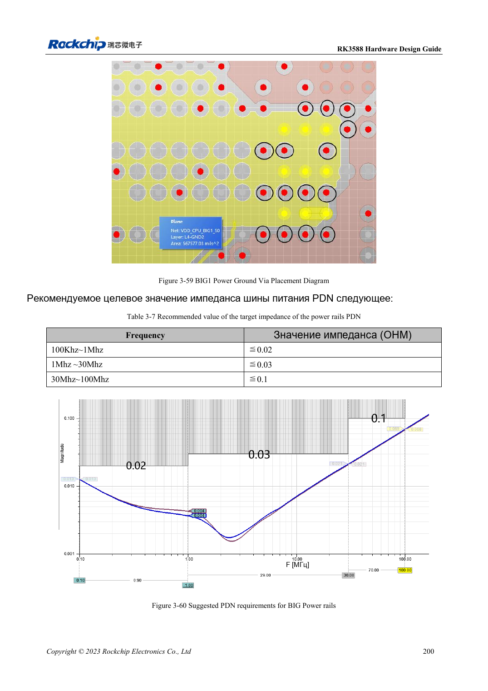

<!-- rk3588-hardware-v13-20261109 -->

# Питание PCB и PDN RK3588: медь, возврат и развязка

Основа — китайская и английская версии RK3588 Hardware Design Guide V1.3 (2023-02-13), для проверки плат SoC и носителей. Носители AIM7 и LM7 проектируют по интерфейсу модуля; Sige7 служит базой проверки ПО и периферии. Возможности SoC не равны перечню разъёмов платы. Проверяйте SDK/BSP, ядро, ревизию и прошивку. Значения взяты из источника, не из измерений ArmSoM.

**RK3588 Hardware Design Guide V1.3 (2023-02-13), EN** · §3.4.2

## Одного количества конденсаторов мало

Число земляных переходов силовых конденсаторов Buck должно соответствовать положительной стороне. Проверяют эффективную ширину меди и сужения после переходов; избегают термобарьерных шеек на критическом питании. Размещение RK806 балансирует путь и нагрев, не только расстояние.

## Проверяйте импеданс по диапазонам

Таблица 3-7 задаёт частотно-зависимые цели BIG PDN, а не один номинал конденсатора. Модель включает регулятор, плоскости, переходы, корпус и ESR/ESL. Это рекомендации эталона, не измерения ArmSoM. Измеряйте провал и звон при скачке нагрузки вместе с температурой, частотой и ошибками.

## Параметры и проверочная таблица

| Параметр | Значение источника |
| --- | --- |
| BIG PDN 100kHz–1MHz | ≤0.02Ω |
| BIG PDN 1–30MHz | ≤0.03Ω |
| BIG PDN 30–100MHz | ≤0.1Ω |
| Ток via (<1V) | 0.5A; пример via 0.5×0.3mm |

## Исходные рисунки

Ниже страницы источника со схемами или временными диаграммами; нажмите для полного разрешения. Обозначения и номиналы относятся к эталонной схеме, не к схеме изделия ArmSoM.

Английский оригинал · PDF 222 · 3-60

## Разработка с ArmSoM

AIM7 подходит для носителей вычислительного модуля, LM7 — для интеграции LGA, Sige7 — для первичной оценки ПО и периферии. До разработки носителя определите уже встроенные цепи питания, DDR и загрузки. Не дублируйте схемы SoC без необходимости. Разъёмы, выведенные интерфейсы, уровни и поддержку системы сверяйте с документацией изделия.

- [ArmSoM AIM7](https://www.armsom.org/aim7) · [AIM7 Docs](https://docs.armsom.org/armsom-aim7)
- [ArmSoM Sige7](https://www.armsom.org/sige7) · [Sige7 Docs](https://docs.armsom.org/armsom-sige7)
- [ArmSoM LM7](https://www.armsom.org/lm7) · [LM7 Docs](https://docs.armsom.org/armsom-lm7)

## Читайте далее

- [RK3588: 30 тем аппаратного проектирования](/ru/articles/rk3588-hardware-design-series/)
- [Высокоскоростная PCB RK3588: площадки и переходы от 8GT/s](/ru/articles/rk3588-high-speed-pcb-review/)
- [Тепловой расчёт RK3588: эталон и проверка системы](/ru/articles/rk3588-thermal-hardware-design/)
