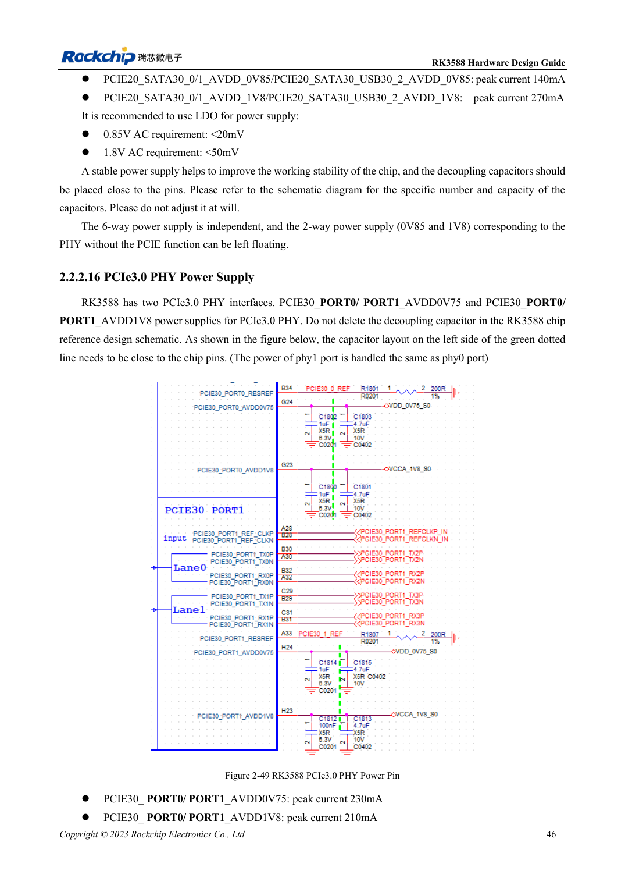
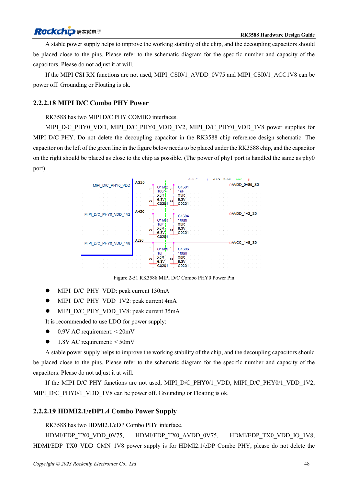

<!-- rk3588-hardware-v13-20261109 -->

# Питание RK3588: запуск и неиспользуемые PHY

Основа — китайская и английская версии RK3588 Hardware Design Guide V1.3 (2023-02-13), для проверки плат SoC и носителей. Носители AIM7 и LM7 проектируют по интерфейсу модуля; Sige7 служит базой проверки ПО и периферии. Возможности SoC не равны перечню разъёмов платы. Проверяйте SDK/BSP, ядро, ревизию и прошивку. Значения взяты из источника, не из измерений ArmSoM.

**RK3588 Hardware Design Guide V1.3 (2023-02-13), EN** · §2.2.1; §2.2.2

## Неиспользуемая функция не отменяет питание

Таблица 2-9 требует начального питания CPU, GPU, NPU, VDENC, DDR, PMU, SARADC, OTP, EMMCIO, VCCIO2, USB2 PHY и TYPEC0. Для каждой цепи фиксируют запуск, работу, сон, нагрузку, пульсации и развязку. Программное отключение не отменяет стартового питания.

## Проверяйте конкретный PHY

При использовании любого порта PCIe3.0 обоим требуются 0.75V и 1.8V. Правила Combo PHY PCIe2.0 не переносятся автоматически. В MIPI CSI расходятся имя 0V75 и строка пикового тока 0V9. Это отмечено как вопрос источника: сверяйте схему и спецификацию, не угадывая напряжение.

## Параметры и проверочная таблица

| Параметр | Значение источника |
| --- | --- |
| Пульсации аналогового PCIe3.0 | 0.75V: <20mV; 1.8V: <50mV |
| Пульсации аналогового PCIe2.0 | 0.85V: <20mV; 1.8V: <50mV |
| Один активный порт PCIe3.0 | Оба порта запитаны |

## Исходные рисунки

Ниже страницы источника со схемами или временными диаграммами; нажмите для полного разрешения. Обозначения и номиналы относятся к эталонной схеме, не к схеме изделия ArmSoM.

Английский оригинал · PDF 68 · 2-49

Английский оригинал · PDF 70 · 2-51

## Разработка с ArmSoM

AIM7 подходит для носителей вычислительного модуля, LM7 — для интеграции LGA, Sige7 — для первичной оценки ПО и периферии. До разработки носителя определите уже встроенные цепи питания, DDR и загрузки. Не дублируйте схемы SoC без необходимости. Разъёмы, выведенные интерфейсы, уровни и поддержку системы сверяйте с документацией изделия.

- [ArmSoM AIM7](https://www.armsom.org/aim7) · [AIM7 Docs](https://docs.armsom.org/armsom-aim7)
- [ArmSoM Sige7](https://www.armsom.org/sige7) · [Sige7 Docs](https://docs.armsom.org/armsom-sige7)
- [ArmSoM LM7](https://www.armsom.org/lm7) · [LM7 Docs](https://docs.armsom.org/armsom-lm7)

## Читайте далее

- [RK3588: 30 тем аппаратного проектирования](/ru/articles/rk3588-hardware-design-series/)
- [Загрузка RK3588: Maskrom, JTAG и UART](/ru/articles/rk3588-boot-debug-hardware/)
- [Порядок питания RK3588: RESETn и S0/S3](/ru/articles/rk3588-power-sequencing-design/)
