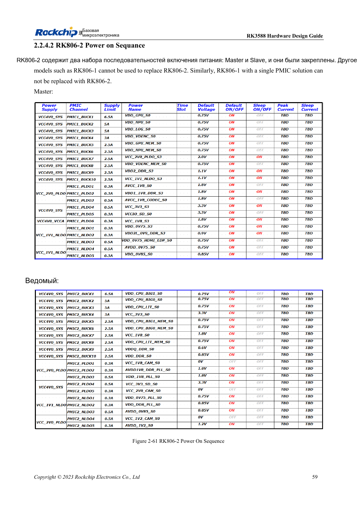

<!-- rk3588-hardware-v13-20261109 -->

# Порядок питания RK3588: RESETn и S0/S3

Основа — китайская и английская версии RK3588 Hardware Design Guide V1.3 (2023-02-13), для проверки плат SoC и носителей. Носители AIM7 и LM7 проектируют по интерфейсу модуля; Sige7 служит базой проверки ПО и периферии. Возможности SoC не равны перечню разъёмов платы. Проверяйте SDK/BSP, ядро, ревизию и прошивку. Значения взяты из источника, не из измерений ArmSoM.

**RK3588 Hardware Design Guide V1.3 (2023-02-13), EN** · §2.1.10.3; §2.2.1.2–2.2.1.3

## Приоритет конкретной последовательности

Принцип меньшего напряжения первым не заменяет порядок MIPI_D/C_PHY_VDD → 1.8V → 1.2V. Используйте дерево питания, не сортировку чисел. Снимайте RESETn ≥1ms после последней стабилизации с учётом периферии. При выключении сначала активируйте RESETn, затем снимайте питание.

## Проверьте сон и обратное питание

Фиксированный вывод 1.8V и выбираемое питание домена должны вместе относиться к S0 либо S3. Измеряйте холодный старт, тёплый сброс, сон и выключение, проверяя обратное питание от USB, HDMI и контроллеров. Носитель соблюдает вход и enable модуля, не повторяя внутренние питания SoC.

## Параметры и проверочная таблица

| Параметр | Значение источника |
| --- | --- |
| Снятие сброса | ≥1ms после стабилизации последней шины |
| Выключение питания | RESETn низкий → питание выключено |
| Эталон MIPI D/C | VDD → 1.8V → 1.2V |

## Исходные рисунки

Ниже страницы источника со схемами или временными диаграммами; нажмите для полного разрешения. Обозначения и номиналы относятся к эталонной схеме, не к схеме изделия ArmSoM.

Английский оригинал · PDF 81 · 2-61

## Разработка с ArmSoM

AIM7 подходит для носителей вычислительного модуля, LM7 — для интеграции LGA, Sige7 — для первичной оценки ПО и периферии. До разработки носителя определите уже встроенные цепи питания, DDR и загрузки. Не дублируйте схемы SoC без необходимости. Разъёмы, выведенные интерфейсы, уровни и поддержку системы сверяйте с документацией изделия.

- [ArmSoM AIM7](https://www.armsom.org/aim7) · [AIM7 Docs](https://docs.armsom.org/armsom-aim7)
- [ArmSoM Sige7](https://www.armsom.org/sige7) · [Sige7 Docs](https://docs.armsom.org/armsom-sige7)
- [ArmSoM LM7](https://www.armsom.org/lm7) · [LM7 Docs](https://docs.armsom.org/armsom-lm7)

## Читайте далее

- [RK3588: 30 тем аппаратного проектирования](/ru/articles/rk3588-hardware-design-series/)
- [Питание RK3588: запуск и неиспользуемые PHY](/ru/articles/rk3588-power-rail-planning/)
- [RK3588 и RK806: один или два PMIC](/ru/articles/rk3588-rk806-pmic-design/)
