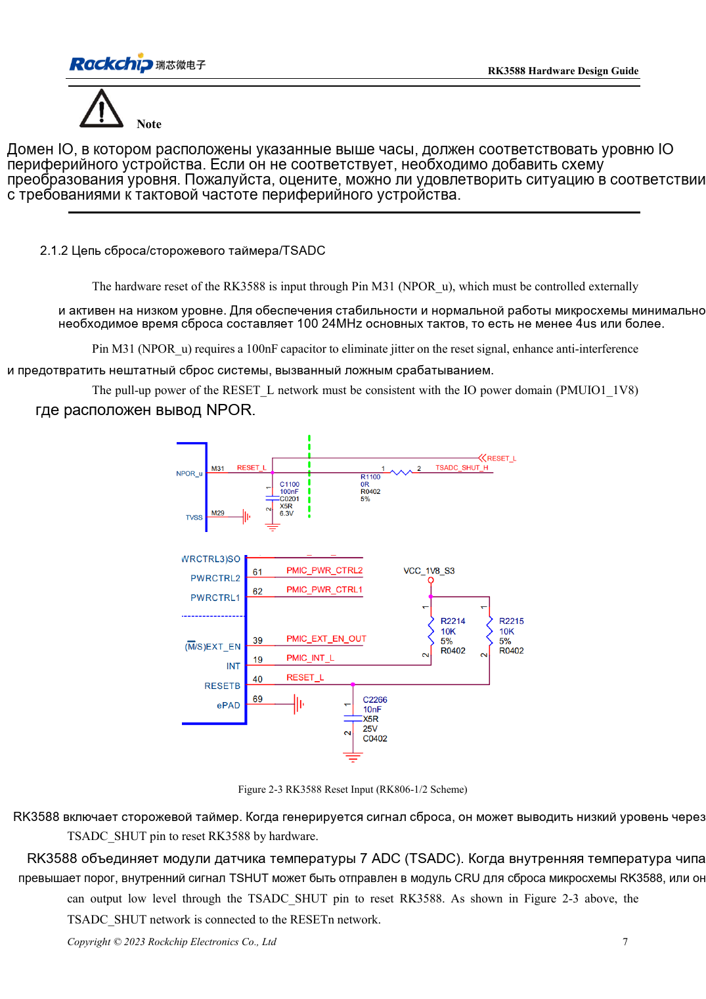
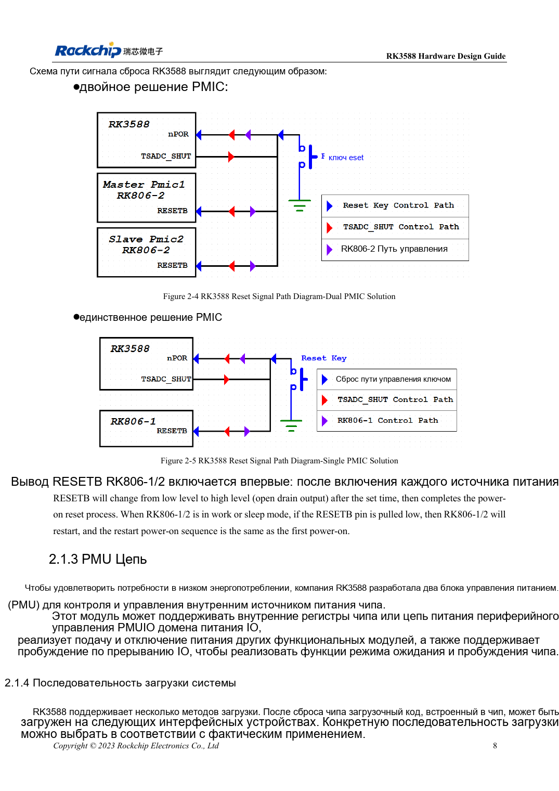

<!-- rk3588-hardware-v13-20261109 -->

# Сброс, watchdog и термозащита RK3588

Основа — китайская и английская версии RK3588 Hardware Design Guide V1.3 (2023-02-13), для проверки плат SoC и носителей. Носители AIM7 и LM7 проектируют по интерфейсу модуля; Sige7 служит базой проверки ПО и периферии. Возможности SoC не равны перечню разъёмов платы. Проверяйте SDK/BSP, ядро, ревизию и прошивку. Значения взяты из источника, не из измерений ArmSoM.

**RK3588 Hardware Design Guide V1.3 (2023-02-13), EN** · §2.1.2; §3.4.1

## Импульс сброса отличается от задержки запуска

NPOR_u на M31 активен нулём. Указаны 100 периодов 24MHz и минимум 4μs; 100/24MHz≈4.167μs, поэтому ровно 4.000μs недостаточно. 100nF ставят у вывода, подтяжку — к PMUIO1_1V8. Ожидание ≥1ms после стабилизации последнего питания — отдельное требование.

## Проверьте всю сеть сброса

RK806-1/2 отпускает RESETB после стартовой задержки; ноль во время работы или сна повторяет последовательность питания. Watchdog и семь TSADC также участвуют в защите. Одновременно наблюдайте RESETn, питание и UART. Путь: кнопка → TVS → 100Ω → фильтр → CPU/PMIC; сброс удаляют от DC/DC, металлических разъёмов и края.

## Параметры и проверочная таблица

| Параметр | Значение источника |
| --- | --- |
| NPOR_u | M31; активный низкий |
| Минимальный сброс | 100 циклов @24MHz ≈4.167μs |
| Фильтрующий конденсатор | 100nF |
| Подтяжка | PMUIO1_1V8 |

## Исходные рисунки

Ниже страницы источника со схемами или временными диаграммами; нажмите для полного разрешения. Обозначения и номиналы относятся к эталонной схеме, не к схеме изделия ArmSoM.

Английский оригинал · PDF 29 · 2-3

Английский оригинал · PDF 30 · 2-5

## Разработка с ArmSoM

AIM7 подходит для носителей вычислительного модуля, LM7 — для интеграции LGA, Sige7 — для первичной оценки ПО и периферии. До разработки носителя определите уже встроенные цепи питания, DDR и загрузки. Не дублируйте схемы SoC без необходимости. Разъёмы, выведенные интерфейсы, уровни и поддержку системы сверяйте с документацией изделия.

- [ArmSoM AIM7](https://www.armsom.org/aim7) · [AIM7 Docs](https://docs.armsom.org/armsom-aim7)
- [ArmSoM Sige7](https://www.armsom.org/sige7) · [Sige7 Docs](https://docs.armsom.org/armsom-sige7)
- [ArmSoM LM7](https://www.armsom.org/lm7) · [LM7 Docs](https://docs.armsom.org/armsom-lm7)

## Читайте далее

- [RK3588: 30 тем аппаратного проектирования](/ru/articles/rk3588-hardware-design-series/)
- [Тактовые цепи RK3588: 24MHz, 32kHz и размещение](/ru/articles/rk3588-clock-hardware-design/)
- [Загрузка RK3588: Maskrom, JTAG и UART](/ru/articles/rk3588-boot-debug-hardware/)
