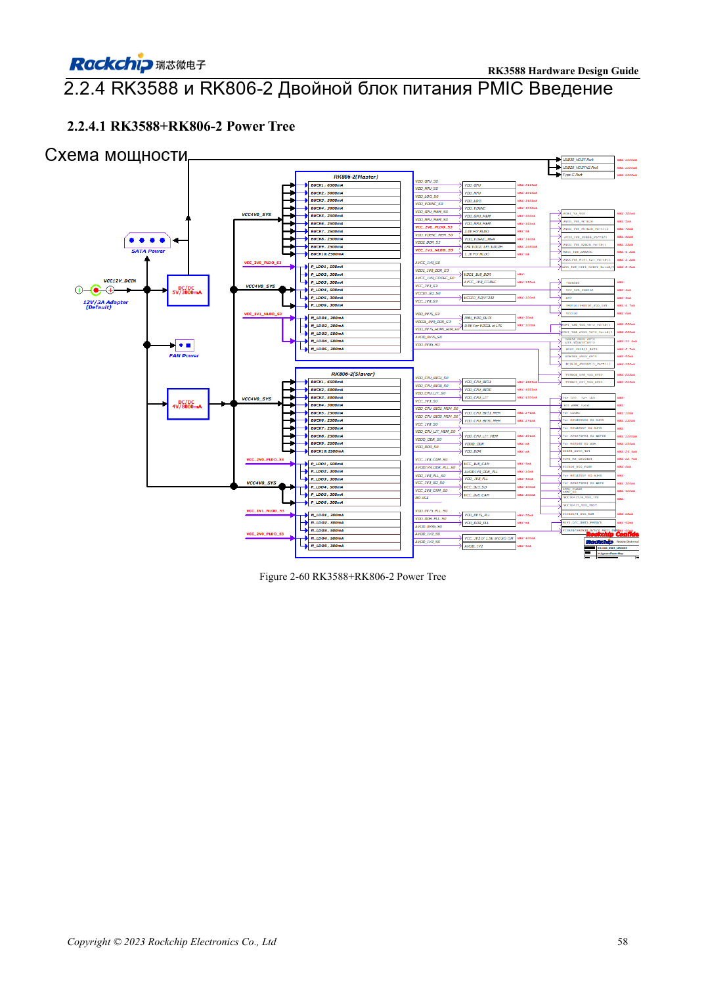
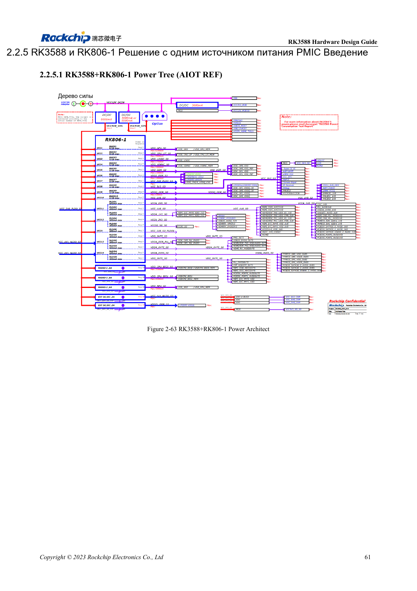

<!-- rk3588-hardware-v13-20261109 -->

# RK3588 и RK806: один или два PMIC

Основа — китайская и английская версии RK3588 Hardware Design Guide V1.3 (2023-02-13), для проверки плат SoC и носителей. Носители AIM7 и LM7 проектируют по интерфейсу модуля; Sige7 служит базой проверки ПО и периферии. Возможности SoC не равны перечню разъёмов платы. Проверяйте SDK/BSP, ядро, ревизию и прошивку. Значения взяты из источника, не из измерений ArmSoM.

**RK3588 Hardware Design Guide V1.3 (2023-02-13), EN** · §2.2.3–2.2.5

## Выберите полный эталон

Два RK806-2 и один RK806-1 с внешними источниками — разные архитектуры, а не схема без одной микросхемы. Вместе переносят выходы, напряжения, порядок, управление, сон и сброс. Вход PMIC 2.7–5.5V не является входной спецификацией платы ArmSoM.

## Синхронизация и размещение

EXT_EN задаёт ведущий/ведомый, SYNC/SYNC_CLK синхронизируют пару; VDC/PWRON/RESET соединяют по эталону. Один PMIC — ведущий с открытыми SYNC/SYNC_CLK. Важны силовые пути, земляные контуры конденсаторов и распределение нагрева. Максимальный ток не гарантируется непрерывно при любой температуре.

## Параметры и проверочная таблица

| Параметр | Значение источника |
| --- | --- |
| Вход RK806 | 2.7–5.5V |
| Корпус | 7×7mm QFN68 |
| Эталон двух PMIC | RK806-2 |
| Эталон одного PMIC | RK806-1 + внешнее питание |

## Исходные рисунки

Ниже страницы источника со схемами или временными диаграммами; нажмите для полного разрешения. Обозначения и номиналы относятся к эталонной схеме, не к схеме изделия ArmSoM.

Английский оригинал · PDF 80 · 2-60

Английский оригинал · PDF 83 · 2-63

## Разработка с ArmSoM

AIM7 подходит для носителей вычислительного модуля, LM7 — для интеграции LGA, Sige7 — для первичной оценки ПО и периферии. До разработки носителя определите уже встроенные цепи питания, DDR и загрузки. Не дублируйте схемы SoC без необходимости. Разъёмы, выведенные интерфейсы, уровни и поддержку системы сверяйте с документацией изделия.

- [ArmSoM AIM7](https://www.armsom.org/aim7) · [AIM7 Docs](https://docs.armsom.org/armsom-aim7)
- [ArmSoM Sige7](https://www.armsom.org/sige7) · [Sige7 Docs](https://docs.armsom.org/armsom-sige7)
- [ArmSoM LM7](https://www.armsom.org/lm7) · [LM7 Docs](https://docs.armsom.org/armsom-lm7)

## Читайте далее

- [RK3588: 30 тем аппаратного проектирования](/ru/articles/rk3588-hardware-design-series/)
- [Порядок питания RK3588: RESETn и S0/S3](/ru/articles/rk3588-power-sequencing-design/)
- [DDR RK3588: LPDDR4/4X/5 и конфигурация памяти](/ru/articles/rk3588-ddr-circuit-design/)
