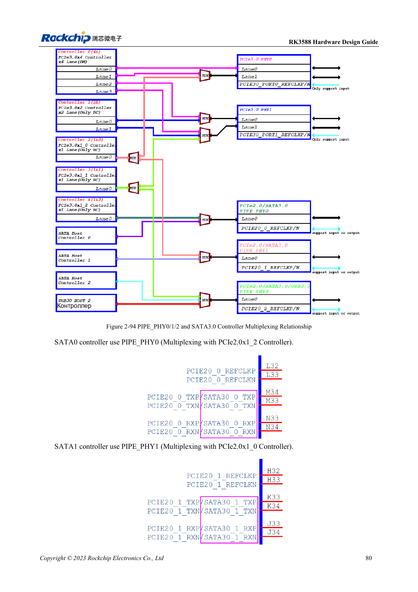

<!-- rk3588-hardware-v13-20261109 -->

# SATA RK3588: три контроллера и общие PHY

Основа — китайская и английская версии RK3588 Hardware Design Guide V1.3 (2023-02-13), для проверки плат SoC и носителей. Носители AIM7 и LM7 проектируют по интерфейсу модуля; Sige7 служит базой проверки ПО и периферии. Возможности SoC не равны перечню разъёмов платы. Проверяйте SDK/BSP, ядро, ревизию и прошивку. Значения взяты из источника, не из измерений ArmSoM.

**RK3588 Hardware Design Guide V1.3 (2023-02-13), EN** · §2.3.5; §3.4.9

## Сначала матрица мультиплексирования

SATA0/1/2 используют PIPE_PHY0/1/2 совместно с PCIe, PHY2 также с USB3 HOST2. Поддержка 1.5/3/6Gbps и Port Multiplier не означает три SATA на любой ArmSoM или полную полосу каждому устройству. Сначала выбирают порты, затем ПО и разъёмы.

## Сигналы и питание диска проверяют отдельно

Эталон ставит 10nF в TX и RX, предпочтительно 0201; номиналы PCIe не подходят автоматически. SATA_CP_DET, MP_SWITCH и CP_POD — общие ресурсы, горячее подключение проектируют отдельно. Внешнее питание проверяют на пусковой ток диска, запись, ошибки и восстановление.

## Параметры и проверочная таблица

| Параметр | Значение источника |
| --- | --- |
| Связь SATA | 10nF ±20%; TX и RX |
| Дифференциальная цель | 100Ω ±10%; резерв источника 90Ω ±10% |
| Длина/разница пары | <6in / <6mil |
| Рекомендуемые переходы | Рекомендуется ≤2 |

## Исходные рисунки

Ниже страницы источника со схемами или временными диаграммами; нажмите для полного разрешения. Обозначения и номиналы относятся к эталонной схеме, не к схеме изделия ArmSoM.

Английский оригинал · PDF 102 · 2-94

## Разработка с ArmSoM

AIM7 подходит для носителей вычислительного модуля, LM7 — для интеграции LGA, Sige7 — для первичной оценки ПО и периферии. До разработки носителя определите уже встроенные цепи питания, DDR и загрузки. Не дублируйте схемы SoC без необходимости. Разъёмы, выведенные интерфейсы, уровни и поддержку системы сверяйте с документацией изделия.

- [ArmSoM AIM7](https://www.armsom.org/aim7) · [AIM7 Docs](https://docs.armsom.org/armsom-aim7)
- [ArmSoM Sige7](https://www.armsom.org/sige7) · [Sige7 Docs](https://docs.armsom.org/armsom-sige7)
- [ArmSoM LM7](https://www.armsom.org/lm7) · [LM7 Docs](https://docs.armsom.org/armsom-lm7)

## Читайте далее

- [RK3588: 30 тем аппаратного проектирования](/ru/articles/rk3588-hardware-design-series/)
- [USB и Type-C RK3588: контроллеры, PHY и восстановление](/ru/articles/rk3588-usb-typec-hardware-design/)
- [PCIe RK3588: линии, опорные такты и питание](/ru/articles/rk3588-pcie-hardware-design/)
