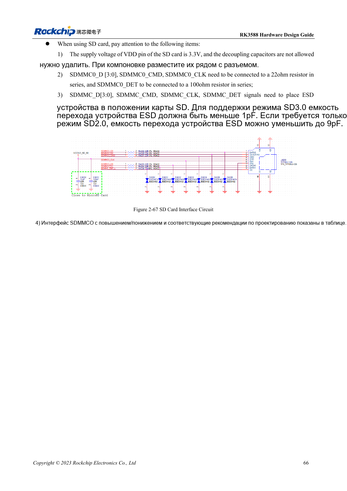

<!-- rk3588-hardware-v13-20261109 -->

# SDMMC и SDIO Wi-Fi RK3588: уровни и защита

Основа — китайская и английская версии RK3588 Hardware Design Guide V1.3 (2023-02-13), для проверки плат SoC и носителей. Носители AIM7 и LM7 проектируют по интерфейсу модуля; Sige7 служит базой проверки ПО и периферии. Возможности SoC не равны перечню разъёмов платы. Проверяйте SDK/BSP, ядро, ревизию и прошивку. Значения взяты из источника, не из измерений ArmSoM.

**RK3588 Hardware Design Guide V1.3 (2023-02-13), EN** · §2.3.1; §3.4.15–3.4.16; §3.4.21

## Различайте питание карты и IO

VDD карты SD равен 3.3V. Переход VCCIO2 на 1.8V после согласования SD3.0 не означает смены питания карты. Выбор SDMMC/JTAG зависит от SDMMC_DET. Эталон: 22Ω на данных/CMD/CLK, 100Ω на DET, развязка и ESD у разъёма.

## Wi-Fi требует такта и RF-проверки

Сверьте IO модуля, направления UART/PCM и амплитуду 32.768kHz; предусмотрите π-согласование антенны. Нагрузку кварца выбирают по модулю; руководство указывает 10ppm при комнатной температуре. Для SD3.0 ёмкость ESD <1pF. Проверяют соединение, скорость, сон/пробуждение и циклы питания.

## Параметры и проверочная таблица

| Параметр | Значение источника |
| --- | --- |
| VDD карты SD | 3.3V |
| Ёмкость ESD SD3.0 | <1pF |
| ESD только для SD2.0 | ≤9pF |
| Data/CMD/CLK; DET | 22Ω; 100Ω |
| PCB: импеданс/длина | 50Ω ±10% / <4in |
| Разница такт/данные | <120mil |

## Исходные рисунки

Ниже страницы источника со схемами или временными диаграммами; нажмите для полного разрешения. Обозначения и номиналы относятся к эталонной схеме, не к схеме изделия ArmSoM.

Английский оригинал · PDF 88 · 2-67

## Разработка с ArmSoM

AIM7 подходит для носителей вычислительного модуля, LM7 — для интеграции LGA, Sige7 — для первичной оценки ПО и периферии. До разработки носителя определите уже встроенные цепи питания, DDR и загрузки. Не дублируйте схемы SoC без необходимости. Разъёмы, выведенные интерфейсы, уровни и поддержку системы сверяйте с документацией изделия.

- [ArmSoM AIM7](https://www.armsom.org/aim7) · [AIM7 Docs](https://docs.armsom.org/armsom-aim7)
- [ArmSoM Sige7](https://www.armsom.org/sige7) · [Sige7 Docs](https://docs.armsom.org/armsom-sige7)
- [ArmSoM LM7](https://www.armsom.org/lm7) · [LM7 Docs](https://docs.armsom.org/armsom-lm7)

## Читайте далее

- [RK3588: 30 тем аппаратного проектирования](/ru/articles/rk3588-hardware-design-series/)
- [FSPI Flash RK3588: загрузка, питание и согласование](/ru/articles/rk3588-fspi-boot-hardware/)
- [USB и Type-C RK3588: контроллеры, PHY и восстановление](/ru/articles/rk3588-usb-typec-hardware-design/)
