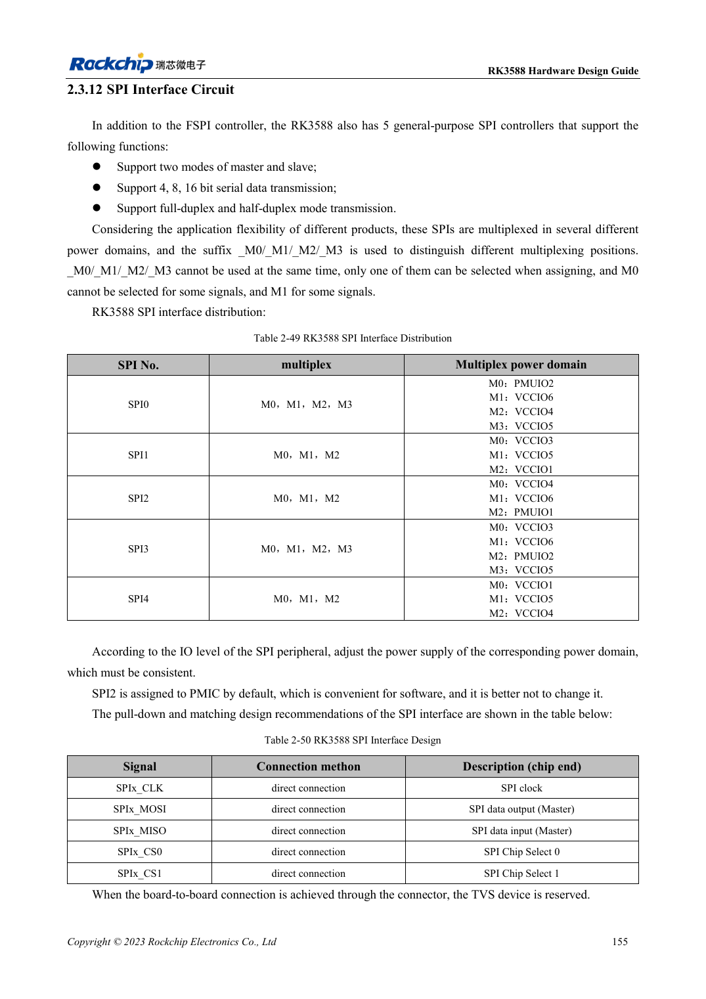

<!-- rk3588-hardware-v13-20261109 -->

# Распределение UART, SPI, CAN, I2C и PWM RK3588

Основа — китайская и английская версии RK3588 Hardware Design Guide V1.3 (2023-02-13), для проверки плат SoC и носителей. Носители AIM7 и LM7 проектируют по интерфейсу модуля; Sige7 служит базой проверки ПО и периферии. Возможности SoC не равны перечню разъёмов платы. Проверяйте SDK/BSP, ядро, ревизию и прошивку. Значения взяты из источника, не из измерений ArmSoM.

**RK3588 Hardware Design Guide V1.3 (2023-02-13), EN** · §2.3.11–2.3.15

## Не смешивайте Mx-группы

M0/M1/M2 для UART, SPI, CAN и I2C — варианты мультиплексирования, не дополнительные контроллеры. Выбирайте полную допустимую группу и питание. SPI2 по умолчанию обслуживает PMIC, не занимайте его произвольно. CAN требует внешнего трансивера: TX/RX SoC не являются дифференциальной шиной.

## Проверяйте протоколы отдельно от таблиц

Эталон I2C — 2.2kΩ вверх, с учётом нагрузки и уровня; HDMI DDC выделен. V1.3 описывает CAN2.0B, 1Mbps, не обещает CAN FD. В I2C-таблице встречаются PMUIO3/4/5/6, не согласованные с таблицей доменов. До настройки контактов сверяйте TRM и схему.

## Параметры и проверочная таблица

| Параметр | Значение источника |
| --- | --- |
| UART / общий SPI | 10 / 5 контроллеры |
| Область CAN источника | 3 контроллеры; CAN2.0B; 1Mbps |
| Эталон I2C | До 400Kbit/s; 2.2kΩ подтяжка вверх |
| Число PWM источника | 4 контроллеры ×4 каналы |

## Исходные рисунки

Ниже страницы источника со схемами или временными диаграммами; нажмите для полного разрешения. Обозначения и номиналы относятся к эталонной схеме, не к схеме изделия ArmSoM.

Английский оригинал · PDF 177 · table:2-50

## Разработка с ArmSoM

AIM7 подходит для носителей вычислительного модуля, LM7 — для интеграции LGA, Sige7 — для первичной оценки ПО и периферии. До разработки носителя определите уже встроенные цепи питания, DDR и загрузки. Не дублируйте схемы SoC без необходимости. Разъёмы, выведенные интерфейсы, уровни и поддержку системы сверяйте с документацией изделия.

- [ArmSoM AIM7](https://www.armsom.org/aim7) · [AIM7 Docs](https://docs.armsom.org/armsom-aim7)
- [ArmSoM Sige7](https://www.armsom.org/sige7) · [Sige7 Docs](https://docs.armsom.org/armsom-sige7)
- [ArmSoM LM7](https://www.armsom.org/lm7) · [LM7 Docs](https://docs.armsom.org/armsom-lm7)

## Читайте далее

- [RK3588: 30 тем аппаратного проектирования](/ru/articles/rk3588-hardware-design-series/)
- [GPIO и SARADC RK3588: домены и кнопки](/ru/articles/rk3588-gpio-saradc-hardware/)
- [Стек и fanout RK3588: HDI и сквозные переходы](/ru/articles/rk3588-pcb-stackup-fanout/)
