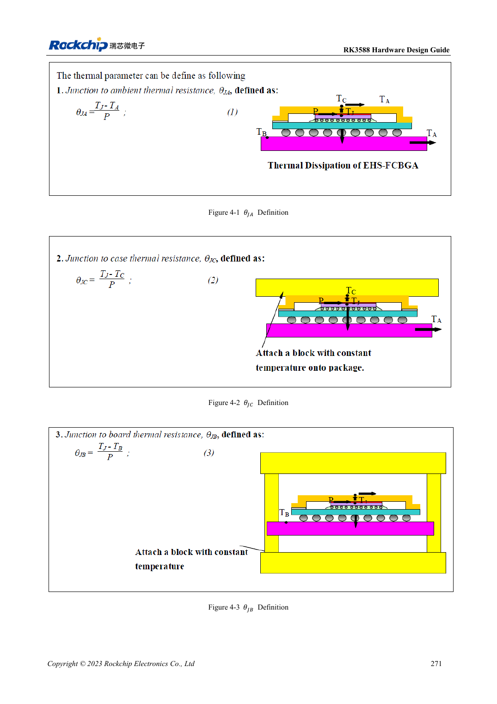

<!-- rk3588-hardware-v13-20261109 -->

# Тепловой расчёт RK3588: эталон и проверка системы

Основа — китайская и английская версии RK3588 Hardware Design Guide V1.3 (2023-02-13), для проверки плат SoC и носителей. Носители AIM7 и LM7 проектируют по интерфейсу модуля; Sige7 служит базой проверки ПО и периферии. Возможности SoC не равны перечню разъёмов платы. Проверяйте SDK/BSP, ядро, ревизию и прошивку. Значения взяты из источника, не из измерений ArmSoM.

**RK3588 Hardware Design Guide V1.3 (2023-02-13), EN** · §4

## Модель не равна нагреву модуля

Таблица 4-1 рассчитана для конкретного корпуса и JEDEC-модели PCB: 101×114mm, 1.6mm, 10 слоёв, без радиатора. Её нельзя прямо переносить на AIM7, носитель LM7 или корпус Sige7. θJA, θJB и θJC относятся к разным точкам и не взаимозаменяемы.

## Проверьте теплоотвод и защиту

Проверяют путь к термоинтерфейсу, радиатору, корпусу и среде, прижим и изоляцию. Интервал RK3588/RK806 20–50mm — рекомендация платы, не переделка модуля. Под реальной политикой BSP измеряют длительную нагрузку, частоту, температуру и задержку; отключение защиты не доказывает производительность.

## Параметры и проверочная таблица

| Параметр | Значение источника |
| --- | --- |
| θJA / θJB / θJC источника | 8.7 / 3.5 / 0.12 °C/W; моделирование |
| PCB источника | 101×114mm; 1.6mm; 10 слоёв |
| Расстояние PMIC–SoC | RK3588–RK806: 20–50mm |

## Исходные рисунки

Ниже страницы источника со схемами или временными диаграммами; нажмите для полного разрешения. Обозначения и номиналы относятся к эталонной схеме, не к схеме изделия ArmSoM.

Английский оригинал · PDF 293 · 4-1

## Разработка с ArmSoM

AIM7 подходит для носителей вычислительного модуля, LM7 — для интеграции LGA, Sige7 — для первичной оценки ПО и периферии. До разработки носителя определите уже встроенные цепи питания, DDR и загрузки. Не дублируйте схемы SoC без необходимости. Разъёмы, выведенные интерфейсы, уровни и поддержку системы сверяйте с документацией изделия.

- [ArmSoM AIM7](https://www.armsom.org/aim7) · [AIM7 Docs](https://docs.armsom.org/armsom-aim7)
- [ArmSoM Sige7](https://www.armsom.org/sige7) · [Sige7 Docs](https://docs.armsom.org/armsom-sige7)
- [ArmSoM LM7](https://www.armsom.org/lm7) · [LM7 Docs](https://docs.armsom.org/armsom-lm7)

## Читайте далее

- [RK3588: 30 тем аппаратного проектирования](/ru/articles/rk3588-hardware-design-series/)
- [Питание PCB и PDN RK3588: медь, возврат и развязка](/ru/articles/rk3588-power-pcb-pdn-design/)
- [ESD и EMI RK3588: защита интерфейсов и возврат тока](/ru/articles/rk3588-esd-emi-hardware-design/)
