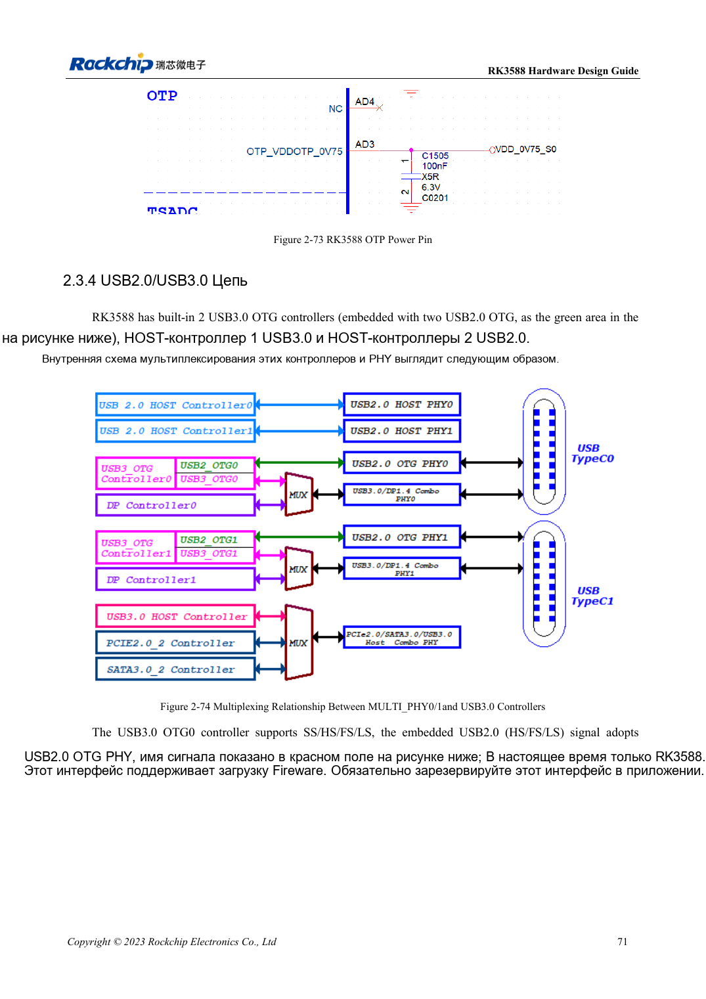
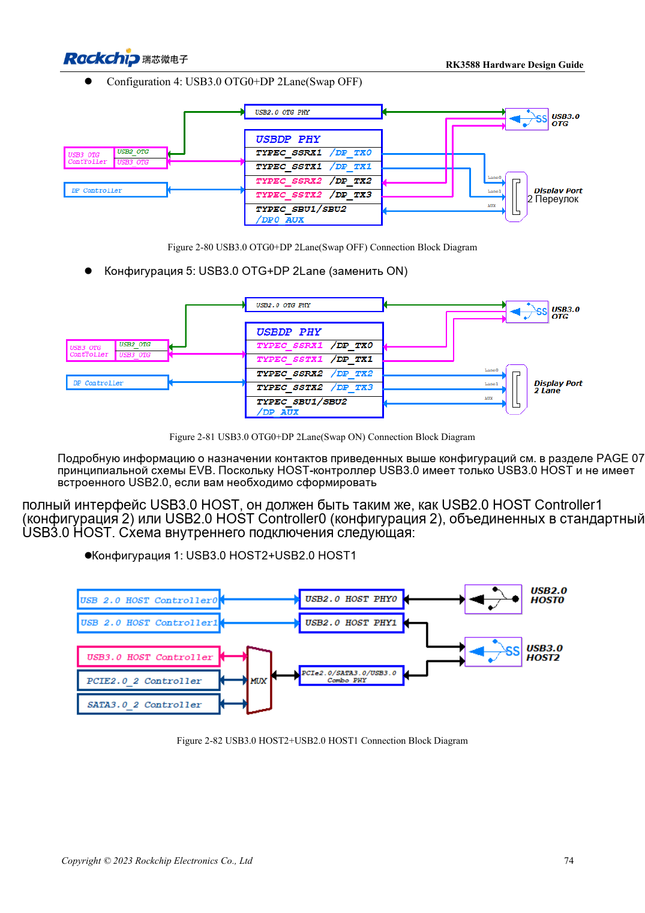

<!-- rk3588-hardware-v13-20261109 -->

# USB и Type-C RK3588: контроллеры, PHY и восстановление

Основа — китайская и английская версии RK3588 Hardware Design Guide V1.3 (2023-02-13), для проверки плат SoC и носителей. Носители AIM7 и LM7 проектируют по интерфейсу модуля; Sige7 служит базой проверки ПО и периферии. Возможности SoC не равны перечню разъёмов платы. Проверяйте SDK/BSP, ядро, ревизию и прошивку. Значения взяты из источника, не из измерений ArmSoM.

**RK3588 Hardware Design Guide V1.3 (2023-02-13), EN** · §2.3.4; §3.4.10–3.4.11

## Различайте контроллеры и порты

SoC имеет два USB3 OTG, один USB3 HOST и два USB2 HOST. Отдельный USB3 HOST не содержит USB2 и требует парного USB2 HOST для полного порта. Сохраните загрузочный USB2-путь OTG0. Распределение USB3/DP Type-C, ориентацию и внешнее управление проектируют вместе.

## Проверьте роли питания и канал

USB3 HOST2 делит ресурсы с SATA/PCIe; все три не считаются одновременно доступными. Проверяют источник/приёмник VBUS, обратное питание, разъёмы и кабели. Сначала USB2-восстановление, затем USB3, длительный обмен, горячее подключение и обе ориентации Type-C. Длина включает модуль и разъёмы.

## Параметры и проверочная таблица

| Параметр | Значение источника |
| --- | --- |
| Импеданс USB2 | 90Ω ±10%; разница пары <20mil |
| Импеданс USB3 | 90Ω ±10%; разница пары <6mil |
| Длина/via USB3 | <6in; рекомендуется ≤2 |
| Ёмкость ESD USB3 | ≤0.2pF |

## Исходные рисунки

Ниже страницы источника со схемами или временными диаграммами; нажмите для полного разрешения. Обозначения и номиналы относятся к эталонной схеме, не к схеме изделия ArmSoM.

Английский оригинал · PDF 93 · 2-74

Английский оригинал · PDF 96 · 2-82

## Разработка с ArmSoM

AIM7 подходит для носителей вычислительного модуля, LM7 — для интеграции LGA, Sige7 — для первичной оценки ПО и периферии. До разработки носителя определите уже встроенные цепи питания, DDR и загрузки. Не дублируйте схемы SoC без необходимости. Разъёмы, выведенные интерфейсы, уровни и поддержку системы сверяйте с документацией изделия.

- [ArmSoM AIM7](https://www.armsom.org/aim7) · [AIM7 Docs](https://docs.armsom.org/armsom-aim7)
- [ArmSoM Sige7](https://www.armsom.org/sige7) · [Sige7 Docs](https://docs.armsom.org/armsom-sige7)
- [ArmSoM LM7](https://www.armsom.org/lm7) · [LM7 Docs](https://docs.armsom.org/armsom-lm7)

## Читайте далее

- [RK3588: 30 тем аппаратного проектирования](/ru/articles/rk3588-hardware-design-series/)
- [SDMMC и SDIO Wi-Fi RK3588: уровни и защита](/ru/articles/rk3588-sdmmc-sdio-wifi-design/)
- [SATA RK3588: три контроллера и общие PHY](/ru/articles/rk3588-sata-hardware-design/)
