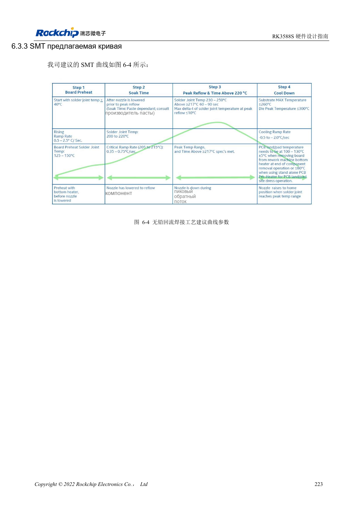
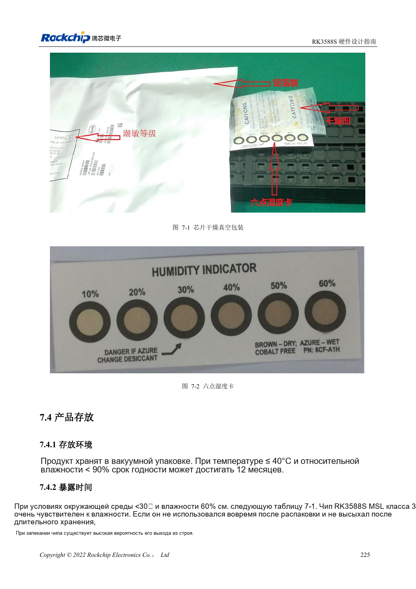

<!-- rk3588s-hardware-v12-20261109 -->

# Монтаж и хранение RK3588S: оплавление, MSL3 и сушка

Основа — китайский RK3588S Hardware Design Guide V1.2 (2023-12-14), для проверки схем и PCB. Носители CM7S проектируют по интерфейсам модуля; Sige7S подходит для оценки ПО и периферии. Возможности SoC не равны разъёмам платы. Проверяйте SDK/BSP, ядро, ревизию, прошивку и мультиплексирование. Значения взяты из источника, не из измерений ArmSoM.

**RK3588S Hardware Design Guide V1.2 (2023-12-14), CN** · §6–7

## Параметры относятся к корпусу чипа

Профиль оплавления RK3588S не разрешает перепайку целого CM7S или Sige7S. Эталонное хранение пасты: 2–10°C, прогрев при комнатной температуре 3–4 часа. Производство согласует сплав, флюс, теплоёмкость платы и ограничения разъёмов. Соединения модуля выполняют по документации изделия.

## Учитывайте суммарную экспозицию

RK3588S — MSL3, 168 часов при ≤30°C/60%RH. Записывайте карту влажности, открытие и хранение; повторная упаковка не обнуляет время автоматически. Таблица 7-2 различает превышение срока более/не более 72 часов и температуру, для толщины ≤1.4mm. Строка MSL1 с 300°C подозрительна и не используется как производственный режим.

## Параметры и проверочная таблица

| Параметр | Значение источника |
| --- | --- |
| Срок вне упаковки MSL3 | 168h при ≤30°C /60%RH |
| Сушка 125°C +10/-0°C (превышение >72h / ≤72h) | 9h /7h |
| Сушка 90°C +8/-0°C (превышение >72h / ≤72h) | 33h /23h |
| Сушка 40°C +5/-0°C (превышение >72h / ≤72h) | 13 суток /9 суток |
| Ограничение корпуса таблицы сушки | Толщина ≤1.4mm |

## Исходные рисунки

Соответствующее английское руководство для этой партии не найдено. Все четыре версии используют снимки китайского оригинала с локализованными подписями. Откройте изображение в полном разрешении; текст и таблицы можно копировать. Номера относятся к физическим страницам PDF.

Китайский оригинал · PDF 238 · 6-4

Китайский оригинал · PDF 240 · 7-2

## Разработка с ArmSoM

CM7S подходит для собственного носителя: сначала определите встроенные питание, DDR и загрузку, затем проектируйте за пределами разъёмов. Sige7S служит базой оценки ПО и периферии. Для обоих изделий проверяйте вывод интерфейсов, контакты, уровни, образы и охлаждение по нужной ревизии. Схема SoC не является схемой подключения изделия.

- [ArmSoM CM7S](https://www.armsom.org/cm7s) · [CM7S Docs](https://docs.armsom.org/armsom-cm7s)
- [ArmSoM Sige7S](https://www.armsom.org/sige7s) · [Sige7S Docs](https://docs.armsom.org/armsom-sige7s)

## Читайте далее

- [RK3588S: 30 тем аппаратного проектирования](/ru/articles/rk3588s-hardware-design-series/)
- [ESD и EMI RK3588S: защита интерфейсов и возврат тока](/ru/articles/rk3588s-esd-emi-hardware-design/)
