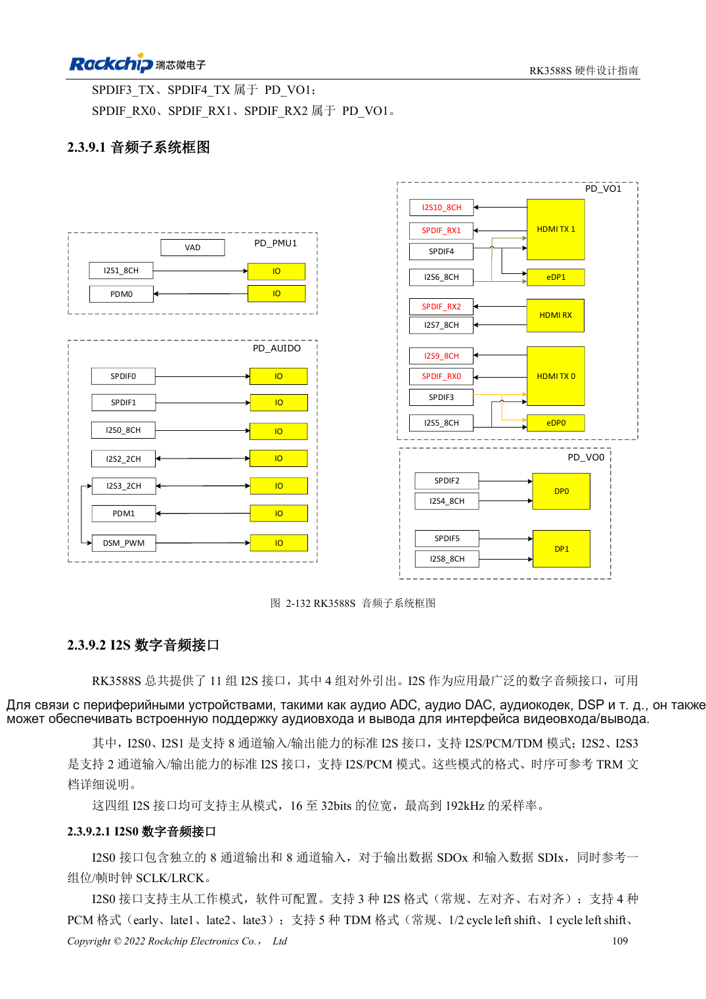
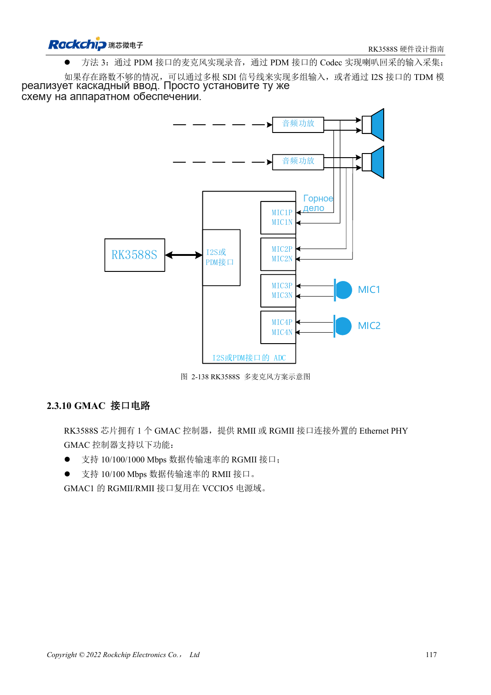

<!-- rk3588s-hardware-v12-20261109 -->

# Аудио RK3588S: I2S, PDM и массивы микрофонов

Основа — китайский RK3588S Hardware Design Guide V1.2 (2023-12-14), для проверки схем и PCB. Носители CM7S проектируют по интерфейсам модуля; Sige7S подходит для оценки ПО и периферии. Возможности SoC не равны разъёмам платы. Проверяйте SDK/BSP, ядро, ревизию, прошивку и мультиплексирование. Значения взяты из источника, не из измерений ArmSoM.

**RK3588S Hardware Design Guide V1.2 (2023-12-14), CN** · §2.3.9; §3.4.18

## Различайте внутренние и внешние интерфейсы

Из 11 I2S наружу выведены четыре, остальные обслуживают видео. I2S0/1: восемь каналов, I2S/PCM/TDM; I2S2/3: два, I2S/PCM. Внутреннее число не равно портам носителя. После Codec/ADC/DAC определяют master/slave, MCLK, SCLK/LRCK, разрядность и частоту.

## Проверьте такты и аналоговые пути

Для нескольких I2S/PDM используют последовательную топологию такта без длинных ветвей. Рекомендуются 22Ω у SoC и отдельная земляная защита тактов. Микрофоны и усилители удаляют от DDR, дисплея, RF и дросселей. Массив с обратным каналом требует проверки синхронизации и программного отображения.

## Параметры и проверочная таблица

| Параметр | Значение источника |
| --- | --- |
| Внешние I2S | 4 группы |
| I2S0/1; I2S2/3 | 8 каналы; 2 каналы |
| Разрядность/частота источника | 16–32bit / до 192kHz |
| Резистор такта | 22Ω |

## Исходные рисунки

Соответствующее английское руководство для этой партии не найдено. Все четыре версии используют снимки китайского оригинала с локализованными подписями. Откройте изображение в полном разрешении; текст и таблицы можно копировать. Номера относятся к физическим страницам PDF.

Китайский оригинал · PDF 124 · 2-132

Китайский оригинал · PDF 132 · 2-138

## Разработка с ArmSoM

CM7S подходит для собственного носителя: сначала определите встроенные питание, DDR и загрузку, затем проектируйте за пределами разъёмов. Sige7S служит базой оценки ПО и периферии. Для обоих изделий проверяйте вывод интерфейсов, контакты, уровни, образы и охлаждение по нужной ревизии. Схема SoC не является схемой подключения изделия.

- [ArmSoM CM7S](https://www.armsom.org/cm7s) · [CM7S Docs](https://docs.armsom.org/armsom-cm7s)
- [ArmSoM Sige7S](https://www.armsom.org/sige7s) · [Sige7S Docs](https://docs.armsom.org/armsom-sige7s)

## Читайте далее

- [RK3588S: 30 тем аппаратного проектирования](/ru/articles/rk3588s-hardware-design-series/)
- [DP и eDP RK3588S: PHY, AUX и развязка](/ru/articles/rk3588s-dp-edp-hardware-design/)
- [Ethernet RK3588S: GMAC, PHY и направление такта](/ru/articles/rk3588s-gmac-hardware-design/)
