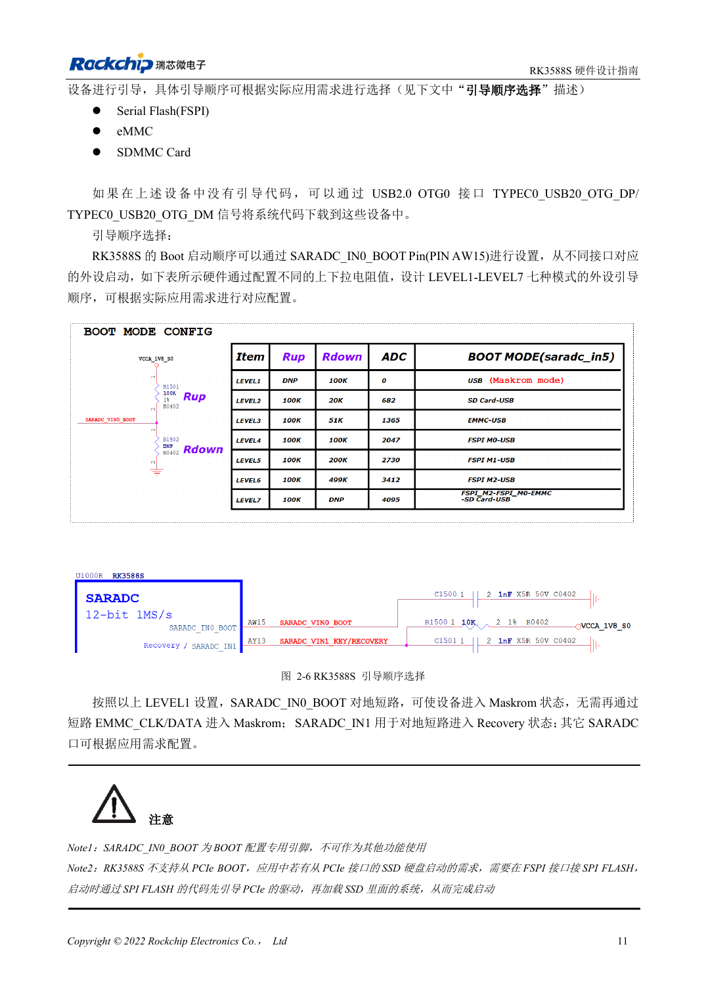
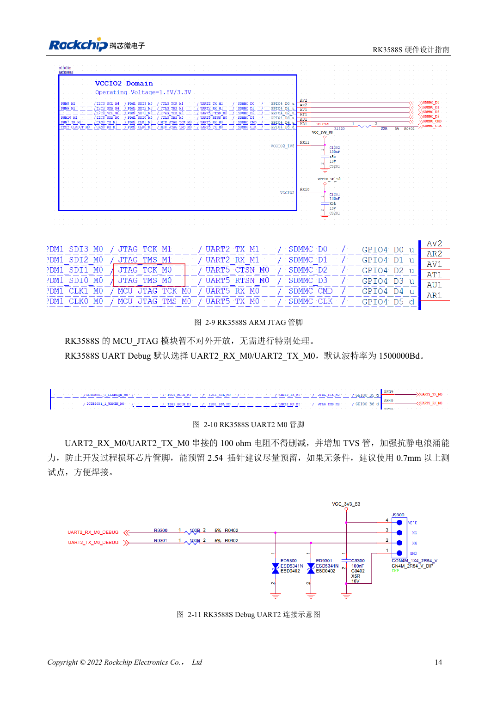

<!-- rk3588s-hardware-v12-20261109 -->

# Загрузка RK3588S: Maskrom, JTAG и UART

Основа — китайский RK3588S Hardware Design Guide V1.2 (2023-12-14), для проверки схем и PCB. Носители CM7S проектируют по интерфейсам модуля; Sige7S подходит для оценки ПО и периферии. Возможности SoC не равны разъёмам платы. Проверяйте SDK/BSP, ядро, ревизию, прошивку и мультиплексирование. Значения взяты из источника, не из измерений ArmSoM.

**RK3588S Hardware Design Guide V1.2 (2023-12-14), CN** · §2.1.4–2.1.6; §2.3.2

## Оставьте путь восстановления

SARADC_IN0_BOOT на AW15 выделен для загрузки; LEVEL1 выбирает Maskrom. Сохраните USB2.0 OTG0 для прошивки. ROM не стартует прямо с PCIe SSD: код FSPI Flash сначала инициализирует PCIe, затем загружает систему. Система на NVMe не означает прямую загрузку ROM с NVMe.

## Сохраните отладку и подтяжки

SDMMC_DET стабилизируют до конца сброса: ноль — SDMMC, единица — ARM JTAG. Журнал использует UART2_M0, 1500000bps; сохраняют 100Ω RX/TX и TVS. 10kΩ на SARADC_IN1 предотвращает неопределённый recovery-вход. Для модуля проверяют разъём и уровни, не используя координаты шаров SoC.

## Параметры и проверочная таблица

| Параметр | Значение источника |
| --- | --- |
| Загрузочный контакт | SARADC_IN0_BOOT / AW15 |
| Отладка | UART2_M0 / 1500000bps |
| SDMMC_DET | 0: SDMMC; 1: ARM JTAG |
| Подтяжка восстановления | SARADC_IN1: 10kΩ |

## Исходные рисунки

Соответствующее английское руководство для этой партии не найдено. Все четыре версии используют снимки китайского оригинала с локализованными подписями. Откройте изображение в полном разрешении; текст и таблицы можно копировать. Номера относятся к физическим страницам PDF.

Китайский оригинал · PDF 26 · 2-6

Китайский оригинал · PDF 29 · 2-10

## Разработка с ArmSoM

CM7S подходит для собственного носителя: сначала определите встроенные питание, DDR и загрузку, затем проектируйте за пределами разъёмов. Sige7S служит базой оценки ПО и периферии. Для обоих изделий проверяйте вывод интерфейсов, контакты, уровни, образы и охлаждение по нужной ревизии. Схема SoC не является схемой подключения изделия.

- [ArmSoM CM7S](https://www.armsom.org/cm7s) · [CM7S Docs](https://docs.armsom.org/armsom-cm7s)
- [ArmSoM Sige7S](https://www.armsom.org/sige7s) · [Sige7S Docs](https://docs.armsom.org/armsom-sige7s)

## Читайте далее

- [RK3588S: 30 тем аппаратного проектирования](/ru/articles/rk3588s-hardware-design-series/)
- [Сброс, watchdog и термозащита RK3588S](/ru/articles/rk3588s-reset-watchdog-hardware/)
- [Питание RK3588S: запуск и неиспользуемые PHY](/ru/articles/rk3588s-power-rail-planning/)
